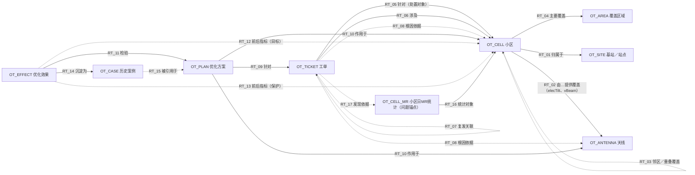

**课题名称：** 基于本体的无线弱覆盖分析及优化决策  
**编制组与职责：** 学员：【待补：姓名】；拟分工——业务（业务问题、规则与预期确认）、数据（样例包、字段字典、映射）、实现（本体、函数、动作、应用）、核验（独立预期复核、用例执行）：【待补：各角色对应姓名】；教练：【待补：姓名】  
**版本、日期与状态：** V0.6；2026-11-04；Day3修订稿（评审结论与交付记录见第6.2节；未确认内容不代填）。  
**业务基线：** 《首日业务场景定义_弱覆盖_Day1.md》V1.0（2026-11-02，讨论稿）。已确认范围：课题名称、北极星问题、课题目标（课题说明原文）；其余内容尚未经Day1评审确认（仓库内未找到Day1评审记录），本文依据这些内容之处一律保持“待确认”，不代填确认。  
**样例与技术基线：** **弱覆盖发现（派单）规则：**`data/覆盖工单规则-弱覆盖.xlsx`（下称[派单规则]）Sheet1第2～5行，按“制式×站点类型（宏站／室分）×场景等级”给出单日门限与“7天出现3天”，本文登记为RULE_D01～D04 v1.0，原文逐行抄录于 `本体应用_弱覆盖/data/source/dispatch_rules_weakcov.json`；同目录 `覆盖工单规则-bak.xlsx` 未采用（U18）。**问题锚点（前置数据）：**[派单规则]“数据源”列为MR，即小区逐日MR统计（本体对象OT_CELL_MR），连同小区制式、站点类型、场景等级（规则选取条件）；弱覆盖问题由规则对它判定发现，不以工单为输入。**原因—措施规则：**`data/覆盖问题汇总_4g&5g.xlsx`（下称[覆盖汇总]）第27、31、45、48、87、89行（真实规则记录，未验证）。**样例：**①合成种子 `本体应用_弱覆盖/data/seed/`（`main.json`主用例、`regional.json`多小区，另有CSV），小区MR按自然日统计（`cellMR`表，装载为OT_CELL_MR实例），独立预期 `data/expected/numeric.json` 由不引用被测代码的构建器事前生成；②样例包 `工程测试包_弱覆盖/`（`sample_inputs.json`、`reference_calc.js`、`expected_outputs.json`，2026-11-02构造，14个计算类用例），其下倾角与周边影响部分与本SPEC一致，可作参照；弱覆盖识别与效果部分按覆盖区域逐期占比编写，不适用本SPEC（U20）。全部为构造假设，尚无版本号。已有模型：无；数智底座培训租户中尚未建出本课题本体。平台版本：【待补】（OSDK规范验证记录为ontology-web-studio 1.0-SNAPSHOT、2026-08-03，仅供参考）。尚未绑定的实现项：全部对象类型、关系类型、函数、动作的平台定义与调用入口；结构化属性的平台支持；MR、工参、告警、参数平台、派单系统的接口。  
**本次运行方式：** 逐功能注明——函数F_01～F_12：测试仿真（构造输入，独立预期事前固定；本地运行版已在 SQLite 上运行，33个用例、313条断言全部通过，但其实现尚不含OT_CELL_MR、F_12与`discovery`快照（见U23），F_12与TC01a未运行；平台运行待Day3）；动作A_01～A_09、A_11：测试仿真（仅在本体中写入测试实例，天馈实施由人工模拟现场回填，不对接真实派单与参数平台）；A_10回退：只定义、不运行；历史回放：无；实际系统只读：无；授权操作：无。  
**标注约定：** **【拟】**＝本组拟定；**【待补】**＝未知；**【待确认】**＝已有口径但含义或数值存疑；**【经验】**＝通用网优经验，门限以省公司口径为准；**【新增】**＝相对Day1新增；设计状态分“设计候选／已有实现／已运行验证”。

## 一、业务目标与本次范围

### 1.1 北极星问题与课题目标

**北极星问题：** 无线网络中哪些区域存在持续或反复出现的弱覆盖，涉及哪些小区，对用户业务体验造成多大影响？这些问题主要由天线配置不合理、发射功率不足、周边环境遮挡还是覆盖资源不足等因素引起？针对不同原因，应优先采取哪些参数调整或覆盖补强措施，如何兼顾周边小区的覆盖与干扰影响，并验证优化措施是否有效、问题是否得到持续改善？  
**课题目标：** 聚焦无线网络弱覆盖场景，构建关联小区、天线、邻区、覆盖数据与优化措施的本体，将常用的问题判断方法和优化经验整理为清晰的对应关系，支撑优化人员开展问题分析、措施选择和效果检查，实现：

- **看清问题：** 结合测量数据、小区性能、工参等数据，识别弱覆盖区域及相关小区，了解问题发生的位置、覆盖情况和影响范围。将相关信息关联展示，帮助优化人员掌握问题的基本情况，明确需要进一步分析和处理的对象。
- **解释原因：** 围绕天线设置、发射功率、周边遮挡和邻区覆盖等常见因素，关联查看小区配置与覆盖数据，辅助判断弱覆盖的主要原因。结合已有优化经验，说明判断依据，帮助优化人员理解问题，并对分析结果进行核查。
- **支撑行动：** 根据问题原因，参考常用优化方法，提出功率调整、下倾角调整或覆盖补强等建议，明确需要处理的小区和建议采取的措施。完成优化后，对比覆盖指标和用户业务表现，检查问题是否改善，并记录有效措施，供后续同类问题处理参考。

**本次要改变的工作：** 承接Day1——优化人员目前只有[派单规则]的派单门限和[覆盖汇总]这张“三级原因→一句措施文字”的对照表（100行、55个三级原因），没有小区与天线实例、判断依据、周边影响和效果记录，原因判断与措施效果都无法核查；弱覆盖问题是否存在，也只能看派单系统有没有出工单，看不到它由哪些数据、按哪条规则得出。本次要改成：**以前置数据为锚点、由规则发现问题，而不是从工单出发**——以小区逐日MR统计（[派单规则]“数据源＝MR”）为锚点，按[派单规则]逐日判定小区是否弱覆盖、按“7天出现3天”在范围内发现弱覆盖小区；发现结果能回到具体日期的MR数据，据此开立处置工单；在一张工单内，把弱覆盖小区、天线、同天线小区、邻区、工参与措施串起来，按“发现依据（前置数据）→证据→原因→措施→周边影响→效果”逐项可核对；覆盖区域只作问题位置与影响范围的上下文。  
**本次实现范围的变化及理由：** Day1北极星覆盖天线、功率、遮挡、覆盖资源不足四类主因及4G／5G。弱覆盖发现（派单规则）按[派单规则]覆盖4G／5G的宏站与室分（一般场景），从前置数据逐日判定并可在范围内批量发现；原因与处置只实现“4G宏站·天线下倾角过小”一条主线（Day1“场景边界”的拟优先项），理由：①同因多症——同一原因在弱覆盖、过覆盖、重叠邻区三类下各出现，规则方向一致；②天线与小区身份不同，天线调整影响其承载的所有小区，最能检验本体价值；③理论覆盖半径、推荐下倾角、前后占比均可由工参与采样独立核算；④9个对象类型全部用到，无空转对象（OT_CELL_MR是问题锚点，OT_TICKET是下游处置载体）。代价：天馈类措施只能“建议＋派单＋回填”，授权自动执行分支留给后续的功率场景；5G与室分小区可发现并建单，但原因判断返回“未知”，转人工。

### 1.2 本次实现范围与成功标准

| 业务目标或关键问题 | 本次支持的判断与操作 | 使用者可核验的成功标准 | 对应用例与测试 |
|---|---|---|---|
| 看清哪些问题及影响 | 判断：J1发现——以小区逐日MR（前置数据）为锚点，按[派单规则]逐日判定小区是否弱覆盖（RSRP＜-110采样点数与弱覆盖占比同时达到门限），按“7天出现3天”判定是否达到派单条件，并可对一个范围内的小区一次批量发现（F_12）；操作：对发现的小区建单（A_01）。工单是发现之后的处置载体，不是发现的输入；覆盖区域只作位置与影响范围的上下文；用户业务影响本次不量化，只给覆盖影响 | 小区X（4G宏站、一般场景，适用RULE_D01：单日≥2000且≥20%）在10-01～10-07的逐日占比为0.2600、0.2500、0.1917、0.2700、0.2375、0.2600、0.2500，命中10-01、10-02、10-04、10-06、10-07共5天（10-03占比不足20%，10-05弱覆盖采样点1900＜2000），判“达到派单条件”，同范围的Y（占比0.0800、命中0天）判“未达到”；发现之时尚无工单，对X建单TK-LTE-X-001后，其`discovery`快照回链到X窗口内7条MR日统计，与独立预期一致；前置数据更正后再次发现的结果随之变化，已建工单的快照不变（TC01a）；某天无MR数据记“未知”，不当作0或“未命中”，命中＋未知仍可能达到3天时判“证据不足”、不建单；场景等级为VIP／VVIP或缺失时为规则缺口，判“证据不足”，不套用一般场景门限；范围内没有MR数据的小区列为“证据不足（数据缺口）”，不静默跳过；4G室分、5G宏站与室分按对应行发现 | TC01、TC01a、TC03b、TC03h、TC06c、TC08 |
| 解释原因并比较处置选择 | 判断：J2归因（排除假性弱覆盖；判定下倾角过小并逐项排除功率、方位、遮挡次因）、J3选措（单次幅度与轮次、同天线小区与重叠邻区的周边影响）；操作：写入根因、确认、生成方案、确认并派单（A_02～A_05） | 告警覆盖多数命中日时“排除”；X总下倾7.00°、推荐下倾10.84°、缺口3.84°；推荐调整2°、共2轮；周边影响“通过”；同天线小区目标半径变严时“调减”或“不通过”；改电调时影响范围只含X阵列；缺工参时“未知”，不判“不命中”；5G与室分小区“未知”，不套用4G宏站公式 | TC01、TC02a～c、TC02f、TC03a、TC03c～g、TC06、TC08 |
| 人员操作与效果核验 | 判断：J4验证、J5沉淀；操作：回填执行信息、写入优化效果、关闭工单、历史案例入库（A_06～A_09） | 前窗口（派单窗口10-01～10-07）汇总占比0.2444→后窗口（实施日次日10-13起7天）0.1358，后窗按派单规则命中0天→“改善”且“达标”；“持续有效”为空（后窗不足14天），不得关闭；后窗14天内每个7天滑窗都未达到派单条件→“持续有效”，由优化主管关闭；第二周复发→不得关闭；保护指标不劣化；实际值与计划值不一致时按实际值评估；回执缺失记“未知”且不得关闭；失败与证据不足案例照常入库；保存后可由非原开发人员重开核对 | TC01、TC02d～e、TC03e、TC04、TC05、TC07 |

**范围界定：**  
- **实现范围：** 弱覆盖发现（派单规则）：以小区逐日MR为前置数据，4G／5G的宏站与室分小区，一般场景（[派单规则]第2～5行），可对给定范围批量发现；原因与处置：4G LTE；宏站；城区；多频共天馈（一副天线承载B1、B2两个小区）；派单对象＝小区（主用例X），覆盖区域A1（构造）只作上下文；时间按自然日——派单窗口7天（主用例2026-10-01～10-07，判断时点10-08），效果后窗＝实施日次日起7天（10-13～10-19），“持续有效”看14天（至10-26）；支持的处置：增大下倾角（机械下倾、电子下倾两种方式），一律“建议＋人工确认＋派单＋回填”，不自动执行。  
- **本次不实现：** VIP／VVIP场景的派单规则（[派单规则]未提供，按规则缺口处理，见TC03h）；5G与室分的原因与处置（可发现并建单，但下倾公式未定义或不适用，F_08返回“未知”，见TC06c、TC08）；功率、方位角、挂高、天线接反、遮挡、覆盖资源不足等其他原因族的处置；新建站与补点；M02过覆盖同因用例、M03邻区侧措施用例（规则已登记，见“业务规则与计算依据”，用例待补）；用户体验的精确量化；全网每日定时发现的调度与MR到齐时点（U22）；长评估全周期；回退动作A_10（只定义）；5G Massive MIMO数字下倾与波束权值。  
- **后续验证安排：** 真实或脱敏的小区、工参、MR取得后做运行验证（见“生产接续”）；上述不实现部分的排期见“未决事项”与“实施安排与变更处理”。

**复用与新增：**

| 类别 | 内容 | 状态标识 |
|---|---|---|
| 复用（已核实定义） | 无。平台上没有本课题可复用的已核实本体定义 | — |
| 依据（来源与候选） | Day1的覆盖区域、小区、天线、基站、工单、优化方案、优化效果、历史案例8个对象类型候选与W1～W16规则，另增小区日MR统计OT_CELL_MR作问题锚点（共9个）；[派单规则]第2～5行（弱覆盖发现与派单门限）；[覆盖汇总]6行规则；切换差课题声明复用本课题的小区、天线、区域定义，本课题是上游，版本冻结由教练协调 | 设计候选（Day1未经评审确认；[派单规则]为规则文件原文，业务确认记录待补） |
| 已有实现 | `reference_calc.js`：F_01～F_11的JavaScript参考实现，仅用于独立预期，不是平台函数（其中F_05、F_06、F_11按覆盖区域逐期占比编写，不适用本SPEC，U20）；`本体应用_弱覆盖/`：本地运行版及独立预期构建器 `scripts/build-expected.js` | `reference_calc.js`已运行验证（14个计算类用例，输出与`expected_outputs.json`一致）；本地运行版已运行验证（33个用例、313条断言通过；尚不含OT_CELL_MR与F_12，见U23） |
| 本次新增 | 9个对象类型（含问题锚点OT_CELL_MR）、17个关系类型、12个函数（含批量发现F_12）、11个动作类型（A_01～A_11，其中A_10只定义，A_11为冲突裁定）、17条核心约束；派单规则RULE_D01～D04；发现范围与窗口规则RULE_F01；措施类型字典（2条）；原因—措施规则M01～M03；样例（样例包14个计算类用例；合成种子，含主用例、门限边界、缺天、退服、室分与5G小区） | 设计候选，平台未建 |

**关键设计取舍**（建模中作出的取舍及其依据与影响；编号H1～H17供正文引用）：

| 编号 | 设计取舍 | 依据与影响 | 确认状态 |
|---|---|---|---|
| H1 | 天线只保留机械下倾角、挂高、方位角、是否电调；电子下倾角与垂直波束宽放在关系RT_02（小区—天线） | 多频共天馈时机械下倾共用、电子下倾按阵列独立；决定“同天线小区受不受影响”（INV_12） | 待确认 |
| H2 | 小区属性`targetRadius`（目标覆盖半径），默认＝0.5×最近站间距，可人工覆盖 | 没有它既无法判断下倾角过小，也无法判断调整后远端是否变弱 | 待确认 |
| H3 | “复发”不作工单状态：新工单关联原工单号，原工单不重开 | 与RT_07、INV_11一致 | 待确认 |
| H4 | [覆盖汇总]6行规则归并为原子动作“增大下倾角”；措施类型字典分机械／电调两条，电调为本组补充 | 源表只有“机械下倾角调整”；电调是否纳入见未决事项 | 待确认 |
| H5 | “重叠覆盖度”拆为实测重叠覆盖度（小区指标）与预测重叠指数（F_10输出） | 调整前预测与调整后实测不能共用一个名字 | 待确认 |
| H6 | F_02、F_04为简化平地模型，不适用5G AAU；5G公式未定义时返回“未知” | 避免套用4G公式（Day1“规则缺口先标缺口、不推断另一制式适用”） | 待确认 |
| H7 | 措施的单次上限、调节分辨率、容差、目标半径系数等作为测试假设，集中登记于“测试假设登记” | 全部为假设值，仅用于验证假设条件下的模型行为 | 待确认 |
| H8 | 工单设`diagnostics[]`（函数结果记录）；方案、效果保存函数调用引用；周边影响结果含取值“未评估”；设INV_15（工参冲突不自动裁决） | 满足V2.1“函数结果与动作记录”“关键事实更新约定”要求；邻区工参缺失不得判通过 | 待确认 |
| H9 | 派单对象＝小区：一张工单恰好针对一个弱覆盖小区（RT_05→OT_CELL）；覆盖区域只作位置与影响范围的上下文（工单`cover_area`），不设区域`weakStatus`与区域`metrics`；弱覆盖判定归小区，处置状态归工单 | [派单规则]的“派单问题”为“宏站／室分弱覆盖小区”，数据源为小区级MR；影响INV_01、INV_14、RT_05、RT_06、RT_08、RT_12、A_01、A_03、A_08、F_05～F_07、F_11 | 待确认（规则文件口径） |
| H10 | 弱覆盖发现采用[派单规则]：RULE_D01～D04 v1.0——单日RSRP＜-110采样点数与弱覆盖占比同时达到门限记命中（宏站≥2000且≥20%，室分≥500且≥15%），7天出现3天达到派单条件；工单保存发现依据快照`discovery` | 规则文件是派单口径；门限随站点类型（OT_SITE.`siteType`）而定 | 规则取自规则文件；业务确认待补 |
| H11 | 发现判定三值：命中≥3天→达到；命中＋未知＜3天→未达到；其余→证据不足。某天无MR数据记“未知”，不记0、不记“未命中” | [派单规则]未写缺天处理（U17），本组按INV_09拟定 | 待确认 |
| H12 | 规则按“制式×站点类型×场景等级”选取；[派单规则]只给“一般场景”，VIP／VVIP或场景等级缺失＝规则缺口，判“证据不足”，不套用一般场景门限；“-bak”文件不采用 | 避免用一般场景门限代替VIP口径（U18） | 待确认 |
| H13 | 效果按自然日评价：前窗＝派单窗口（7天）；后窗＝实施日次日起连续有数据的天（遇第一个缺天即止），≥7天（TH11）才评估；`achieved`＝后窗前7天不再满足派单规则；`sustained`＝后窗14天（TH12）内每个7天滑窗都不满足派单规则；保护指标缺数据→待评估 | 效果与派单同一口径，避免“占比降了但仍会被再次派单” | 待确认 |
| H14 | **问题锚点＝前置数据本身**：小区逐日MR统计（[派单规则]“数据源＝MR”）。弱覆盖问题＝[派单规则]对窗口内前置数据的判定结果（发现），身份由数据与规则确定（问题键`problemKey`＝`{cellKey}@{问题类型}@{窗口末日}`），不是预先登记的对象；工单是发现之后的处置载体，可重派、可缺失，不定义问题 | [派单规则]本身就是“对MR数据判定”的规则，工单是它的输出；以数据为锚点，“有没有问题、几天命中、缺哪天数据”才能回到具体日期；影响3.1核心对象与问题发现链、S0～S1、INV_16、A_01、RULE_T01 | 待确认 |
| H15 | 小区逐日MR建为对象类型OT_CELL_MR（小区×自然日），小区不设`mrDaily[]`属性；设RT_16（OT_CELL_MR→OT_CELL，统计对象）、RT_17（OT_TICKET→OT_CELL_MR，发现依据） | 锚点须是可被引用、可核验的对象：缺天＝没有实例、迟到与更正＝新实例或新版本、证据按日期与版本回链；同时不依赖平台对结构化属性的支持（U09）；影响OT_CELL、F_05、F_06、F_11、RT_08、RT_12、D01、DM_01 | 待确认 |
| H16 | F_05、F_06以OT_CELL_MR为输入，F_06为“发现判定”；F_12在给定范围内批量发现（只读，不创建工单）；A_01“依发现结果建单”，建单时重算F_06；RULE_F01规定发现范围与窗口；主用例从S0发现步骤开始 | 让“从数据发现问题”成为可独立执行、可核验的起点，而不是已知小区之后的单点校验；影响F_05、F_06、F_12、A_01、S0、TC01、TC01a、TC08 | 待确认 |
| H17 | 工单快照命名为`discovery`（不叫“派单快照”，以免与A_05向现场“派单”混淆），含`problemKey`、`evidenceRefs[]`（OT_CELL_MR的`mrKey`与版本）；效果前窗取`discovery.evidenceRefs`所指的数据版本；设INV_16（问题须由前置数据发现）、INV_17（前置数据只追加） | 前置数据可迟到、可更正，建单时的发现依据必须固定且可逐条核对，效果基线不得随数据更正漂移【拟】 | 待确认 |

## 二、贯穿用例与业务操作

### 2.1 主用例输入与初始事实

| 项目 | 本组填写 |
|---|---|
| 用例标识、业务名称与输入性质 | UC-WC-01：4G城区宏站小区X因天线下倾角过小达到弱覆盖派单条件——**从前置数据（小区逐日MR）发现**、建单、定因、选措、周边校验、派单、回填、效果、案例沉淀。输入性质：**构造输入（假设）**，不对应任何现网对象；文件：`本体应用_弱覆盖/data/seed/main.json`（CSV版在`data/seed/csv/`）；派单规则取自[派单规则]第2行（RULE_D01），原因—措施规则取自[覆盖汇总]第27行（真实规则，未验证）；**问题锚点＝前置数据**（X、Y的逐日MR统计），工单是发现之后的产物 |
| 使用者、触发条件及初始状态 | 使用者：地市优化工程师（确认）、优化本体（规则命中、校验、建议）、现场维护人员（实施并回填）、优化主管（多小区变更批准）【拟，Day1角色待确认】。入口：**对前置数据的发现**——对给定范围内小区的逐日MR统计，按[派单规则]做发现判定（F_12），不是从工单进入。触发：每日发现（时点与MR到齐时间【拟】，见U22）；本例判断时点10-08 09:00，小区X在10-01～10-07内有5天达到RULE_D01单日门限（≥3天）。当时已知：X、Y的逐日MR（Z1、Z2只有工参与邻区，无MR）、工参、邻区，尚无任何弱覆盖工单；尚未知：根因、用户业务影响（无数据）、告警是否重合、现场是否可实施 |
| 具体实例、范围与时间 | 发现范围：X、Y（样例中有派单窗口MR的小区）；派单对象：小区X（LTE，B1，宏站S1，场景等级“一般”）；同天线小区Y（B2）；天线AN1（站点S1）；重叠邻区Z1（S2）、Z2（S3）；覆盖区域A1（上下文：X主服务0.7、Y 0.3）。派单窗口：2026-10-01～10-07；判断时点：10-08 09:00；现场实施：10-12 09:30（回填接收10:00）；效果后窗：10-13～10-19（“持续有效”另看10-20～10-26） |
| 必需输入与来源记录 | **锚点数据（OT_CELL_MR实例，小区×自然日）：**小区X逐日MR（`sampleTotal`／`sampleWeak`，采样点）：10000/2600、9800/2450、12000/2300、10200/2754、8000/1900、10500/2730、9900/2475；Y逐日6000/480（占比0.08）；站点S1～S3均为宏站，坐标S1(30.0000,120.0000)、S2(30.0045,120.0000)、S3(30.0000,120.0052)；天线AN1：挂高30 m、机械下倾3°、支持电调；小区X：电子下倾4°、垂直波束宽8°、目标半径250 m；Y：5°、8°、250 m；邻区Z1（挂高30 m、总下倾9°、波束宽8°）、Z2（30 m、8°、8°）；告警记录：空；后窗X逐日MR（迟到数据`lateMetrics`）：10100/1414、9900/1287、10300/1545、10000/1200、9800/1372、10200/1326、10050/1407；保护指标：Y的MR弱覆盖占比0.08→0.07、Z1实测重叠覆盖度0.25→0.18。**来源缺失：**无用户业务影响数据、无MR距离—电平分布、无真实工参 |
| 规则、约束与独立依据 | 规则：RULE_D01（v1.0，[派单规则]第2行原文）；RULE_F01（v0.1）；RULE_W04、W16（v0.2）、T01（v0.3）；RULE_W05／W08／W09、W06、W13、W14、M01、G01（v0.1）；**业务确认状态：待确认**；测试假设见“测试假设登记”。独立依据：[派单规则]原文；Day1“术语与指标口径”的理论覆盖半径公式【经验，简化平地模型】；独立预期构建器 `scripts/build-expected.js`（不引用被测代码，只读种子数据与规则抄录）；下倾与周边影响数值另与参考程序`reference_calc.js`一致；人工核查：待优化专家与核验人员 |
| 业务判断与验证关联 | J1发现→TC01、TC01a、TC03b、TC03h、TC08；J2归因→TC01、TC03a、TC03c～g、TC07d；J3选措→TC01、TC02a～c、TC02f、TC06；J4验证→TC01、TC02d～e、TC03e、TC05、TC07e、TC07f；J5沉淀→TC07e、TC07f。预期统一记录于“验证用例与独立预期” |

### 2.2 从输入到保存读回的完整操作

执行角色为【拟】。

| 步骤与执行角色 | 实际读取的事实及关系 | 判断或人员操作 | 输出、保存位置与读回预期 | 函数／动作标识 |
|---|---|---|---|---|
| **S0 发现**（锚点：前置数据） 优化本体或地市优化工程师（只读，不建单） | 发现范围{X、Y}在派单窗口10-01～10-07的OT_CELL_MR（RT_16）；各小区制式（`rat`）、站点类型（RT_01→OT_SITE）、场景等级（`sceneLevel`）→按“制式×站点类型×场景等级”选取适用的派单规则（X、Y均为RULE_D01）；此时无任何工单 | F_12对范围内每个小区逐日调F_05、再调F_06：X逐日占比0.2600／0.2500／0.1917／0.2700／0.2375／0.2600／0.2500，10-03占比＜20%、10-05弱覆盖采样点1900＜2000记“否”，命中5天≥3天→“达到派单条件”；Y每天480/6000＝0.0800，采样点＜2000，命中0天→“未达到派单条件”；缺天、无规则或窗口内无MR的小区单列为“证据不足” | 返回发现清单（**只读，不落库**，可由前置数据与规则版本重算）：X｛达到，命中5天，`problemKey`＝LTE:X@MR弱覆盖小区@2026-10-07，证据＝窗口内7条OT_CELL_MR｝、Y｛未达到｝；计数达到1／未达到1／证据不足0。读回：清单中每个“达到”项能展开到逐日占比及所依据的MR日统计 | F_05、F_06、F_12／— |
| **S1 建单** 优化本体（自动）或地市优化工程师 | S0发现清单中的“达到”项X；同小区同问题类型是否已有未关闭工单；RT_01、RT_02、RT_03派生的涉及小区 | A_01按`cellKey`与判断时点**重算F_06**（不采信清单里的旧结果）：命中5天≥3天，仍“达到派单条件”；无未关闭工单；未达到或证据不足的小区不建单 | 新建工单TK-LTE-X-001，状态“待核验”，针对X（RT_05）；涉及Y（同天线小区）、Z1、Z2（重叠邻区）（RT_06）；`discovery`快照＝`problemKey`、RULE_D01@v1.0、窗口、命中日、未知日、门限、`evidenceRefs[]`（X窗口内7条OT_CELL_MR及版本，RT_17）；类别“覆盖结构”、问题类型“MR弱覆盖小区”、派单问题“宏站弱覆盖小区”、场景等级“一般”；`diagnostics[]`写入F_06结果（含逐日F_05结果）。读回：工单页显示逐日占比、命中日与“达到派单条件（5/7天）”，并可点开每一条依据的MR日统计 | F_06／A_01 |
| **S2 排除假性弱覆盖** 优化本体，工程师复核 | X的5个命中日；告警系统中X、Y、Z1、Z2的告警记录（来源事实，本例为空） | 重合占比＝0/5＝0→“无重合”，不排除 | `diagnostics[]`追加F_07结果（重合天数、占比、所用告警区间引用）；工单仍“待核验” | F_07／— |
| **S3 定因** 优化本体，工程师确认 | RT_02：X经AN1提供覆盖，电子下倾4°、垂直波束宽8°；AN1挂高30 m、机械下倾3°（工参v1）；X目标半径250 m；站点距离S1–S2 500.4 m、S1–S3 500.7 m；次因输入：现网功率＝规划功率、方位偏差5°≤20°、无遮挡证据 | 总下倾7.00°；rNear／rFar＝154.3／572.4 m；推荐下倾10.84°，缺口3.84°＞容差0.5°→命中M01“弱覆盖小区天线下倾角过小”；功率、方位、遮挡逐项排除 | A_02追加根因第1轮：主因＋已排除次因，`evidenceRefs`回链X的MR派单窗口（10-01～10-07，即OT_CELL_MR实例）、AN1工参v1、RT_02及F_08调用引用；A_03确认→工单“已确认”。读回：根因页可展开证据与函数版本 | F_01～F_04、F_08／A_02、A_03 |
| **S4 选措** 优化本体 | 工单（已确认）、F_08缺口、措施类型字典TILT_UP_MECH（单次上限2°、分辨率1°）、调整方式＝机械；历史案例0条，规则继续判断 | Δ＝⌊min(3.84,2)÷1⌋×1＝2°；轮次＝⌈3.84÷2⌉＝2 | 方案计算结果在A_04事务中暂存，随S5一并保存 | F_09／A_04 |
| **S5 周边校验** 优化本体 | RT_10影响范围：机械下倾→AN1承载的X、Y；邻区Z1、Z2（RT_03）；目标半径X／Y＝250／250；站间距 | Δ＝2°：X远端572.4→342.9 m（≥250）、Y远端429.0→285.4 m（≥250）；预测重叠指数Z1 415.0→185.4、Z2 500.7→271.2，均不增大→“通过”，Δ终＝2° | 方案PL-TK-LTE-X-001-R1：`measureType`取字典快照，`actions`＝AN1机械下倾3→5°、回退值3°，`impact`＝通过及4项逐项检查；状态“待确认” | F_10／A_04 |
| **S6 确认并派单** 地市优化工程师；优化主管 | 方案（待确认，impact＝通过）；影响范围X、Y两个小区；X场景等级“一般” | 天馈类不得自动执行（INV_05）；AN1承载2个小区，按多小区变更追加优化主管批准【拟，见未决事项】 | `approval`记录两级确认；方案“待确认→已批准→已派单”，生成派单号；工单→“处置中” | ／A_05 |
| **S7 实施与回填** 现场维护人员实施，优化工程师复核 | 派单、方案`actions` | 现场10-12 09:30实施，回填实际机械下倾5°（等于计划）；以实际值再调F_10复核→通过 | `execution`＝派单号、执行人、执行时间、回执“成功”、`actualValues`；方案“已实施”；AN1.mechTilt写入新版本v2＝5°，生效时间＝实施时间；工单→“待评估”。读回：重开方案可见执行信息，AN1可按时点读回3°或5° | F_10／A_06 |
| **S8 效果与沉淀** 优化本体，工程师复核；优化主管；知识维护人 | X的前窗（派单窗口10-01～10-07，取`discovery.evidenceRefs`所指的OT_CELL_MR版本）与后窗（实施日次日10-13起）的OT_CELL_MR；保护指标（Y的MR弱覆盖占比、Z1实测重叠覆盖度）；方案执行信息 | 前0.2444→后0.1358（7天汇总），差0.1086≥0.05→改善；后窗10-13～10-19按RULE_D01命中0天→未达到派单条件→达标；后窗只有7天＜14天→持续有效为空；保护指标未恶化；状态“改善”。申请关闭时持续有效为空→拒绝 | 建优化效果EF-TK-LTE-X-001-R1-E1，目标指标指向X（RT_12）；工单→“已改善”；历史案例CS-TK-LTE-X-001-R1入库，结论“证据不足”（持续有效未知），验证状态“未验证”，适用条件含制式、站点类型、场景等级、区域场景。读回：效果页显示前后窗口、后窗命中天数、四项判定与保护指标 | F_11／A_07、A_08（拒绝）、A_09 |

**关键分支：**  
- **证据不足：**某天无MR数据、场景等级无对应派单规则，或缺挂高工参。人员决定：补数据或补规则；系统行为：缺天记“未知”（范围内整个窗口无MR的小区在F_12清单中列为“证据不足（数据缺口）”，不静默跳过），命中＋未知仍可能达到3天时F_06返回“证据不足”、A_01不建单（缺天补满也不够3天则判“未达到”）；场景等级为VIP／VVIP或缺失→规则缺口，F_06返回“证据不足”，不套用一般场景门限；F_08返回“未知”并列出缺项（不判“不命中”）；保存内容：不建单，或工单留在“待核验”、不建方案（TC03a、TC03b、TC03h）。  
- **原因不唯一：**下倾缺口命中的同时，功率偏低或方位偏差超门限也命中。人员决定：由优化工程师判断是否转专家；系统行为：主因与次因分别记录，不自动确认；保存内容：根因第1轮含主因、次因及各自证据，方案只针对主因（TC03f）。  
- **措施不可行：**同天线小区Y的目标半径变严，Δ＝2°时Y远端不达标。系统逐级减一个分辨率，取第一个可行值（调减）；无可行值则“不通过”，方案停在草案并转人工，保存`impact`逐项检查（TC02a、TC02b）。邻区工参缺失时周边影响记“未评估”，同样不得批准（TC03g）。  
- **目标改善但保护条件失败：**X占比下降、后窗不再满足派单规则，但Y的MR弱覆盖占比由0.08升至0.15，超容差0.02→状态“劣化”，提示回退或换措施，不判有效（TC02d）。  
- **改善但仍满足派单规则：**后窗汇总占比下降≥0.05，但后窗前7天仍有3天命中→“未达标”，工单“改善未解决”，进入下一轮方案（TC07e③）；第二周再次达到派单条件→`sustained`＝否，不得关闭（TC07f②）。  
- **执行结果未知：**派单后回执或现场回填缺失→`receipt`＝未知，工单留在“处置中”，不得评估、不得关闭；先核对原派单记录，不直接重发（TC07c）。  
- **实际值不等于计划值：**计划+2°、现场+3°→按实际值评估，并以实际值调F_10做事后复核（TC02e）。

沿用Day1判断标准及已确认预期：Day1的J1～J5判断标准目前均为“待确认”，本次根据今天确定的输入补充了具体预期（见“验证用例与独立预期”），预期依据与确认状态逐条标注；门限、容差、单次上限等一律作为测试假设单列（见“测试假设登记”）。

## 三、本体五元素定义

**五元素为对象类型、属性、关系类型、函数、动作类型。** 对象实例、关系实例、函数调用结果和动作执行记录各有自己的身份或引用，不写成类型定义。建模先回答：业务中的事物是谁、怎样关联、哪些事实会改变判断，再组织计算和操作。

### 3.1 对象类型与核心结构

**核心对象类型及理由：** **问题锚点是前置数据本身——小区日MR统计**（OT_CELL_MR，小区×自然日）：[派单规则]的“数据源”列为MR，弱覆盖问题不是预先存在的工单，而是[派单规则]对这批数据的判定结果；锚点数据自带身份（`cellKey`＋业务日期）、可核验（有效采样点、RSRP＜-110 dBm采样点）、随时间追加（缺天＝没有实例＝未知，迟到与更正按业务日期归日并留版本），发现结果、根因证据与效果前后窗都回链到它。查看入口是**小区**（OT_CELL，数据的宿主与派单对象，身份由`cellKey`保持，改名、改PCI都不改变它），优化人员围绕“哪个小区的MR按[派单规则]达到弱覆盖、由哪副天线提供覆盖、主因是什么、如何处置、是否改善”持续查看；**工单**（OT_TICKET）是发现之后的处置载体，承载发现依据快照、根因、措施、评估链条，可复发，恰好针对一个弱覆盖小区，**不是锚点**：没有它，前置数据与规则照样能发现问题；有了它，问题仍由数据与规则决定。选前置数据作锚点，是因为派单与效果都按小区MR评价，“有没有问题、几天命中、缺哪天数据”这些答案必须能回到具体日期的数据，而根因、措施和效果才需要落到可追溯、可复发的处置单上。覆盖区域（OT_AREA）保留为问题位置与影响范围的上下文（工单`cover_area`），不承载弱覆盖判定与状态（H9）。

**问题怎样被发现（前置数据→问题→处置）：** ①**前置数据**：OT_CELL_MR（小区逐日MR）＋小区制式、站点类型、场景等级（规则选取条件）；②**发现**：F_05逐日判定单日是否命中（RULE_D01～D04），F_06按“7天出现3天”判定该小区是否达到派单条件，F_12对范围内全部小区批量执行；结果只读，可由数据与规则版本重算，不落库；③**问题**＝某小区在某个7天窗口内被规则判为“达到派单条件”，其身份由数据与规则确定：`problemKey`＝`{cellKey}@{问题类型}@{窗口末日}`，不是预先登记的对象（每日滑动窗口会给同一个持续问题不同的`problemKey`，建单去重按（小区，问题类型），见INV_14，不按`problemKey`）；④**处置**：A_01依发现结果建单（重算F_06，固定`discovery`快照与MR证据引用），其后的根因、方案、效果、案例都挂在工单上，处置状态属于工单。曾考虑把“弱覆盖问题”建成独立对象并先于工单登记，不采用：登记后的对象仍是“被登记的记录”，数据与规则的因果会被记录取代；它也没有独立于处置的生命周期——核验、排除、处置、关闭已由工单承载，数据变化后由F_12重新发现即可。**术语：**“派单规则”指[派单规则]文件里的发现条件，“派单”（A_05）指把措施派给现场；派单窗口＝发现窗口＝判断时点所在日之前的7个自然日。

| 对象类型标识与名称 | 业务定义、粒度及边界 | 实例身份、生命周期与典型实例 |
|---|---|---|
| OT_AREA 覆盖区域 | 问题发生位置与影响范围的上下文（场景、室内外、城乡、区县），对应工单`cover_area`。不是小区、不是单个栅格、也不是工单；不承载弱覆盖判定与状态（H9） | 主键`areaId`；无业务状态，范围变更产生新版本；典型：A1 |
| OT_CELL 小区 | 无线覆盖的服务单元，**弱覆盖派单对象**，同时是邻区、功率等参数的作用对象；承载场景等级与小区级指标，逐日MR统计由OT_CELL_MR承载（RT_16）。与天线（物理载体）、站点（归属单位）区别开；没有告警状态，弱覆盖处理状态归工单 | 主键`cellKey`（LTE:ECI／NR:NCI），PCI与名称不作标识；改名、改PCI身份不变；典型：X（B1，派单对象）、Y（B2，同天线）、Z1、Z2（邻区）、W、N1、C2～C11（同类新实例）。样例用简称 |
| OT_CELL_MR 小区日MR统计【**问题锚点，新增H15**】 | 一个小区一个自然日的MR汇聚统计：有效采样点数与RSRP＜-110 dBm的弱覆盖采样点数；[派单规则]“数据源＝MR”所指的前置数据本身，弱覆盖发现与效果前后窗比较的输入。**不是**MR原始采样（来源事实，不入本体），**不是**弱覆盖结论（占比与是否命中由F_05派生，不存储） | 主键`mrKey`＝`{cellKey}@{date}`（业务发生日期）；无业务状态，只追加：同日重复到达按最新接收的一条为准、旧条保留为旧版本；缺天＝没有实例＝未知；典型：LTE:X@2026-10-01 |
| OT_ANTENNA 天线 | 下倾角、挂高、方位角的物理载体，天馈类措施的作用对象；一副天线可承载多个小区（多频、多制式共天馈）。是资源，小区是它提供的服务，二者通过RT_02关联 | 主键`antennaId`（站点＋扇区＋天线序号，编码规则【待补】）；随工参版本变化（`effectiveTime`）；典型：AN1（承载X、Y）、AN2 |
| OT_SITE 基站／站点 | 小区归属单位，参数与工程的作用边界；提供坐标用于站间距，提供站点类型（宏站／室分）用于选取派单规则与派单问题。规划站点推进本次不用 | 主键`siteId`（eNB ID／gNB ID）；状态规划→在建→开通→退网，本场景只取“开通”；典型：S1、S2、S3 |
| OT_TICKET 工单 | 对一个**已发现**的弱覆盖小区的处置单（处置载体），对应[派单规则]的“类别／问题类型／派单问题”；承载发现依据快照、根因、措施与评估链条，可复发。**不是问题锚点**：问题由前置数据按规则发现，工单只记录“发现之后怎么处理”。**不等于**[覆盖汇总]的三级原因——后者是规则，不是问题实例 | 主键`ticketNo`（【拟】TK-{制式}-{小区标识}-{序号}，编码规则【待补】；接入派单系统后以`taskno`为准）；状态待核验→已确认／已排除→处置中→待评估→已改善／改善未解决→已关闭；典型：TK-LTE-X-001 |
| OT_PLAN 优化方案 | 针对工单根因的措施方案：措施类型快照、动作明细、周边影响结果、审批、执行信息、回退条件。措施类型与执行记录都是它的属性，不单设对象 | 主键`planNo`（工单号＋轮次）；执行状态草案→待确认→已批准→已派单→已实施／失败／未知→已回退；典型：PL-TK-LTE-X-001-R1 |
| OT_EFFECT 优化效果 | 一次方案实施后一轮评价的结果记录，是“改善／达标／持续有效”的依据。评价过程是函数F_11，**评价结果**是对象——它有多轮、有状态，并被历史案例引用，需要独立追踪 | 主键`effectNo`（工单号＋轮次＋评估序号）；效果状态待评估→评估中→改善／未改善／劣化／未达标→持续有效；典型：EF-TK-LTE-X-001-R1-E1 |
| OT_CASE 历史案例 | 已评定的“问题—根因—措施—效果”记录，含失败与证据不足，供同类问题检索复用。不是[覆盖汇总]的100行规则 | 主键`caseNo`（【拟】CS-{ticketNo}-R{轮次}）；验证状态未验证→已验证；当前0个实例；典型：CS-TK-LTE-X-001-R1（测试中） |

**模型取舍：**  
- **作为属性：** 覆盖区域的范围与场景；小区的目标半径、邻区、场景等级与小区级指标（逐日MR统计不作属性，见OT_CELL_MR）；天线的挂高、机械下倾角、方位角；工单的发现依据快照、根因与函数结果记录；方案的措施类型、动作明细、周边影响、审批、执行信息。理由：这些内容没有独立的核验、处置或生命周期，随所属对象一同追踪。  
- **作为对象（锚点）：** 小区日MR统计。理由：它是弱覆盖发现的输入与全部证据的源头，要被工单、效果和问答逐条引用并核对（按日期、按版本）；缺天、迟到、更正都要在数据层可见——放在小区的结构化属性里，这些差别难以表达，也依赖平台是否支持结构化属性（U09）。MR原始采样仍是来源事实，不入本体。  
- **作为关系属性：** 电子下倾角、垂直波束宽放在RT_02（小区—天线）。多频共天馈时，机械下倾角整副天线共用，电子下倾角按阵列独立——调机械下倾，天线承载的所有小区受影响；调电子下倾，只有对应阵列的小区受影响。这决定“同天线小区受不受影响”，放在天线上会得出错误范围。  
- **作为来源事实，不入本体：** MR原始采样（按小区×自然日汇聚后成为OT_CELL_MR）、告警记录、勘察记录、KPI原始值。汇聚后成为指标属性，或经`evidenceRefs`被引用、作为函数输入。  
- **作为配置与规则，不作对象：** 派单规则RULE_D01～D04（[派单规则]原文）、措施类型字典、原因—措施对应规则M01～M03（见“业务规则与计算依据”）。  
- **作为函数，不建对象：** 单日弱覆盖判定与弱覆盖占比、“7天出现3天”的发现判定、范围内批量发现、假性弱覆盖排除、理论覆盖半径、推荐下倾角、周边影响评估、效果判定；弱覆盖问题本身是这些判定对前置数据的结果，不单建对象（理由见上）。  
- **哪些未来需求会触发扩展：** VIP／VVIP场景（补派单规则即可，不改模型）；5G与室分的原因判断（F_02、F_04另行定义）；功率、方位、挂高、接反等其他原因族（新增措施类型字典项与RULE，必要时新增函数）；规划站推进（启用OT_SITE的规划状态与“推进建设”关系）；平台不支持结构化属性（`neighbors`、`metrics`、`discovery`、`rootCauses`、`diagnostics`、`actions`）时改为独立关联表或对象，对象数量随之变化【待平台确认】；全网每日发现时OT_CELL_MR的数据量与分区方式亦须平台确认（U22）。  
- **同一事物统一身份：** 小区在MR、KPI、工参、告警、工单之间以ECI／NCI对应，名称仅展示；4G／5G共站共天馈小区经“站点＋扇区＋天线”映射到同一副天线。

> 指导：分析、评价、报告等步骤定义为函数，不建对象类型；弱覆盖问题、告警发生等有独立核验、处置或生命周期的事物可建对象类型。本组采用Day1的8类对象候选并新增OT_CELL_MR作问题锚点（共9类），其中“弱覆盖问题”按规则对前置数据的判定结果处理、不单建对象（理由见“核心对象类型及理由”），“告警”作为来源事实不建对象，“根因结论”“执行记录”“措施类型”归入工单、方案的属性；取舍的理由已写明，不以对象类型数量作为完成标准。

**核心结构图：**

实线为业务关系，虚线为证据引用或派生关系。文字版（图无法渲染时阅读）：**小区日MR统计（问题锚点）→统计对象→小区**；小区→归属于→站点；小区→由…提供覆盖→天线；小区→主要覆盖→覆盖区域（上下文）；工单→针对→弱覆盖小区（处置对象），工单→发现依据→小区日MR统计，工单→涉及→同天线小区与重叠邻区；方案→针对→工单，方案→作用于→天线／小区；效果→检验→方案，效果→比较前后指标→派单小区（目标）／涉及小区（保护）；效果→沉淀为→案例→被引用于→方案。

### 3.2 属性定义

结构化属性类型记为`struct[]`，“时序”表示每条取值带时间窗；平台是否支持见“未决事项”。

| 所属对象类型或关系类型 | 属性标识与含义 | 数据类型、单位及允许值 | 必填条件、缺失含义与更新规则 | 来源或计算依据 |
|---|---|---|---|---|
| OT_AREA | `areaId` 区域编码，身份 | string | 必填；不随服务小区、措施变化；栅格尺寸与聚合规则【待补】，不影响派单判定 | 区域主数据；工单`cover_area`；样例A1 |
| OT_AREA | `areaName`、`range`、`areaScene`、`areaLevel`、`indoorOutdoor`、`urbanRural`、`district` 展示名、范围、场景、等级、室内外、城乡、区县 | string；`range`＝栅格集合或边界；`areaLevel`∈一般／VIP／VVIP；`indoorOutdoor`∈室内／室外；`urbanRural`∈城区／农村 | `areaScene`、`indoorOutdoor`必填，其余缺失＝未知；`range`变更产生新版本；**不设区域弱覆盖状态与区域指标**（H9），派单与效果看小区 | 场景库、GIS【待补】；工单`cover_area`、`scene`、`inoutdoor` |
| OT_CELL | `cellKey` 小区身份 | string，"LTE:"＋ECI／"NR:"＋NCI | 必填；PCI与名称不作标识；样例X、Y、Z1、Z2、W、N1、C2～C11为简称，真实数据按映射表转ECI | OMC、工参；ECI＝eNB ID×256＋小区号 |
| OT_CELL | `rat`、`band` 制式、频段 | enum LTE／NR；string | `rat`必填，与站点类型、场景等级共同决定适用的派单规则，并决定原因函数是否适用（NR的F_02、F_04暂不适用）；`band`选填，用于区分同天线多频小区 | 工参 |
| OT_CELL | `sceneLevel` 场景等级【新增，H12】 | enum 一般／VIP／VVIP | 选取派单规则的条件之一；缺失＝未知，**不默认一般场景**，派单判定返回“证据不足”（规则缺口）；建单时快照到工单；VIP／VVIP的方案批准追加优化主管 | 场景库／网格等级【待补】；工单`scene_level`；样例全部为“一般”（TC03h改为VIP） |
| OT_CELL | `rsPower`、`rsPowerPlan` 现网功率、规划功率 | number，dBm／RE | 选填；缺失则次因“功率偏低”记未核查；功率偏低＝`rsPower`＜`rsPowerPlan`；规划值【待补】 | OMC、规划值 |
| OT_CELL | `targetRadius` 目标覆盖半径【新增】 | number，m，＞0 | F_08、F_10必需；默认＝0.5×最近站间距（TH14），人工覆盖须留痕；缺失→相关函数返回“未知” | RULE_G01；样例直接给定 |
| OT_CELL | `neighbors[]` 邻区（有向） | `struct[]`：`{targetCellKey, freqType∈同频／异频, overlapWeight}` | 选填；A→B与B→A分别记在各自名下；未提供＝未知，不等于无邻区；距离由F_01派生，不存储 | OMC邻区表、MR【待补】 |
| OT_CELL | `metrics[]` 小区级其他指标（保护指标来源） | `struct[]`时序`{name, date, value}`；如`实测重叠覆盖度`，0～1 | 缺失＝未知，保护项缺数据时效果“待评估”；实测重叠覆盖度与F_10输出的预测重叠指数不是同一个量（H5） | MR、KPI；种子`cellMetrics` |
| OT_CELL | `azimuthDeviationDeg`、`obstructionEvidence` 次因输入 | number °；enum 是／否／未核查（引用勘察记录，不存勘察原文） | 选填；缺失＝未核查，不得当作“无偏差”“无遮挡” | MR＋工参对照；勘察记录【待补】 |
| OT_CELL_MR | `mrKey`、`cellKey`、`date` 日统计身份、所属小区、业务日期【新增，H15】 | string＝`{cellKey}@{date}`；string（RT_16）；date，自然日 | 必填；`date`取业务发生日期，不取接收日期；缺天＝没有该实例＝未知，不补0；样例X、Y为简称，真实数据按映射表转ECI／NCI | MR平台小区级日汇总；种子`cellMR` |
| OT_CELL_MR | `sampleTotal`、`sampleWeak` 有效采样点、弱覆盖采样点（派单与效果的评价对象） | int，采样点；`sampleWeak`＝RSRP＜-110 dBm的采样点，且≤`sampleTotal` | 必填；弱覆盖占比＝`sampleWeak`÷`sampleTotal`与单日命中由F_05派生，不存储；分母口径【待确认，U17】 | MR平台；种子`cellMR` |
| OT_CELL_MR | `receivedAt`、`version` 接收时间、版本 | datetime；int，从1起 | 同日重复到达按最新接收的一条为准，旧版本保留可读；工单`discovery.evidenceRefs[]`引用`mrKey`＋`version`，因此数据更正不改写已建工单的发现依据（INV_17）；`receivedAt`缺省取装载时间 | MR平台；DM_01装载 |
| RT_02（小区→天线） | `elecTilt` 电子下倾角、`vBeam` 垂直波束宽、`arrayPort` 阵列端口【新增，H1】 | number，°；number，°；string | `elecTilt`、`vBeam`必填，缺失→F_03、F_08返回“未知”；电调后写新版本带生效时间，历史保留；小区总下倾＝天线`mechTilt`＋本关系`elecTilt`，由F_03派生不存储 | 工参、电调回执 |
| OT_ANTENNA | `antennaId`、`siteId` 天线身份、所在站点 | string；`siteId`引用OT_SITE | 必填；编码规则【待补】 | 工参 |
| OT_ANTENNA | `height` 挂高 | number，m，相对覆盖面，＞0 | 必填；缺失→F_08返回“未知（证据不足）”，不判不命中 | 工参 |
| OT_ANTENNA | `mechTilt` 机械下倾角 | number，°，整副天线共用 | 必填；每次变更生成新版本，带`effectiveTime`，旧版本保留；A_06回填更新 | 工参、A_06回填 |
| OT_ANTENNA | `supportsRET`、`azimuth` 是否电调、方位角 | bool；number，°，自正北顺时针 | `supportsRET`必填，决定能否选电调；`azimuth`选填 | 工参 |
| OT_ANTENNA | `effectiveTime` 工参版本生效时间 | datetime | 版本属性，必填；取**实施时间**，不取回填接收时间 | 工参、A_06 |
| OT_SITE | `siteId`、`siteType`、`lifecycle` | string；enum 宏站／室分；enum 规划／在建／开通／退网 | 必填；`siteType`**决定派单规则与派单问题**（宏站／室分弱覆盖小区），缺失→小区站点类型未知，A_01拒绝（INV_01）；原因与处置本场景限宏站、开通 | 工参、规划库 |
| OT_SITE | `lat`、`lon` 坐标 | number，度 | 必填；缺失→F_01返回空，站间距＝未知 | 工参 |
| OT_TICKET | `ticketNo` 工单号 | string，【拟】TK-{制式}-{小区标识}-{序号} | 必填、唯一；编号规则【待补】；接入派单系统后对应`taskno` | 工单系统 |
| OT_TICKET | `problemCategory`、`problemType`、`dispatchProblem`、`weakKind`、`rat`、`sceneLevel` 类别、问题类型、派单问题、弱覆盖分型、制式、场景等级 | enum 覆盖结构；enum MR弱覆盖小区；enum 宏站弱覆盖小区／室分弱覆盖小区；enum 近端／远端／室分／上行／综合；enum LTE／NR；enum 一般／VIP／VVIP | 前三项取[派单规则]原文，`dispatchProblem`由站点类型决定；`rat`、`sceneLevel`为建单时的小区快照；`weakKind`未分型＝空 | [派单规则]第2～5行；RULE_T01 |
| OT_TICKET | `discovery` 发现依据快照【新增，H10、H17】 | struct：`{problemKey, ruleId, ruleVersion, window{from,to,days}, hitDates[], hitDays, unknownDates[], minHitDays, verdict, evidenceRefs[]}`；`problemKey`＝`{cellKey}@{问题类型}@{窗口末日}`；`evidenceRefs[]`＝`{mrKey, version}`，窗口内实际存在的OT_CELL_MR（缺天不引用），经RT_17指向锚点数据 | 必填；建单时由A_01重算的F_06结果写入，此后不改；重算只追加诊断记录，不改快照；历史工单按当时规则版本与数据版本读回；`evidenceRefs[]`至少一条，否则拒绝建单（INV_16） | F_06；A_01；RULE_D01～D04、RULE_F01 |
| OT_TICKET | `status` 工单状态 | enum 待核验／已确认／已排除／处置中／待评估／已改善／改善未解决／已关闭 | 必填；迁移见状态约束；**不含“复发”**（H3） | A_01～A_08 |
| OT_TICKET | `relatedTicketNo`、`affectedUsers` | string；number，可空 | 复发时填原工单号；`affectedUsers`空＝未知，不是0 | A_01；用户面系统【待补】 |
| OT_TICKET | `diagnostics[]` 函数结果记录【新增，H8】 | `struct[]`：`{callId, kind∈发现判定／假性弱覆盖／下倾角命中, funcId, funcVersion, inputRefs[], ruleVersions[], result, evidenceRefs[], calledAt, calledBy}` | 每次调用追加，不覆盖；`inputRefs`含MR窗口与工参版本；派单判定只引用实际适用的那条派单规则；见下文“函数结果与动作记录” | F_06、F_07、F_08 |
| OT_TICKET | `rootCauses[]` 根因 | `struct[]`：`{round, role∈主因／次因／已排除, causeFamily, causeLabel, evidenceRefs[], diagCallId, source∈规则／优化本体／人工}` | A_02追加新轮次，不覆盖旧轮；`causeLabel`取[覆盖汇总]三级原因；症状级标签不得作主因；置信度口径【待补】，定义前不输出“置信度” | A_02；RULE_W06 |
| OT_PLAN | `planNo`、`ticketNo`、`round` | string【拟】PL-{ticketNo}-R{round}；string；int | 必填；一张工单可有多轮方案 | A_04 |
| OT_PLAN | `measureType` 措施类型快照 | struct：`{measureCode, name, bigClass, midClass, smallClass, level, executorRole, remote, reversible, direction, maxStep, resolution}` | 必填；生成时带入字典快照，字典日后变更不改历史方案 | 措施类型字典 |
| OT_PLAN | `status` 执行状态 | enum 草案／待确认／已批准／未批准／已派单／已实施／失败／未知／已回退 | 必填；迁移见状态约束 | A_04～A_06、A_10 |
| OT_PLAN | `actions[]` 动作明细 | `struct[]`：`{targetKind∈天线／小区阵列, targetKey, param∈mechTilt／elecTilt, currentValue, targetValue, deltaValue, rollbackValue}`；° | 必填；`deltaValue`取F_10调减后的值，为分辨率整数倍且≤单次上限 | F_09、F_10 |
| OT_PLAN | `impact` 周边影响结果 | struct：`{callId, result∈通过／调减／不通过／未评估, deltaPlan, deltaFinal, checks[]}` | 必填；`checks[]`逐项留痕；邻区工参缺失该项＝未评估，整体不得为“通过” | F_10 |
| OT_PLAN | `approval`、`rollbackCondition` 审批、回退条件 | struct：`{approverRoles[], decision, time, reason}`；string | `rollbackCondition`必填＝保护指标恶化或超门限；`approval`在A_05写入 | A_05；RULE_W14 |
| OT_PLAN | `execution` 执行信息 | struct：`{dispatchNo, executor, executeTime, receipt∈成功／失败／未知, actualValues[]}` | A_06写入；回执缺失＝未知；`actualValues`为现场回填实际值，不得用计划值代替 | A_05、A_06 |
| OT_EFFECT | `effectNo`、`planNo`、`round`、`beforeWindow`、`afterWindow` | string；int；struct：`{from, to, days}`（自然日） | 必填；前窗＝派单判定所用7天窗口（取`discovery.evidenceRefs`所指的OT_CELL_MR版本，不随后续更正漂移）；后窗＝实施日次日起连续有数据的天（遇第一个缺天即止）；一个方案可多轮评估 | A_07 |
| OT_EFFECT | `beforeRatio`、`afterRatio`、`afterHitDays`、`improved`、`achieved`、`sustained`、`protectionOk` | number，0～1；int（后窗前7天按派单规则的命中天数）；bool，可空 | 后窗不足7天时为空；判定空＝未知，不是“否” | F_11 |
| OT_EFFECT | `protection[]`、`status`、`callRef` | `struct[]`：`{name, before, after, pass}`；enum 待评估／评估中／改善／未改善／劣化／未达标／持续有效 | `status`必填，是**效果状态**；保护指标取同天线小区与重叠邻区的小区级指标，任一项缺数据→待评估 | F_11 |
| OT_CASE | `caseNo`、`sourceTicketNo`、`planNo`、`effectNo` | string | 必填，可追溯到来源 | A_09 |
| OT_CASE | `applicability`、`measureType`、`deltaValue` | struct：`{rat, siteType, sceneLevel, areaScene, urbanRural, indoorOutdoor, causeFamily, vendor, tiltRange}`；方案快照；number，° | 必填；引用案例须匹配适用条件 | A_09 |
| OT_CASE | `outcome`、`validation` | enum 有效可复现／无效／证据不足；enum 未验证／已验证 | 必填；失败与证据不足必须入库；当前案例数为0 | A_09 |
| RT_04／RT_06／RT_08／RT_10／RT_13 | 关系属性：`role`、`share`、`period`、`evidenceKind` | RT_04：`role`∈主服务／次服务，`share`0～1，`period`；RT_06：`role`∈同天线小区／重叠邻区；RT_08：`evidenceKind`∈小区MR／小区指标／工参／勘察；RT_10：`role`∈主作用／受影响；RT_13：`role`∈同天线小区／重叠邻区 | `share`缺失＝未知；其余必填 | 见关系类型表 |

**状态约束：** 执行状态（方案）与效果状态（效果）分别定义，工单状态是业务流转状态。

| 对象 | 状态取值 | 允许转移（触发动作；必要证据） |
|---|---|---|
| OT_TICKET | 待核验、已确认、已排除、处置中、待评估、已改善、改善未解决、已关闭 | 待核验→已确认／已排除（A_03；已确认须有主因证据，已排除须F_07＝排除）；已确认→处置中（A_05）；处置中→待评估（A_06回执成功）；待评估→已改善／改善未解决（A_07，样本足）；已改善→已关闭（A_08，须持续有效＝真）；改善未解决→处置中（新一轮A_04）。再次触发不重开，由A_01新建并关联 |
| OT_PLAN（执行状态） | 草案、待确认、已批准、未批准、已派单、已实施、失败、未知、已回退 | 草案→待确认（A_04，impact＝通过或调减）；草案停留并转人工（impact＝不通过或未评估）；待确认→已批准→已派单／未批准（A_05）；已派单→已实施／失败／未知（A_06）；已实施→已回退（A_10，本期只定义） |
| OT_EFFECT（效果状态） | 待评估、评估中、改善、未改善、劣化、未达标、持续有效 | 待评估→改善／未改善／劣化／未达标（A_07，后窗≥7天且保护指标齐全）；改善→持续有效（后窗14天内每个7天滑窗都未达到派单条件）。保护不通过＝劣化；改善且达标＝改善；改善未达标＝未达标 |
| OT_CASE（验证状态） | 未验证、已验证 | 评定为持续有效且可复现后→已验证；无效与证据不足的案例同样保留，不删除 |

**核心约束（不变量）：**

| 编号 | 约束 | 校验点 |
|---|---|---|
| INV_01 | 一张工单恰好针对一个弱覆盖小区（派单对象），该小区须能确定制式与站点类型（宏站／室分） | A_01、RT_05 |
| INV_02 | 症状级标签（[覆盖汇总]K族7个：弱覆盖、远端弱覆盖、室分弱覆盖、上行弱覆盖、重叠覆盖、过覆盖、服务小区过覆盖导致重叠覆盖）不得作主因，须先下钻 | A_02 |
| INV_03 | 主因至少有一条直接证据（小区MR、工参、告警记录、勘察） | A_02、RT_08 |
| INV_04 | 待核验或已排除的工单不得生成优化方案 | A_04 |
| INV_05 | 天馈类措施（`executorRole`＝现场维护）不得自动执行：须人工确认并派单，由现场维护人员执行并回填 | A_05 |
| INV_06 | 周边影响为“不通过”或“未评估”的方案不得批准；“调减”的方案必须按调减后的幅度写入 | A_04、A_05、F_10 |
| INV_07 | 效果评估与复核使用现场回填的**实际值**，不使用计划值 | A_06、F_10 |
| INV_08 | 回执或回填缺失记“未知”，不得推进到待评估或关闭 | A_06、A_07 |
| INV_09 | MR缺天、规则缺失（含场景等级无对应派单规则）、工参缺失一律记“未知／证据不足”，不得写0或默认结论 | F_05、F_06、F_12、F_08、F_10、F_11、A_01 |
| INV_10 | 持续有效为空或否时，工单不得关闭 | A_08 |
| INV_11 | 历史不覆盖：根因修订追加轮次；工参变更带生效时间；复发新建工单关联原单；失败与证据不足案例照常入库 | A_02、A_06、A_09 |
| INV_12 | 影响范围由调整方式决定：机械下倾→天线承载的所有小区；电子下倾→仅对应阵列小区 | F_10、RT_10 |
| INV_13 | 单次调整幅度≤单次上限，且为调节分辨率的整数倍；缺口更大则分轮 | F_09 |
| INV_14 | 同一小区同一问题类型存在未关闭工单时，不重复建单，关联已有工单 | A_01 |
| INV_15 | 同一天线同一生效区间两个来源取值冲突时不自动裁决，转人工；裁定前相关函数返回“冲突”，不评估【新增】 | A_06、F_08、F_10、F_11 |
| INV_16 | **问题须由前置数据发现**：工单只能依发现结果建立——建单时F_06对窗口内OT_CELL_MR判定为“达到派单条件”，且`discovery.evidenceRefs[]`指向窗口内实际存在的OT_CELL_MR；无前置数据支撑的工单（未达到、证据不足、窗口无MR）不得建立；工单的状态、关闭与删除不改变前置数据与发现判定【新增，H14】 | A_01、RT_17 |
| INV_17 | **前置数据只追加**：OT_CELL_MR不被覆盖改写——同日重复到达新增版本，迟到数据按业务日期归日；已建工单的`discovery`快照与效果前窗按其引用的数据版本读回，不因数据更正而重算改写；更正后的发现结果由F_12另行给出【新增，H17】 | DM_01、A_01、F_11、F_12 |

**身份与历史：**  
- **跨系统身份映射：**小区在MR、KPI、工参、告警、派单工单之间以ECI／NCI（加制式前缀）对应；天线以站点＋扇区＋天线序号对应；小区日MR统计以`cellKey`＋业务日期对应（`mrKey`）；覆盖区域只作上下文，与工单`cover_area`对应，空间参照（坐标系、栅格划分）【待补】。  
- **改名、迁移、边界变更：**小区改名、改PCI不改`cellKey`；覆盖区域范围变更生成新版本；派单对象是小区本身，服务小区变化不改工单对象，RT_04按时段保留历史；天线下倾角变更生成新工参版本。  
- **历史判断读回当时事实：**每条诊断记录与根因轮次保存所用工参版本与MR数据版本（`inputRefs`）；按时点（as-of）读回天线、关系时取判断时点有效的版本，不把后来才出现的工参用到过去的判断里。

**函数结果与动作记录【核心必填】：**  
- **函数调用结果**不写成类型定义，作为带身份的记录保存在所属对象内：A_01建单时重算的F_06（含逐日F_05结果）、其后的F_07、F_08的结果追加到工单`diagnostics[]`，每条有`callId`（【拟】CL-{ticketNo}-{序号}）；F_06的结论另写入工单`discovery`快照；F_12的发现清单是只读结果，不落库，可由前置数据与规则版本重算，被选中的一项由A_01固定为工单`discovery`快照；F_08命中后的根因另存为`rootCauses[]`的一个轮次，通过`diagCallId`指回诊断记录；F_09、F_10的结果保存在方案`actions`、`impact`；F_11的结果保存在优化效果。每条记录含`funcId`、`funcVersion`、`inputRefs[]`（实际读取的对象、MR窗口、关系引用与工参版本）、`ruleVersions[]`、`result`、`evidenceRefs[]`、`calledAt`、`calledBy`，因此可定位到产生它的函数版本、输入和证据。  
- **动作执行记录**由平台Action执行链路（参数校验→权限校验→审批校验→Groovy执行→审计落库）产生一条审计记录，含执行ID、动作类型及版本、实际目标、操作者、输入、时间、回执，执行ID即平台`traceId`【待平台核对】；A_05、A_06另把审批与现场执行细节保存在方案的`approval`、`execution`中，并引用该执行ID。记录不单独建对象类型：它没有独立于方案的业务生命周期，且平台审计已承载。  
- **保存后重开核对：**按工单号→方案→效果逐级重开，读回的发现依据快照（及其引用的OT_CELL_MR版本）、诊断记录、根因轮次、`impact`、`execution`、效果判定应与保存时逐项一致，并能展开到函数版本、输入和证据（TC04a）。

### 3.3 关系类型定义

| 关系类型标识与名称 | 起点对象类型→终点对象类型 | 数量关系、角色与成立条件 | 来源、有效期间及未知语义 | 哪项判断使用该关系 |
|---|---|---|---|---|
| RT_01 归属于 | OT_CELL→OT_SITE | N:1；小区隶属的基站（eNB／gNB ID为ECI／NCI高位） | ECI／NCI拆出；当前有效，站点迁移保留历史；未取到工参＝未知，不等于无站点 | F_01站间距；A_04作用边界 |
| RT_02 由…提供覆盖 | OT_CELL→OT_ANTENNA | N:1（天线1:N）；属性`elecTilt`、`vBeam`、`arrayPort`；实际角色；成立：工参小区—天线对应与现场核对一致 | 工参；随工参版本有效；天线接反时对应错位，须核对；缺失＝未知 | F_02～F_04、F_08；F_10决定同天线小区范围（INV_12） |
| RT_03 邻区／重叠覆盖 | OT_CELL→OT_CELL | N:M有向，以小区属性`neighbors`记录；重叠为派生 | OMC邻区表、MR邻区电平【待补】；按时段保留；缺失＝未知（F_10记“未评估”），不等于无邻区 | F_10重叠邻区范围与预测重叠指数 |
| RT_04 主要覆盖 | OT_CELL→OT_AREA | N:M；`role`主服务／次服务；`share`采样占比；`period` | MR采样的服务小区【待补】；按时段保留历史；占比缺失＝未知 | 工单`cover_area`上下文、问答“这个区域涉及哪些小区”；不参与派单判定 |
| RT_05 针对 | OT_TICKET→OT_CELL | N:1，恰好一个；派单对象＝弱覆盖小区；成立：该小区的前置数据（OT_CELL_MR）按派单规则判为“达到派单条件”（INV_16） | 创建后不变（小区改名不改关系） | A_01；INV_01、INV_14 |
| RT_06 涉及 | OT_TICKET→OT_CELL | N:M；`role`同天线小区／重叠邻区 | 同天线小区由RT_02派生，重叠邻区由RT_03派生；建单时写入；关系变更后新建的工单按新关系派生（TC02f） | F_07告警范围；F_10保护范围 |
| RT_07 复发关联 | OT_TICKET→OT_TICKET | N:0..1；新工单指向原工单，原工单不重开 | 建单时同小区同问题类型存在已关闭工单；永久保留 | A_01；INV_11 |
| RT_08 根因依据 | OT_TICKET→OT_CELL／OT_ANTENNA | N:M；`evidenceKind`；成立：某轮根因引用了该小区的MR窗口、指标或天线工参版本 | 证据回链，不只引用结论文字；引用的MR窗口须有OT_CELL_MR数据，`evidenceKind`＝小区MR时`evidenceRefs`落到具体的OT_CELL_MR实例；告警、勘察是来源事实，经`evidenceRefs`引用，不建关系 | F_08、A_02；INV_03 |
| RT_09 针对 | OT_PLAN→OT_TICKET | N:1；成立：工单“已确认” | — | A_04；INV_04 |
| RT_10 作用于 | OT_PLAN→OT_ANTENNA／OT_CELL | N:M；`role`主作用／受影响。机械下倾：主作用＝天线，受影响＝承载的所有小区；电子下倾：主作用＝对应阵列小区，受影响＝仅该阵列 | 由方案`actions`与RT_02派生；作用对象可能不是问题小区自身（如邻区侧天线） | F_10、A_05；INV_12 |
| RT_11 检验 | OT_EFFECT→OT_PLAN | N:1；成立：方案已实施 | — | F_11、A_07 |
| RT_12 比较前后指标（目标） | OT_EFFECT→OT_CELL | N:1；目标＝工单针对的弱覆盖小区 | 前窗＝派单窗口（取`discovery.evidenceRefs`所指的OT_CELL_MR版本），后窗＝实施日次日起；看该小区的OT_CELL_MR | F_11 |
| RT_13 比较前后指标（保护） | OT_EFFECT→OT_CELL | N:M；`role`同天线小区／重叠邻区 | 保护范围与RT_06、RT_10一致 | F_11 |
| RT_14 沉淀为 | OT_EFFECT→OT_CASE | 1:0..1 | 评定完成后入库，含失败 | A_09；INV_11 |
| RT_15 被引用于 | OT_CASE→OT_PLAN | N:M | 选措时检索；当前案例0条，无案例时依已确认规则继续判断，不记为“无可用措施” | A_04 |
| RT_16 统计对象【新增，H15】 | OT_CELL_MR→OT_CELL | N:1；一个小区一个自然日至多一个当前版本；成立：MR日汇总的`cellKey`对应到本体小区 | MR平台日汇总；随数据追加；`cellKey`无法对应→不装载（映射失败，见“维护与变更约定”）；小区没有任何OT_CELL_MR＝尚无前置数据，不等于无弱覆盖 | F_05、F_06、F_12（发现）；F_11（前后窗、保护指标）；INV_17 |
| RT_17 发现依据【新增，H15】 | OT_TICKET→OT_CELL_MR | N:M；成立：该工单`discovery`快照引用了这条MR日统计（`mrKey`＋`version`） | 建单时写入，此后不变；引用的版本即使后来被更正仍可读回；缺天不建立该关系 | A_01；INV_16；TC01a、TC04a |

**变化检验：**  
- **改变RT_02：**把Y改挂到另一副天线AN3（机械下倾3°）。应变化：对机械下倾方案，影响范围由{X,Y}变为{X}，F_10不再校验Y；以TC02a的输入（Y目标半径340 m）重算，结果由“调减（Δ＝1°）”变为“通过（Δ＝2°）”。应保持：X、Y的`cellKey`、历史工单、已有`impact`记录与根因轮次不变（TC02f）。  
- **改变调整方式：**机械改电子下倾，范围由{X,Y}缩为{X阵列}，其余输入不变（TC02c）。  
- **改变小区场景等级：**X由“一般”改为“VIP”，适用规则由RULE_D01变为“无”（规则缺口），派单判定由“达到”变为“证据不足”，不建单；同站一般场景小区Y照常按RULE_D01判定（TC03h）。**改变站点类型：**同一组MR按室分门限（≥500且≥15%）判定，派单问题变为“室分弱覆盖小区”，F_08返回“未知”（TC08 C10）。
- **改变前置数据：**把X的10-05一条更正为`sampleWeak`＝2000、`sampleTotal`＝8000（占比0.2500）。应变化：OT_CELL_MR新增10-05的版本2；再次发现时F_05对10-05由“否”变“是”，X命中由5天变为6天。应保持：已建工单TK-LTE-X-001的`discovery`快照（命中5天、引用10-05版本1）、效果前窗数据与根因轮次不变（TC01a）。  

> 示例（弱覆盖课题）：按天线参数实际作用范围寻找受影响小区——机械下倾作用于整副天线，因此同天线的X、Y都要校验，字段编号对得上只解决连接，业务含义、时段与角色仍需核实。

### 3.4 函数定义

函数只计算、不改记录；各函数的版本见标识列（`funcVersion`）。公式为简化平地模型【经验】，参数引用“测试假设登记”。

| 函数标识、名称及版本 | 业务问题与适用对象类型 | 输入契约 | 判断方法与依据 | 输出契约与异常分支 |
|---|---|---|---|---|
| F_01 siteDistance v0.1 | 两站点相距多远（站间距）；OT_SITE | 两个站点引用及其`lat`、`lon` | 球面大圆距离（haversine，地球半径6371 km） | `distance`（m）；任一坐标缺失→空（未知） |
| F_02 theoryRadius v0.1 | 小区的理论覆盖范围；OT_CELL（经RT_02取天线） | 挂高h（m）、总下倾θ（°）、垂直波束宽β（°） | RULE_W06：rNear＝h÷tan(θ＋β/2)；rFar＝h÷tan(θ－β/2) | `{rNear, rFar}`（m，1位小数）；h、θ、β≤0或θ＋β/2≥90°→无效；θ－β/2≤0→rFar＝不收敛（∞），**不得当作0**；`rat`＝NR→未定义（H6） |
| F_03 totalTilt v0.1 | 小区实际总下倾角；OT_CELL | 天线引用（`mechTilt`及版本）、RT_02引用（`elecTilt`） | 总下倾＝`mechTilt`＋`elecTilt` | °；任一缺失→空 |
| F_04 recommendTilt v0.1 | 为让远端落在目标半径应下倾多少；OT_CELL | h、β、目标半径Rt | RULE_W06：θ_t＝arctan(h÷Rt)＋β/2（主瓣上沿落在Rt上） | °；h、Rt、β≤0→无效 |
| F_05 dailyWeakCheck v0.3 | 小区某天是否弱覆盖（单日命中）；OT_CELL_MR（经RT_16属于OT_CELL） | 当天OT_CELL_MR的`sampleTotal`、`sampleWeak`（取最新版本，或按`evidenceRefs`指定的版本）；适用的派单规则（按小区制式×站点类型×场景等级选取RULE_D01～D04） | RULE_D01～D04：占比＝sampleWeak÷sampleTotal；`sampleWeak`≥门限（宏站2000／室分500）**且**占比≥门限（宏站20%／室分15%）→命中，等于门限算命中 | `{date, mrKey, version, ratio(4位小数), weakOk, ratioOk, hit∈是／否／未知}`；当天无OT_CELL_MR实例→未知，ratio为空，**不得为0**；无对应规则→未知（规则缺口） |
| F_06 discoverCell v0.3 | 小区是否达到派单条件（7天出现3天）＝该小区的前置数据是否发现了弱覆盖问题；OT_CELL | 窗口（判断时点所在日之前的7个自然日）内各日OT_CELL_MR的F_05结果；规则的`windowDays`＝7、`minHitDays`＝3 | RULE_D01～D04：命中天数≥3→达到；命中＋未知＜3→未达到（缺天补满也不够）；其余→证据不足 | `{verdict∈达到派单条件／未达到派单条件／证据不足, problemKey（仅“达到”时给出）, ruleId, window, hitDays, hitDates[], unknownDates[], missDates[], daily[], evidenceRefs[]}`；`evidenceRefs[]`＝窗口内实际存在的OT_CELL_MR键与版本；无对应规则→证据不足，`unknownDates`＝全部7天，不套用其他场景门限 |
| F_07 falseWeakCheck v0.2 | 弱覆盖是否由退服、告警等造成；OT_TICKET（派单小区及RT_06涉及的小区） | 派单窗口的命中日集合；派单小区、同天线小区、重叠邻区的告警区间（来源事实，取自告警系统）；TH07 | RULE_W04：重合占比＝落在告警区间内的命中日数÷命中日数；≥TH07＝排除；0＜占比＜TH07＝部分重合，转人工；＝0＝无重合 | `{结论∈排除／部分重合／无重合／不适用, 重合天数, 命中日数, 占比, 所用告警引用}`；无命中日→不适用 |
| F_08 matchTiltCause v0.2 | 弱覆盖是否由下倾角过小引起，并排除次因；OT_TICKET→OT_CELL→OT_ANTENNA | **必需：**h、`mechTilt`、`elecTilt`、β、Rt；**可选参考：**`rsPower`／`rsPowerPlan`、`azimuthDeviationDeg`、`obstructionEvidence`（MR距离—电平分布本次无输入） | RULE_W06、W05／W08／W09，顺序见下文“函数填写要求” | `{match∈命中／不命中／未知／冲突, totalTilt, thetaTarget, deficit, rNear, rFar, otherCauses[], role, missing[]}`；缺任一必需输入→未知并列缺项；`rat`＝NR→未知（规则缺口）；站点类型＝室分→未知（不适用宏站下倾模型）；工参待回填→未知；工参冲突→冲突 |
| F_09 planTilt v0.1 | 一次调多少、需几轮；OT_PLAN | 缺口（F_08）；调整方式（机械／电子）；单次上限TH02；调节分辨率TH03 | RULE_W14：Δ＝⌊min(缺口,TH02)÷分辨率⌋×分辨率；轮次＝⌈缺口÷TH02⌉ | `{Δ(°), 轮次, executable}`；Δ＝0（缺口小于分辨率）→不可执行；F_08未命中→不生成 |
| F_10 assessImpact v0.1 | 调整会不会伤到同天线小区和重叠邻区；OT_PLAN→OT_CELL | 调整方式与Δ；影响范围小区集（RT_10、RT_02派生）及各小区h、总下倾、β、Rt；重叠邻区集（RT_03）及其站点距离（F_01）、h、总下倾、β | RULE_W13，逐级尝试见下文 | `{result∈通过／调减／不通过／未评估, deltaPlan, deltaFinal, affectedCells[], attempts[], checks[]}`；邻区工参缺失→该项“未评估”，整体不得为“通过” |
| F_11 judgeEffect v0.3 | 措施是否有效、是否持续；OT_EFFECT | 前窗（派单窗口7天，取工单`discovery.evidenceRefs`所指的OT_CELL_MR版本）与后窗（实施日次日起连续有数据的天，取最新版本）的OT_CELL_MR（RT_12）；适用的派单规则；保护指标（RT_13涉及小区）；TH09、TH11～TH13；方案`execution`实际值 | RULE_W16＋RULE_D01～D04，判定顺序见下文 | `{beforeRatio, afterRatio, afterHitDays, improved, achieved, sustained, protectionOk, status, daysAfter}`；后窗＜TH11（7天）、前窗无数据或无对应规则→状态“待评估”，各判定为空 |
| F_12 scanWeakCells v0.1【新增，H16】 | 在给定范围内，哪些小区的前置数据按[派单规则]发现了弱覆盖问题；OT_CELL（范围）→OT_CELL_MR | 发现范围（小区集合：显式列出，或按站点／区县展开）；判断时点；窗口＝判断时点所在日之前的7个自然日；RULE_F01 | 对范围内每个小区：读其窗口内OT_CELL_MR（RT_16）、制式、站点类型（RT_01）、场景等级，逐日调F_05、再调F_06；按判定分组汇总；**只读，不创建工单、不读取工单**，同一数据与规则版本重复调用结果相同 | `{refTime, window, scope[], items[{cellKey, verdict, problemKey, ruleId, hitDays, unknownDates[], evidenceRefs[]}], counts{达到, 未达到, 证据不足}}`；窗口内无任何OT_CELL_MR的小区列为“证据不足（数据缺口）”，不静默跳过；站点类型未知或规则缺口→该项“证据不足”并标注缺项 |

**函数填写要求（表内无法表达的条件顺序与公式）：**

- **F_08顺序：**①检查必需输入，缺任一→返回“未知”并列出缺项，到此为止；②F_03求总下倾θ，F_04求θ_t，缺口＝θ_t－θ，F_02求rNear、rFar；③缺口＞TH01→“命中”，`role`＝主因“弱覆盖小区天线下倾角过小”（规则M01）；否则→“不命中，转其他原因族”；④无论命中与否，逐项判次因：`powerLow`为真→发射功率；`azimuthDeviationDeg`＞TH08→覆盖方向偏差；有遮挡证据→周边遮挡。必需输入与可选参考分开：可选参考缺失只影响次因，不影响“命中／未知”。没有可比历史案例（案例库0条）时，依已确认规则继续判断。  
- **F_10逐级尝试：**影响范围由调整方式决定——机械＝天线承载的所有小区，电子＝仅目标阵列小区（INV_12）。Δ从F_09给出的计划值起，逐级减一个分辨率，取**第一个**同时满足下列两项的值：①范围内每个小区调整后的rFar≥其目标半径（远端不变弱）；②派单小区对每个重叠邻区的预测重叠指数不大于调整前。预测重叠指数＝max(0, rFar(目标)＋rFar(邻区)－站间距)；rFar＝∞时指数＝∞。Δ＝计划值→“通过”，小于计划值→“调减”，无可行Δ→“不通过”；任一邻区工参缺失→该项“未评估”，整体“未评估”。事后复核（TC02e）用现场实际值调用同一函数。预测重叠指数是调整前的几何预测，与调整后实测的`overlapDegree`不是同一个量（H5）。  
- **F_11判定顺序：**①后窗连续有数据的天数＜TH11（7天），或前窗无数据，或无对应派单规则→状态“待评估”，各判定为空，结束；②前后汇总占比＝Σ弱覆盖采样÷Σ有效采样（前窗＝派单窗口7天，后窗取前7天）；③`improved`＝前－后≥TH09；`achieved`＝后窗前7天按同一派单规则判“未达到派单条件”；④`protectionOk`＝每项保护指标恶化量≤TH13（恶化方向由`worseIfHigher`决定），任一保护项缺数据→状态“待评估”、`protectionOk`为空；⑤`sustained`：后窗＜TH12（14天）→空；否则后窗14天内每个7天滑窗（共8个）都判“未达到派单条件”→真，任一滑窗不是“未达到”→假；⑥状态：保护不通过＝劣化；改善且达标＝改善（`sustained`为真则“持续有效”）；仅改善＝未达标；其余＝未改善。  
- **F_12顺序：**①展开发现范围（小区集合）；②对每个小区取窗口内OT_CELL_MR，按小区制式、站点类型、场景等级选规则（选不到规则→该小区证据不足，标“规则缺口”）；③逐日调F_05，再调F_06；④按“达到／未达到／证据不足”分组并计数返回。F_12不读工单、不写任何记录；对某一项是否建单，由A_01重算F_06后决定。**F_06与F_12的分工：**F_06回答“这一个小区是否达到”，F_12回答“这个范围里有哪些小区达到”，二者口径完全相同（INV_09、RULE_D01～D04、RULE_F01）。  
- **缺失与冲突的共同约定：**MR缺天、规则缺失（含场景等级无对应派单规则）、工参缺失→“未知／证据不足”；同一事实两来源冲突→“冲突”（INV_15）；函数不写记录，写入由动作完成。

> 指导：原因判断是函数，调用得到的诊断记录保留证据与版本；相似案例、时间接近和文本解释不能替代因果依据。F_08只输出命中与缺口，不输出“置信度”——置信度的证据等级或校准口径【待补】，定义前不使用该词。

### 3.5 动作类型定义

角色为【拟】。

| 动作类型标识与名称 | 发起角色、业务目的与实际目标类型 | 输入、授权与执行前提 | 改变的记录或外部状态 | 成功依据、失败及未知处理 |
|---|---|---|---|---|
| A_01 createTicket 建单（依发现结果） | 优化本体或地市优化工程师；对前置数据发现的弱覆盖小区建立可追溯的处置单；目标：新建OT_TICKET | 输入：`cellKey`、判断时点（缺省取运行时钟）；可附F_12清单项作参考，但**不采信**。前提：小区存在且能确定制式、站点类型（RT_01）；A_01自行重算F_06＝达到派单条件（窗口＝判断时点所在日之前的7个自然日），并且窗口内存在OT_CELL_MR证据 | 新建工单（待核验）；写`discovery`快照（`problemKey`、规则与门限、命中／未知日、`evidenceRefs[]`）与RT_17，类别／问题类型／派单问题、场景等级快照，RT_05、RT_06，`diagnostics[]`；同小区同问题类型有**未关闭**工单→关联不新建；有**已关闭**工单→新建并填`relatedTicketNo`；**不写、不改OT_CELL_MR** | 成功：返回`ticketNo`且重开一致，`discovery.evidenceRefs[]`逐条可读回OT_CELL_MR。小区不存在或站点类型未知→拒绝（INV_01）；重复→关联（INV_14）；证据不足（缺天、规则缺口、窗口无MR）→拒绝，不建单（INV_09、INV_16）；未达到派单条件→不建单（INV_16） |
| A_02 writeRootCause 写入根因 | 优化本体（规则命中）、优化工程师、专家；记录定因结论；目标：OT_TICKET的`rootCauses[]` | 输入：`ticketNo`、`causeLabel`、`causeFamily`、`role`、`evidenceRefs`、`source`。前提：工单为待核验或已确认；F_07结论不是“排除” | 追加一轮根因，不覆盖旧轮 | 症状级标签作主因→拒绝（INV_02）；主因无证据→拒绝（INV_03）；工单已排除→拒绝 |
| A_03 confirmTicket 确认或排除 | 地市优化工程师（疑难转专家）；确认定因或排除假性弱覆盖；目标：OT_TICKET状态 | 输入：`ticketNo`、`decision`、`reason`。前提：工单待核验；已有主因证据，或F_07＝排除 | 待核验→已确认／已排除；记录确认人与理由 | F_07＝部分重合→须人工写明复核判断，不得自动确认；F_08次因命中→不得自动确认，由工程师判断是否转专家（TC03f）；无主因证据→不得确认 |
| A_04 generatePlan 生成优化方案 | 优化本体；为已确认工单生成带周边校验的方案；目标：新建OT_PLAN | 输入：`ticketNo`、`adjustType`。前提：工单已确认；F_08＝命中；电子下倾要求`supportsRET`为真 | 调F_09、F_10建方案，`measureType`取字典快照；通过或调减→状态“待确认”，`actions`写调减后的Δ；不通过或未评估→状态“草案”，标“转人工” | 工单待核验或已排除→拒绝（INV_04）；F_08＝未知→不建（INV_09）；电子下倾但不支持电调→拒绝 |
| A_05 approveAndDispatch 确认并派单 | 地市优化工程师；作用于2个及以上小区、VIP／VVIP场景（取自小区场景等级）或跨站的方案追加优化主管批准【拟】；批准并派给现场；**实际操作目标：**机械＝天线AN1的`mechTilt`，电子＝X阵列的`elecTilt` | 输入：`planNo`、`decision`、`executor`。前提：方案待确认；`impact`为通过或调减；方案所依据的工参版本等于当前版本 | 待确认→已批准→已派单；工单→处置中；写`approval`与派单号 | `impact`为不通过／未评估→拒绝（INV_06）；试图自动执行天馈类措施→拒绝（INV_05）；工参版本已变→退回草案重算（TC07b③） |
| A_06 recordExecution 回填执行信息 | 现场维护人员回填，优化工程师复核；记录现场实际调整；目标：OT_PLAN的`execution`，并更新OT_ANTENNA的`mechTilt`（或RT_02的`elecTilt`）新版本 | 输入：`planNo`、`dispatchNo`、`executeTime`、`receipt`、`actualValues[]`。前提：方案已派单 | 写`execution`；成功→方案已实施，天线新版本生效时间＝`executeTime`，工单→待评估；失败→失败；回执缺失→未知 | 缺实际值→不得记已实施（INV_07）；回执缺失记“未知”，工单留在处置中（INV_08）；实际≠计划→按实际值记，并以实际值调F_10事后复核；与其他来源冲突→INV_15 |
| A_07 recordEffect 写入优化效果 | 优化本体，优化工程师复核；记录一轮效果评价；目标：新建OT_EFFECT | 输入：`planNo`。前提：方案已实施；前窗取工单派单窗口，后窗取实施日次日起的小区MR，保护指标取RT_06涉及小区 | 调F_11建优化效果；工单→已改善或改善未解决，或保持待评估 | 后窗不足7天或保护指标缺数据→效果“待评估”、判定为空（INV_09）；保护指标恶化→劣化，提示回退 |
| A_08 closeTicket 关闭工单 | 优化主管；关闭已持续有效的问题；目标：OT_TICKET状态 | 输入：`ticketNo`。前提：效果状态＝持续有效 | 工单→已关闭 | `sustained`为空或假→拒绝（INV_10）；优化本体无权关闭 |
| A_09 archiveCase 历史案例入库 | 优化专家或知识维护人；沉淀经验；目标：新建OT_CASE | 输入：`effectNo`、`applicability`（制式、站点类型、场景等级、区域场景等）。前提：效果已评定（含劣化、未改善） | 建历史案例；`outcome`：持续有效→有效可复现（验证状态仍为“未验证”）；改善但持续有效为空→证据不足；劣化／未改善／未达标→无效【拟】 | 缺适用条件→拒绝；引用不存在的效果→拒绝；不得只存成功案例（INV_11） |
| A_10 rollbackPlan 回退方案 | 优化工程师；保护指标恶化时恢复原值；目标：新建回退方案 | 输入：`planNo`。前提：效果＝劣化，或保护指标不通过 | 建回退方案（目标值＝`rollbackValue`），走A_05；原方案→已回退 | **本期只定义，不测** |
| A_11 resolveFactConflict 裁定工参冲突 | 地市优化工程师；对同一天线同一生效区间两个来源取值冲突作出裁定；目标：OT_ANTENNA 对应字段的新版本与冲突记录 | 输入：`conflictId`、`chosenSource`、`reason`。前提：冲突记录为未裁定 | 写入裁定版本（来源“ruling”，生效时间同冲突）；冲突记录置已裁定，含裁定人、理由、时间；因冲突停在“处置中”的工单→待评估 | 无未裁定冲突、未写理由、所选来源不在两个来源之内→拒绝（INV_15）；优化本体无权裁定 |

**关键动作详细约定：**以下三个动作改变工单与现场状态，逐项填写。

**A_01 建单（依发现结果）**

- **入口与目标：**发现清单（F_12结果）中“达到派单条件”项的“建单”，或工程师指定小区；目标：小区引用`cellKey`；发现窗口＝判断时点所在日之前的7个自然日（主用例10-01～10-07）。
- **执行前检查：**当前版本校验——**重算F_06**，所用OT_CELL_MR窗口与当前数据一致，不采信F_12清单里的旧结果；权限——优化本体或工程师；必需检查——按小区制式、站点类型、场景等级选取派单规则，F_05、F_06结果，窗口内存在OT_CELL_MR证据（INV_16），同小区同问题类型未关闭工单检索，由A_01自身与F_06承担。
- **不满足条件时：**小区不存在或站点类型未知→拒绝；证据不足（缺天、规则缺口、窗口无MR）→不建单并说明缺天日期或缺失的规则；未达到派单条件→不建单。
- **执行与结果：**新建工单，返回`ticketNo`；`discovery`保存发现依据快照与`evidenceRefs[]`（RT_17），`diagnostics[]`保存F_06调用引用（含逐日F_05结果）；逐目标结果：1个弱覆盖小区（RT_05）＋涉及的同天线小区与重叠邻区（RT_06）＋窗口内各条OT_CELL_MR（RT_17）。**A_01不写、不改OT_CELL_MR。**
- **重复提交：**去重标识＝（`cellKey`，`problemType`）下存在未关闭工单；重复提交→返回已有`ticketNo`并关联，不新建。
- **超时与恢复：**建单超时先按去重标识核对是否已落库，已落库不重发；恢复条件＝读回到工单。

**A_05 确认并派单**

- **入口与目标：**工单页“方案确认”；目标：`planNo`引用；参数：`decision`、`executor`；实际操作目标：AN1的`mechTilt`3→5°（单位°）。
- **执行前检查：**当前版本校验——方案所依据的AN1工参版本等于当前最新版本，否则退回草案重算；权限——优化工程师确认权限，作用于2个以上小区时追加优化主管批准【拟】；必需检查——`impact`为通过或调减，由F_10与平台审批校验承担。
- **不满足条件时：**不通过／未评估／版本过期→拒绝；审批未完成→保持“待确认”，转人工。
- **执行与结果：**生成派单记录（本次测试仿真，不对接真实派单系统）；结果字段：派单号、`approval`、方案状态；逐目标结果：每个`actions`目标（AN1）一行。
- **重复提交：**去重标识＝（`planNo`）；重复提交→返回已有派单号，不重复派单、不重复写审批。
- **超时与恢复：**超过回执时限【待补】仍无A_06→`receipt`记“未知”并提醒；先向现场或派单系统核对原派单，确认未执行才可撤销重派，不直接重发。

**A_06 回填执行信息**

- **入口与目标：**派单回填页；目标：`planNo`＋`dispatchNo`；参数：`actualValues`（AN1，`mechTilt`，实际值，°）、`executeTime`、`receipt`。
- **执行前检查：**当前版本校验——方案状态＝已派单且`dispatchNo`匹配；权限——被派单的现场维护人员可写，优化工程师复核；必需检查——实际值必填；数值在天线合法域内【合法域待补】；与资源系统同期取值比对（冲突→INV_15）。
- **不满足条件时：**缺实际值→拒绝记已实施；超合法域或冲突→转人工。
- **执行与结果：**写`execution`；新建AN1工参版本v2，生效时间＝`executeTime`；工单→待评估；逐目标结果：实际值、计划值、偏差。
- **重复提交：**去重标识＝（`dispatchNo`，`targetKey`，`param`）；同值重复→忽略并返回原记录；异值→按冲突转人工，不覆盖。
- **超时与恢复：**回执缺失→`receipt`＝未知；恢复条件＝现场补回执，或优化工程师核实后补录；未恢复前工单不得进入待评估或关闭。

**前置数据、分析对象、实际操作目标与核验范围：**前置数据＝X（及发现范围内Y）的小区逐日MR（OT_CELL_MR，只读）；分析对象＝弱覆盖小区X＋涉及的Y、Z1、Z2（覆盖区域A1只作上下文）；实际操作目标＝天线AN1的机械下倾角（机械）或X阵列的电子下倾角（电子）；核验范围＝X的MR目标指标＋同天线小区Y与重叠邻区Z1、Z2的保护指标。四者分别记录，不混用。

**自动与人工边界：**  
- **仅生成建议：**A_04生成的方案、F_08的命中结论、F_10的周边校验结论。  
- **须人工确认：**A_03确认或排除、A_05确认并派单（含多小区变更的主管批准）、A_08关闭、A_09入库；天馈类措施（含机械下倾）一律人工确认并由现场执行，不自动执行（INV_05）；电子下倾虽可远程，因Day1“默认全部人工确认”也走A_05，且本次不对接参数平台。  
- **可自动：**F_12发现（只读）、A_01建单、A_02规则命中的根因写入（须有证据）、A_07写入优化效果（工程师复核）。  
- **无法满足条件时：**证据不足→留“待核验”；周边影响不通过或未评估→方案停在草案并转人工；冲突或回执未知→转核查，不推进、不重发。

**执行记录：**执行ID（平台`traceId`）、动作类型及版本、实际目标、操作者、输入、时间、回执及后续效果引用，由平台审计落库；方案内`approval`、`execution`引用该执行ID。未知结果先核对原执行记录，不直接重发。

## 四、样例数据、判断依据与效果口径

### 4.1 数据需求与最小样例包

> 指导：数据需求分主用例必需、反例必需和后续扩展三类。以下样例**全部为合成（构造）数据**，不能写成真实客户现状；真实或脱敏数据尚未取得。

| 数据或来源事实 | 服务的判断／操作 | 主键、粒度、关键字段及单位 | 关联身份与时间语义 | 样例位置、可用状态及缺口处理 |
|---|---|---|---|---|
| D01 小区MR逐日统计【**问题锚点数据**，主用例必需】 | **F_05、F_06、F_12（发现）**；A_01；F_11；TC01、TC01a、TC03b、TC08 | 每行＝小区×自然日（OT_CELL_MR）；`date`、`sampleTotal`（有效采样点）、`sampleWeak`（RSRP＜-110 dBm采样点） | `cellKey`；自然日；缺天＝未知；同日重复取最新接收、旧条保留 | 种子`cellMR`（派单窗口10-01～10-07，X、Y）；后窗为迟到数据`lateMetrics.cellMR`（10-13～10-19）、`lateMetrics2.cellMR`（10-20～10-26）；合成 |
| D02 小区场景等级与站点类型【锚点的识别条件，主用例必需】 | 选取派单规则（F_05、F_06、F_12）；A_01、A_05 | 小区`sceneLevel`（一般／VIP／VVIP）；站点`siteType`（宏站／室分） | `cellKey`、`siteId`（RT_01） | 种子`cells`、`sites`、`cellSite`；全部为“一般”；合成 |
| D03 小区—天线工参【主用例必需】 | F_02～F_04、F_08、F_10 | 天线：`antennaId`、`height`（m）、`mechTilt`（°）、`supportsRET`、`effectiveTime`；小区：`band`、`targetRadius`（m）；RT_02：`elecTilt`（°）、`vBeam`（°）、`arrayPort` | `antennaId`、`cellKey`；工参版本`effectiveTime` | 种子`antennas`、`cells`、`cellAntenna`；合成 |
| D04 站点坐标【主用例必需】 | F_01 | `siteId`、`lat`、`lon`（度） | `siteId` | 种子`sites` S1～S3；合成 |
| D05 邻区与邻区工参【主用例必需】 | F_10 | X的`neighbors[]`；Z1、Z2的天线与RT_02（总下倾9°、8°） | `cellKey`、`siteId`；RT_03 | 种子`cells`、`antennas`、`cellAntenna`（AN_Z1、AN_Z2）；合成 |
| D06 次因输入【主用例必需，均不命中】 | F_08 | `rsPower`／`rsPowerPlan`（dBm／RE）、`azimuthDeviationDeg`（°）、`obstructionEvidence` | `cellKey` | 种子`cells`（X：功率15.2／15.2、方位偏差5°、遮挡“否”）；合成 |
| D07 覆盖区域与小区—区域关系【上下文】 | 工单`cover_area`、问答 | `areaId`、`areaScene`、`indoorOutdoor`等；RT_04的`role`、`share` | `areaId`、`cellKey` | 种子`areas`、`areaCells`：A1（X主服务0.7、Y 0.3）；不参与派单与效果计算；合成 |
| D08 保护指标【主用例必需】 | F_11 | Y的OT_CELL_MR（MR弱覆盖占比）、Z1的`metrics`（实测重叠覆盖度），前后窗 | `cellKey`（Y、Z1）；RT_13 | 种子`cellMR`、`cellMetrics`及迟到数据；合成 |
| D09 告警记录（来源事实，不入本体）【反例必需】 | F_07；TC03c、TC03d、TC08 | `cell`、`type`、`startDate`、`endDate`（日期，含首尾） | `cellKey`、自然日 | 主用例为空；TC03c、TC03d在测试中构造；种子`regional.alarms`（C5退服10-01～10-07）；合成 |
| D10 执行回填【反例必需】 | A_06、F_10事后复核；TC02e | `actualValues[]`（°）、`executeTime`、`receipt` | `planNo`、`dispatchNo` | 测试中构造；合成 |
| D11 派单规则、措施类型字典与原因—措施规则【主用例必需】 | F_05、F_06、F_11；A_04；RULE_M01 | [派单规则]第2～5行；字典2条；规则M01～M03 | `ruleId`、`measureCode` | `本体应用_弱覆盖/data/source/dispatch_rules_weakcov.json`（规则文件原文抄录）与本体定义；规则行取自[覆盖汇总]第27、31、45、48、87、89行（真实记录，未验证） |
| D12 测试假设（门限与口径）【主用例必需】 | 全部函数 | 见“测试假设登记” | — | 本体定义`parameters`；合成，待省优化主管确认 |
| D13 多小区与新实例输入【反例必需】 | TC03b、TC03h、TC06、TC08（含F_12批量发现） | 门限边界C2、只命中2天C3、缺天C4、退服C5、新实例C6／C7、4G室分C10、5G室分C11；W、N1在测试中构造 | — | 种子`regional.json`；预期由独立构建器事前固定于`data/expected/numeric.json` |
| D14 MR距离—电平分布、脱敏真实工参与MR、真实弱覆盖派单工单、用户体验、规划站库【后续扩展】 | F_08证据补强、J1用户影响、生产接续 | — | — | 未取得；缺口影响见“未决事项”，不阻塞本次主用例 |

**本体对象、属性与实际表、字段的对应关系【核心必填，新增】：**本节把3.1～3.3的对象类型、属性与关系逐项落到实际表与字段上。**表名一律采用实现基线 `本体应用_上海工单/data/seed/` 下的CSV文件名（不带后缀）**（14张表、一表一个文件），下文`表.字段`写法中省略后缀；字段名取该表表头，与本SPEC字段字典同名同义（D01～D13的种子表与这些文件一一对应，如D01 `cellMR`对应`cell_mr`）。**真实系统的表名、字段名与编码以接口文档为准，接入前按U24核对，对应关系本身不变**。方向说明：**读**＝装载时由源表写入本体；**写**＝由动作写回源表或平台存储；**派生**＝不落源表，由身份规则或函数计算。

**表1 对象类型与承载表**

| 对象类型 | 承载表（`data/seed`下的CSV文件） | 所在系统 | 主键、粒度 | 方向与说明 |
|---|---|---|---|---|
| OT_AREA | `areas` | 场景库／GIS | `areaId`；一区域一行 | 读；`range`无对应字段（栅格集合或边界，U24）；只作上下文 |
| OT_CELL | `cells`（`cell_neighbors`、`cell_metrics`另计） | OMC／资源系统 | `cellKey`；一小区一行 | 读；`neighbors[]`、`metrics[]`分别取另两张表 |
| OT_CELL_MR | `cell_mr` | MR平台 | 主键（`cellKey`,`date`）；一小区一自然日一行 | 读＋追加；`mrKey`、`version`派生，不回写源表 |
| OT_ANTENNA | `antennas` | 资源系统／工参库 | 主键（`antennaId`,`effectiveTime`）；一版本一行 | 读＋写；A_06追加新版本行，不改旧行 |
| OT_SITE | `sites` | OMC／资源系统 | `siteId`；一站点一行 | 读；提供`siteType`与坐标 |
| OT_TICKET | `source_tickets`＋平台工单存储 | 派单系统／平台 | `ticketNo`（源表为`taskno`） | 写＋对账；`source_tickets`是来源事实，只作对账，不作发现输入 |
| OT_PLAN | 平台方案存储；动作明细对账`field_executions`、ICOS方案表 | 平台／工单系统 | `planNo`＝`ticketNo`＋轮次 | 写；`impact`派生，不落源表 |
| OT_EFFECT | 平台效果存储；指标取`cell_mr`、`cell_metrics` | 平台 | `effectNo`＝`ticketNo`＋轮次＋评估序号 | 写；各项判定由F_11派生 |
| OT_CASE | 平台案例存储 | 平台 | `caseNo` | 写；无源表 |

**表2 规则与来源事实的承载表（不建对象）**

| 表标识 | 表 | 关键字段 | 用途 |
|---|---|---|---|
| T11 | `alarms` | `cell`、`type`、`startDate`、`endDate` | F_07的输入；来源事实，不入本体，经`evidenceRefs`引用 |
| T12 | 覆盖工单规则-弱覆盖 Sheet1 | `制式`、`类别`、`问题类型`、`派单问题`、`持续时长`、`数据源`、`一般场景派单规则` | RULE_D01～D04；建单时取`problemCategory`、`problemType`、`dispatchProblem` |
| T13 | 覆盖问题汇总_4g&5g Sheet1 | `type1`、`type2`、`type3`、`nettype`、`suggest`、`oneplan`、`secondplan`、`threeplan`、`para_type2` | RULE_M01～M03；措施类型字典与`measureType`快照 |
| T14 | `source_tickets`（4张真实工单的抄录，来源事实） | `taskno`、`district`、`rat`、`issue`、`kpiName`、`kpiValue`、`cellName`、`windowStart`、`windowEnd`、`closure`、`inScope`、`reason` | 与OT_TICKET对账；不作发现输入；完整工单字段见“真实派单工单字段对应”（U21） |
| T15 | ICOS方案表（`data/工单入参_切换差小区_20260929151926.xlsx`的“ICOS初始方案”工作表） | `execution_id`、`parachinname`、`f_para`、`b_para` | OT_PLAN.`actions[]`的现网值与提交值对账 |
| T16 | `field_executions`（现场回填记录，来源事实） | `taskno`、`cellName`、`antennaId`、`param`、`fromValue`、`toValue`、`executeTime`、`receivedAt`、`executor`、`receipt` | OT_PLAN.`execution`；OT_ANTENNA新版本 |
| T17 | `provenance`（数据来源清单） | `entityType`、`entityId`、`origin`、`note` | 记录每个实例取自原文还是构造；不入本体，被问到时回答 |

**表3 对象属性、关系属性与字段**

| 对象类型／关系类型 | 本体属性 | 表.字段 | 方向 | 转换、口径与缺失处理 |
|---|---|---|---|---|
| OT_AREA | `areaId` | `areas.areaId` | 读 | 原值，主键；不随服务小区变化 |
| OT_AREA | `areaName`／`areaScene`／`areaLevel`／`indoorOutdoor`／`urbanRural`／`district` | `areas`同名列 | 读 | 原值；`areaLevel`∈一般／VIP／VVIP；`areaScene`、`indoorOutdoor`缺失＝未知 |
| OT_AREA | `range` | 无对应字段 | — | 栅格集合或边界由GIS提供【待补，U24】；缺失不影响派单与效果 |
| OT_CELL | `cellKey` | `cells.cellKey` | 读 | `"LTE:"＋eci`／`"NR:"＋nci`；ECI＝eNB×256＋小区号，NCI＝gNB×4096＋小区号；与`cell_mr.cellKey`同名同义 |
| OT_CELL | `cellName` | `cells.cellName` | 读 | 只作展示，不作标识 |
| OT_CELL | `rat` | `cells.rat` | 读 | 原值LTE／NR；源值为4G／5G时归一再装载 |
| OT_CELL | `band` | `cells.band` | 读 | 原值（B3、B8等）；用于区分同天线多频小区 |
| OT_CELL | `sceneLevel` | `cells.sceneLevel` | 读 | 建单时快照到OT_TICKET.`sceneLevel`；源缺失不默认“一般”（H12） |
| OT_CELL | `rsPower`／`rsPowerPlan` | `cells`同名列 | 读 | dBm／RE；缺失＝未核查，功率偏低＝`rsPower`＜`rsPowerPlan` |
| OT_CELL | `targetRadius` | `cells.targetRadius` | 读 | m；缺失时按RULE_G01以0.5×最近站间距**临时**取值并在`diagnostics[].inputRefs`留痕，不回写源表 |
| OT_CELL | `neighbors[]` | `cell_neighbors`：`cellKey`、`targetCellKey`、`freqType`、`overlapWeight` | 读 | 按`cellKey`聚合为数组；有向，A→B与B→A各一行 |
| OT_CELL | `metrics[]` | `cell_metrics`：`cellKey`、`name`、`date`、`value`、`receivedAt` | 读 | 按`cellKey`聚合为时序；`name`如“实测重叠覆盖度” |
| OT_CELL | `azimuthDeviationDeg`／`obstructionEvidence` | `cells`同名列 | 读 | 缺失＝未核查，不得当作“无偏差”“无遮挡” |
| OT_CELL_MR | `cellKey`／`date` | `cell_mr.cellKey`／`cell_mr.date` | 读 | `date`取业务发生日期，不取`receivedAt`的日期 |
| OT_CELL_MR | `mrKey` | 派生：`cellKey＋"@"＋date` | 派生 | 不落源表；装载时生成 |
| OT_CELL_MR | `sampleTotal`／`sampleWeak` | `cell_mr`同名列 | 读 | 采样点；`sampleWeak`为RSRP＜-110 dBm采样点且≤`sampleTotal` |
| OT_CELL_MR | `receivedAt` | `cell_mr.receivedAt` | 读 | 接收时间，决定数据到达与版本；缺省取装载时间 |
| OT_CELL_MR | `version` | 派生：同日按`receivedAt`升序的序号（从1起） | 派生 | 旧版本保留可读；不写源表（INV_17） |
| OT_ANTENNA | `antennaId`／`siteId` | `antennas`同名列 | 读 | 天线编号为“站点-扇区-序号”；`siteId`外键到`sites.siteId` |
| OT_ANTENNA | `height`／`azimuth`／`supportsRET` | `antennas`同名列 | 读 | m／°／bool；`height`缺失→F_08未知；`supportsRET`决定能否选电子下倾 |
| OT_ANTENNA | `mechTilt` | `antennas.mechTilt` | 读＋写 | 整副天线共用；A_06追加新版本行（`effectiveTime`＝`executeTime`），不改旧行 |
| OT_ANTENNA | `effectiveTime` | `antennas.effectiveTime` | 读＋写 | 取实施时间，不取回填接收时间；as-of读回按此列 |
| OT_SITE | `siteId`／`siteType`／`lifecycle`／`lat`／`lon` | `sites`同名列 | 读 | `siteType`∈宏站／室分，决定派单规则与派单问题；坐标缺失→站间距未知 |
| OT_TICKET | `ticketNo` | `source_tickets.taskno` | 写＋读 | 新建按【拟】规则生成；接入后以派单系统`taskno`为准；`taskid`（省侧单号）另存 |
| OT_TICKET | `problemCategory` | 规则表T12.`类别` | 派生＋写 | `source_tickets`无对应字段；建单时按适用规则写入 |
| OT_TICKET | `problemType` | `source_tickets.issue`；规则表T12.`问题类型` | 写＋对账 | 弱覆盖取“MR弱覆盖小区”【待核对，U21】 |
| OT_TICKET | `dispatchProblem` | 规则表T12.`派单问题` | 派生 | 由`siteType`决定（宏站／室分弱覆盖小区） |
| OT_TICKET | `weakKind` | 无对应字段 | — | 未分型＝空 |
| OT_TICKET | `rat` | `source_tickets.rat` | 读 | 取值为LTE／NR；源值为4G／5G时归一 |
| OT_TICKET | `sceneLevel` | `source_tickets`无此字段 | 派生 | 建单时取`cells.sceneLevel`快照；工单场景等级字段【待补，U21】 |
| OT_TICKET | `discovery` | 派生（F_06）；与`source_tickets.windowStart`／`windowEnd`对账 | 派生＋写 | `evidenceRefs[]`落地到`cell_mr`（`mrKey`＋`version`）；建单后不改 |
| OT_TICKET | `status` | 平台状态；对账`source_tickets.closure` | 写 | 状态值见“状态约束”；源`closure`只作对账，不直接映射 |
| OT_TICKET | `relatedTicketNo` | 无对应字段 | 写 | `source_tickets`无原单号；复发时由平台填原`taskno`【待补，U24】 |
| OT_TICKET | `affectedUsers` | 无（用户面系统） | — | 空＝未知，不是0 |
| OT_TICKET | `diagnostics[]` | 平台函数调用记录（执行ID＝`traceId`） | 写 | 不落源表；含`funcId`、`inputRefs`（MR窗口与工参版本）、`ruleVersions` |
| OT_TICKET | `rootCauses[]` | 平台写入；外部三级原因见“工单根因信息”工作表 | 读＋写 | `source_tickets`无三级原因字段；外部结论记`source`＝外部，不替代F_08证据 |
| OT_PLAN | `planNo`／`ticketNo`／`round` | 派生：`PL-{ticketNo}-R{round}`；`ticketNo`＝`source_tickets.taskno` | 派生＋写 | 平台方案存储 |
| OT_PLAN | `measureType` | 规则表T13 `oneplan`／`secondplan`／`threeplan`＋措施字典 | 派生＋写 | 生成时快照字典，字典变更不改历史方案 |
| OT_PLAN | `status` | 平台状态；对账ICOS方案状态 | 写 | 见状态约束；ICOS状态字段【待补，U24】 |
| OT_PLAN | `actions[]` | ICOS方案表`parachinname`／`f_para`／`b_para`；`field_executions`：`param`／`fromValue`／`toValue` | 写＋对账 | 现网值↔`currentValue`、建议值↔`targetValue`；天馈类不自动下发（INV_05） |
| OT_PLAN | `impact` | 派生（F_10） | 派生 | 不落源表；逐项检查存`checks[]` |
| OT_PLAN | `approval` | 审批记录（平台／派单系统） | 写 | 两级确认；审批字段名【待补，U24】 |
| OT_PLAN | `rollbackCondition` | 规则RULE_W14与方案文本 | 派生＋写 | 生成方案时写入 |
| OT_PLAN | `execution` | `field_executions`：`taskno`（派单号）／`executor`／`executeTime`／`receipt`／`toValue`（实际值） | 读＋写 | 实际值不得用计划值代替（INV_07、INV_08） |
| OT_EFFECT | `effectNo`／`planNo`／`round` | 派生 | 派生＋写 | 平台效果存储 |
| OT_EFFECT | `beforeWindow`／`afterWindow` | 派生：`discovery.window`；`execution.executeTime`次日 | 派生 | 不落源表 |
| OT_EFFECT | `beforeRatio`／`afterRatio`／`afterHitDays`／`improved`／`achieved`／`sustained`／`protectionOk` | 派生（F_11读`cell_mr`、`cell_metrics`） | 派生＋写 | 后窗不足7天为空；空≠否 |
| OT_EFFECT | `protection[]`／`status`／`callRef` | 派生＋平台存储 | 写 | 保护指标取`cell_mr`与`cell_metrics` |
| OT_CASE | `caseNo`／`sourceTicketNo`／`planNo`／`effectNo` | 派生 | 派生＋写 | 平台案例存储，可追溯到来源 |
| OT_CASE | `applicability`／`measureType`／`deltaValue` | 快照自`cells`、`sites`、`antennas`、`cell_antenna`、规则表T12／T13与方案 | 写 | 引用案例须匹配适用条件 |
| OT_CASE | `outcome`／`validation` | 平台存储 | 写 | 失败与证据不足照常入库（INV_11） |
| RT_04 | `role`／`share` | `area_cells.role`／`area_cells.share` | 读 | 主服务／次服务；`share` 0～1，缺失＝未知 |
| RT_06 | `role` | 派生（RT_02同天线＋RT_03重叠） | 派生 | 建单时写入，关系变化后新建工单按新关系派生 |
| RT_08 | `evidenceKind` | 派生（引用`cell_mr`／`cell_metrics`／`antennas`／勘察记录） | 派生 | 引用须可逐条回链 |
| RT_10 | `role` | 派生（`actions[].param`＝`mechTilt`→天线；`elecTilt`→小区阵列） | 派生 | 决定影响范围（INV_12） |
| RT_13 | `role` | 派生（同RT_06） | 派生 | 保护范围与RT_06、RT_10一致 |

**表4 关系类型与连接表、连接键**

| 关系类型 | 关联表与连接键 | 连接条件 | 方向与说明 |
|---|---|---|---|
| RT_01 归属于 | `cell_site`（`cellKey`,`siteId`） | `cell_site.cellKey`＝`cells.cellKey` | 读；也可由`cellKey`拆出eNB／gNB ID校验 |
| RT_02 由…提供覆盖 | `cell_antenna`（`cellKey`,`antennaId`,`elecTilt`,`vBeam`,`arrayPort`,`effectiveTime`） | `cell_antenna.cellKey`＝`cells.cellKey`；`cell_antenna.antennaId`＝`antennas.antennaId`；取`effectiveTime`≤判断时点的版本 | 读＋写；电子下倾与波束宽落关系（H1） |
| RT_03 邻区／重叠覆盖 | `cell_neighbors`（`cellKey`,`targetCellKey`,`freqType`,`overlapWeight`） | `cell_neighbors.cellKey`＝`cells.cellKey`；`cell_neighbors.targetCellKey`＝`cells.cellKey` | 读；有向，缺失＝未知 |
| RT_04 主要覆盖 | `area_cells`（`areaId`,`cellKey`,`role`,`share`） | `area_cells.areaId`＝`areas.areaId`；`area_cells.cellKey`＝`cells.cellKey` | 读；只作上下文 |
| RT_05 针对 | `source_tickets`（`cellName`,`rat`）→ `cells` | `source_tickets`无ECI，先按`cellName`＋`rat`对照`cells`；接入真实工单后以`eci`＋`nettype`拼`cellKey`（U24） | 写；建单时确定，此后不变 |
| RT_06 涉及 | 由RT_02（同`antennaId`）与RT_03派生 | 同一天线的小区＋`cell_neighbors.targetCellKey` | 派生 |
| RT_07 复发关联 | 平台原工单号 | 同`cellKey`且同`problemType`，原单已关闭；`source_tickets`无此字段【待补，U24】 | 写 |
| RT_08 根因依据 | `discovery.evidenceRefs[]` → `cell_mr`（`cellKey`,`date`）／`antennas`／`cell_metrics` | 按证据引用等值连接 | 写＋读；不只引用结论文字 |
| RT_09 针对 | 方案`ticketNo` → `source_tickets.taskno` | 等值连接 | 写 |
| RT_10 作用于 | `actions[].targetKey` → `antennas.antennaId`或`cells.cellKey` | 由`actions[].param`决定目标类型 | 派生 |
| RT_11 检验 | 效果`planNo` → 方案`planNo` | 等值连接 | 写 |
| RT_12 比较前后指标（目标） | `cell_mr.cellKey`＝工单针对的小区 | 前窗取`discovery.evidenceRefs`所指版本，后窗取最新版本 | 派生 |
| RT_13 比较前后指标（保护） | `cell_mr`、`cell_metrics` | 同上，小区集取RT_06 | 派生 |
| RT_14 沉淀为 | 效果`effectNo` → 案例 | 等值连接 | 写 |
| RT_15 被引用于 | 案例引用方案 | 按`applicability`检索匹配 | 读 |
| RT_16 统计对象 | `cell_mr.cellKey`＝`cells.cellKey` | 等值连接 | 读；装载时校验，映射失败不装载 |
| RT_17 发现依据 | `discovery.evidenceRefs[].mrKey`＋`version` → `cell_mr`（`cellKey`,`date`,`receivedAt`） | `mrKey`拆为`cellKey`与`date`；`version`对应同日`receivedAt`排序 | 写；建单后不变，引用的版本可读回 |

- **表名与字段：**表名即`data/seed`下的CSV文件名（后缀省略）；字段名取表头，与本SPEC字段字典同名同义；真实系统的表名、字段名与编码（制式取值、场景等级写法、工单状态取值）以接口文档为准，接入前按U24核对，**本体与表的对应关系不变**。
- **不落源表的内容：**`mrKey`、`version`、`discovery`、`diagnostics[]`、`impact`、效果各项判定、`caseNo`、`planNo`、`effectNo`由身份规则或函数派生；源表只承载事实字段，本体存储另记版本与引用。
- **写回边界：**本次只写平台存储与样例表的新版本；真实MR平台、工参库、派单系统、参数平台均不写入（见“生产接续”）。

**字段字典：**种子文件`本体应用_弱覆盖/data/seed/main.json`、`regional.json`（同名CSV在`data/seed/csv/`，文件名＝场景_表名）。样例包`工程测试包_弱覆盖/sample_inputs.json`的识别与效果字段（`area.weakSeries`、`effect.before／after`）按覆盖区域口径编写，不适用本SPEC（U20）。

| 字段路径 | 类型 | 单位 | 枚举／取值 | 缺失值含义 | 来源 |
|---|---|---|---|---|---|
| `refTime` | datetime | — | 判断时点（主用例2026-10-08T09:00:00） | 缺省取运行时钟 | 合成 |
| `sites[].siteId／siteType／lifecycle／lat／lon` | string／enum／enum／number／number | —／—／—／度／度 | `siteType`∈宏站／室分 | `siteType`缺失→无法选派单规则，A_01拒绝（INV_01）；坐标缺失→站间距未知 | 合成 |
| `antennas[].antennaId／siteId／height／mechTilt／supportsRET／azimuth／effectiveTime` | string／string／number／number／bool／number／datetime | —／—／m／°／—／°／— | `height`＞0 | `height`缺失→F_08“未知”（TC03a）；`mechTilt`缺失→总下倾未知 | 合成 |
| `cells[].cellKey／cellName／rat／band／sceneLevel` | string／string／enum／string／enum | — | `rat`∈LTE／NR；`sceneLevel`∈一般／VIP／VVIP | `sceneLevel`缺失→规则缺口，派单判定“证据不足”（TC03h） | 合成 |
| `cells[].rsPower／rsPowerPlan／targetRadius／azimuthDeviationDeg／obstructionEvidence／neighbors[]` | number／number／number／number／enum／object[] | dBm／RE、dBm／RE、m、°、—、— | `obstructionEvidence`∈是／否／未核查；`neighbors[]`＝`{targetCellKey, freqType, overlapWeight}` | 功率、方位、遮挡缺失＝未核查（次因不判）；`targetRadius`缺失→F_08、F_10未知 | 合成 |
| `cellSite[].cellKey／siteId` | string | — | RT_01 | 缺失→站点类型未知，A_01拒绝 | 合成 |
| `cellAntenna[].cellKey／antennaId／elecTilt／vBeam／arrayPort／effectiveTime` | string／string／number／number／string／datetime | —／—／°／°／—／— | RT_02 | `elecTilt`、`vBeam`缺失→F_03、F_08未知 | 合成 |
| `areas[]`、`areaCells[].areaId／cellKey／role／share` | object[] | `share` 0～1 | `role`∈主服务／次服务 | 缺失只影响上下文展示，不影响派单与效果 | 合成 |
| `cellMR[].cellKey／date／sampleTotal／sampleWeak`（装载为OT_CELL_MR；`receivedAt`缺省取装载时间） | string／date／int／int | —／自然日／采样点／采样点 | `sampleWeak`≤`sampleTotal`；`sampleWeak`＝RSRP＜-110 dBm | 某天无记录＝未知（不补0），见TC03b | 合成 |
| `cellMetrics[].cellKey／name／date／value` | string／string／date／number | 0～1 | `name`如“实测重叠覆盖度” | 缺失→保护项缺数据，效果“待评估” | 合成 |
| `alarms[].cell／type／startDate／endDate` | string／string／date／date | 自然日 | 告警区间（含首尾） | 空数组＝本次查询无告警，不等于告警系统无数据 | 合成；`regional`含C5退服 |
| `lateMetrics`、`lateMetrics2`（各含`cellMR[]`、`cellMetrics[]`） | object | 同上 | 实施后才到达的迟到数据：第1周10-13～10-19，第2周10-20～10-26 | 未注入＝后窗无数据，效果“待评估” | 合成；测试与问答CLI的`:late`、`:late2`注入 |

**映射规则：**下表是装载时按源字段自下而上的归并对应（对象、属性级的自上而下对应见上文“本体对象、属性与实际表、字段的对应关系”）。

| 源字段 | 目标 | 说明 |
|---|---|---|
| `cellMR[]`（含迟到数据`lateMetrics*.cellMR[]`） | **OT_CELL_MR**（`mrKey`＝`cellKey@date`，`sampleTotal`，`sampleWeak`），RT_16→OT_CELL | 每个小区每个自然日一个实例（同日重复＝新版本）；问题锚点数据 |
| `cells[].sceneLevel`；`sites[].siteType`（经`cellSite`） | OT_CELL.`sceneLevel`；OT_SITE.`siteType` | 与`rat`共同决定适用的派单规则 |
| `cellSite[]` | RT_01 | — |
| `cellAntenna[]` | RT_02的`elecTilt`、`vBeam`、`arrayPort`，有效期自`effectiveTime` | 不放在天线上（H1） |
| `antennas[]` | OT_ANTENNA对应属性，版本`effectiveTime` | — |
| `cells[].targetRadius／neighbors[]` | OT_CELL.`targetRadius`、`neighbors[]`（RT_03派生） | 邻区工参经RT_02取邻区天线 |
| `cells[].rsPower／rsPowerPlan／azimuthDeviationDeg／obstructionEvidence` | F_08的可选参考输入 | 功率偏低＝`rsPower`＜`rsPowerPlan` |
| `cellMetrics[]` | OT_CELL.`metrics[]` | 保护指标来源 |
| `areas[]`、`areaCells[]` | OT_AREA、RT_04 | 只作上下文 |
| `alarms[]` | 不入本体；经`diagnostics[]`的`inputRefs`与`evidenceRefs`引用 | 来源事实 |
| 动作输入`actualValues[]`、`executeTime` | OT_PLAN.`execution`；OT_ANTENNA新版本（生效时间＝`executeTime`） | 实际值不得用计划值代替 |

**真实派单工单字段对应**（真实工单是发现之后的下游产物，本体不以它作发现输入，只用它与F_12发现结果对账，见“生产接续”；参照`data/工单入参_切换差小区_20260929151926.xlsx`的“工单根因信息”“ICOS初始方案”两个工作表；该样例是切换差小区工单，弱覆盖工单字段是否相同待核对，U21）：

| 工单字段 | 本体目标 | 说明 |
|---|---|---|
| `taskno`（工单编号）、`taskid`（省侧单号） | OT_TICKET.`ticketNo`；省侧单号另存 | 本地运行版按【拟】规则生成工单号，接入后以`taskno`为准 |
| `eci`＋`nettype` | OT_CELL.`cellKey`（`LTE:`＋ECI；5G为`NR:`＋NCI） | `cgi`作校验；`cell_name`→`cellName`，只作展示 |
| `task_type`（问题类型）、`cate`／`type` | OT_TICKET.`problemType`（弱覆盖为“MR弱覆盖小区”【待核对】） | 样例取值为“切换差小区” |
| `degradation_time`（劣化周期，分号分隔的日期） | OT_TICKET.`discovery.hitDates` | 是命中日还是窗口日待核对（U21） |
| `duration_day`（持续天数）、`degradation_times`（劣化次数） | `discovery.window.days`、`discovery.minHitDays` | 样例为7与3，与[派单规则]“7天出现3天”对应 |
| `ttime`（原因问题发生日期） | `discovery.window` | 用于核对派单窗口 |
| `scene_level`（场景等级）、`taskscene_level`（工单场景等级） | OT_CELL.`sceneLevel`、OT_TICKET.`sceneLevel` | 取哪个字段待核对；“VIP场景”等取值归一为一般／VIP／VVIP |
| `cover_area`（覆盖区域）、`scene`、`inoutdoor`、`city`／`region` | OT_AREA（`areaName`、`areaScene`、`indoorOutdoor`、`district`）及RT_04 | 只作上下文 |
| `type1`／`type2`／`type3`（一级／二级／三级原因）、`conclusion` | OT_TICKET.`rootCauses[]`（`causeFamily`、`causeLabel`，来源“外部”） | 外部结论不替代F_08证据；`top_causes`、`final_ratio`（置信度档位）不使用（无校准口径） |
| `time_limit`（处理时限）、`createtime`、`triggertime` | 工单时间属性 | 与回执超时、评估窗口的关系待定（U11、U19） |
| ICOS方案：`execution_id`、`parachinname`、`f_para`（现网值）、`b_para`（建议值） | 动作执行ID；OT_PLAN.`actions[]`（`param`、`currentValue`、`targetValue`） | 天馈类措施不经ICOS自动下发（INV_05） |

- **同源重复：**同一小区同一自然日出现多条MR统计→按最新接收的一条，保留旧条；**跨源冲突：**同一天线同一生效区间两来源取值不同→INV_15，转人工；**身份变更：**小区改名、改PCI按`cellKey`保持；**粒度差异：**MR为采样级，按小区×自然日汇聚成OT_CELL_MR，采样占比不外推为用户占比；**延迟数据：**迟到的MR或回填按其业务发生日期归日，不按接收时间归日，已评估的结论不改写，见“关键事实更新约定”。

**样例包组织：**输入（种子`本体应用_弱覆盖/data/seed/`，由`scripts/gen-seed.js`生成）与预期（`data/expected/numeric.json`）分别存放；独立预期构建器`scripts/build-expected.js`只读种子与规则抄录，按本SPEC的公式算出预期，不引用`src/`与`ontology/`，在测试前运行并固定。样例包`工程测试包_弱覆盖/`仅其下倾角与周边影响部分可作参照（U20）。版本：目前无版本号，建议Day3起标注版本号（如V1.0）并写入交付清单；时间窗口：派单窗口2026-10-01～10-07，判断时点10-08，实施10-12，后窗10-13～10-19（第2周10-20～10-26）；使用范围：功能验证，不代表现网。输入不含可直接泄露正确原因的答案标签：小区简称（X、C6等）与`note`只用于人读，被测应用只读取事实；TC06d验证换名后结论不变。

**关键事实更新约定【核心必填】：**

| 关键事实或关系 | 更新触发、允许滞后与失效处理 | 新实例／修订／关系变更及冲突处理 | 重算、重新确认与历史保留 | 维护责任与验证用例 |
|---|---|---|---|---|
| 天线AN1的机械下倾角`mechTilt`（工参版本，带`effectiveTime`） | 触发：①A_06现场回填实际值；②资源系统工参同步；③优化工程师确认的人工纠错。时效：方案已派单而未回填期间，该值视为“待回填”，F_08、F_10不得以计划值代替（INV_07、INV_08），相关请求返回“未知”；回填滞后的上限【待补】 | 天线`antennaId`身份不变，`mechTilt`新增一个版本，生效时间＝实施时间（不是接收时间），旧版本保留；RT_02关系不变。冲突：同一生效区间两来源取值不同→保留两条来源记录，状态“冲突”，转人工核对现场，裁定前不计算（INV_15） | 受影响判断重算：AN1承载的X、Y的F_03、F_02、F_08；在办方案的F_10复核；待评估工单的效果后窗起点＝生效时间所在日的次日（第一个完整自然日）。原判断保留：第1轮根因（所用版本v1）、第1轮方案及其`impact`、原执行记录原样可读回；as-of读回判断时点的版本 | 回填：现场维护人员；复核与裁定：地市优化工程师；工参库维护：规划／资源人员【待补】；验证：TC05a、TC05b |
| 小区X的日MR统计OT_CELL_MR（迟到、更正数据） | 触发：MR平台日汇总到达。时效：派单判定须等窗口末日数据到齐，某天未到＝未知；效果后窗按实施日次日起连续到达的天数计，遇缺天即止 | 按业务日期归日，不按接收时间；同日重复（更正）按最新接收的一条为新版本，保留旧版本 | 发现快照建单后不改，更正只影响此后的F_12结果（INV_17）；效果在后窗满7天时评估、满14天时判持续有效，每次评估新建效果记录，不改写旧记录 | MR平台负责人【待补】；验证：TC01、TC01a、TC03b、TC03e、TC07f |

**更新过程（以AN1为例）：**第1轮方案派单时AN1为v1（机械3°）。现场实施后回填实际5°，A_06写入v2（机械5°，生效时间＝实施时间）；新事实从生效时间起采用。随后：X总下倾由7°变9°，缺口由3.84°变1.84°，F_08重算仍“命中”；第2轮机械Δ＝1°会使Y远端降到244.3 m（＜250），F_10判“不通过”；改电子下倾仅调X阵列，Δ＝1.8°可“通过”。第1轮的根因、方案、执行记录及其所用的v1工参保持不变，不把v2用到第1轮的判断里。**设计两个验证：**TC05a正常变化（含迟到回填），TC05b过期或冲突。

### 4.2 业务规则与计算依据

规则版本：RULE_D01～D04为v1.0（规则文件原文）；RULE_W04、W16为v0.2；RULE_T01为v0.3、RULE_F01为v0.1；其余为v0.1。**业务确认状态均为“待确认”**（Day1讨论稿与规则文件均未见确认记录，确认人【待补】）。

| 规则标识及版本 | 业务含义、来源与确认状态 | 适用范围与判定条件 | 输出及证据不足处理 | 使用函数及验证用例 |
|---|---|---|---|---|
| RULE_D01 v1.0 | 4G宏站弱覆盖小区；[派单规则]第2行原文：“宏站基站RSRP小于-110的弱覆盖采样点大于等于2000（单日），弱覆盖占比大于等于20%；7天出现3天”；类别“覆盖结构”、问题类型“MR弱覆盖小区”、派单问题“宏站弱覆盖小区”、数据源MR；规则文件原文，业务确认待补 | LTE×宏站×一般场景；对OT_CELL_MR逐日判定：单日`sampleWeak`≥2000且占比≥0.20→命中；7天内命中≥3天→达到派单条件 | 缺天→未知；命中＋未知＜3→未达到；其余→证据不足 | F_05、F_06、F_12、F_11；TC01、TC01a、TC03b、TC08 |
| RULE_D02 v1.0 | 4G室分弱覆盖小区；[派单规则]第3行：单日RSRP＜-110采样点≥500且占比≥15%，7天出现3天；派单问题“室分弱覆盖小区” | LTE×室分×一般场景 | 同RULE_D01 | F_05、F_06、F_12；TC08（C10） |
| RULE_D03 v1.0 | 5G宏站弱覆盖小区；[派单规则]第4行，门限同第2行 | NR×宏站×一般场景 | 同RULE_D01 | F_05、F_06、F_12；TC06c（N1） |
| RULE_D04 v1.0 | 5G室分弱覆盖小区；[派单规则]第5行，门限同第3行 | NR×室分×一般场景 | 同RULE_D01 | F_05、F_06、F_12；TC08（C11） |
| RULE_F01 v0.1【新增，H16】 | 发现范围与窗口：从前置数据发现弱覆盖问题时，窗口＝判断时点所在日之前的7个自然日（窗口末日＝判断日前一天）；范围内每个小区都要有结论；本组拟定，参照场景收敛文档SC-WC-01的每日09:00批量识别；待确认 | 范围＝给定小区集合（显式列出或按站点／区县展开）；窗口内无OT_CELL_MR的小区→“证据不足（数据缺口）”，不静默跳过，也不判“未达到”；规则缺口（VIP／VVIP或场景等级缺失）→“证据不足”；发现只读，不依赖工单；每日一次的调度时点与MR到齐时间【待补，U22】 | 证据不足分项列出缺天日期或缺失的规则 | F_12；TC01、TC08 |
| RULE_W04 v0.2 | 先排除假性弱覆盖；Day1 W4，[覆盖汇总]第12行含“处理邻区故障站点”；按命中日计；待确认 | 取派单小区及其同天线小区、重叠邻区的告警区间；重合占比＝落在告警区间内的命中日数÷命中日数；≥TH07排除；0～TH07之间部分重合；＝0无重合 | 排除→工单“已排除”，不调参；部分重合→转人工；无命中日→不适用 | F_07；TC01、TC03c、TC03d、TC08（C5） |
| RULE_W05／W08／W09 v0.1 | 次因排除：发射功率偏低、覆盖方向偏差、周边遮挡；Day1 W5、W8、W9，【经验】；待确认 | 功率：现网低于规划值；方位：偏差＞TH08；遮挡：有勘察或GIS证据 | 次因命中→与主因并列记录，不自动确认；缺证据→未核查，不当作无 | F_08；TC03f |
| RULE_W06 v0.1 | 下倾角过小：总下倾偏离推荐下倾；Day1 W6，[覆盖汇总]A族6行；公式【经验，简化平地模型，TH15】；待确认 | LTE宏站；rNear＝h÷tan(θ＋β/2)，rFar＝h÷tan(θ－β/2)，θ_t＝arctan(h÷Rt)＋β/2；缺口＝θ_t－θ＞TH01→命中。主因证据＝工参推算＋小区按派单规则达到派单条件（MR派单窗口）；MR距离—电平分布为补强证据，本次无输入（见未决事项） | 缺任一必需输入→未知并列缺项；NR→未知（公式未定义）；室分→未知（不适用）；不命中→转其他原因族 | F_02、F_03、F_04、F_08；TC01、TC03a、TC06、TC08 |
| RULE_W13 v0.1 | 周边影响护栏：增强类措施不得伤到同天线小区与重叠邻区；Day1 W13，几何近似【TH16】；待确认 | 范围：机械＝天线承载全部小区，电子＝目标阵列；①范围内每小区调整后rFar≥目标半径；②派单小区对每个重叠邻区的预测重叠指数不增大；Δ逐级减一个分辨率取第一个可行值 | 通过／调减／不通过；邻区工参缺失→未评估，不得批准 | F_10；TC01、TC02a～c、TC02f、TC03g、TC05a |
| RULE_W14 v0.1 | 措施准入与约束；Day1 W14；单次上限与分辨率为测试假设；待确认 | 天馈类（含机械下倾）不得自动执行；单次Δ≤TH02且为TH03整数倍；缺口更大分轮；作用于2个以上小区或VIP／VVIP小区追加主管批准【拟】 | Δ＝0不可执行；越限拒绝 | F_09；A_04、A_05；TC01、TC07b |
| RULE_W16 v0.2 | 效果判断：派单窗口与实施次日起的后窗同口径比较＋三层判断＋保护指标；Day1 W16，按[派单规则]口径；待确认 | 见“效果判断与持续观察”；达标与持续有效均以“不再满足派单规则”为准 | 后窗不足7天或保护指标缺数据→待评估；未知不记0 | F_11；TC01、TC02d、TC03e、TC07e、TC07f |
| RULE_G01 v0.1 | 目标覆盖半径取法【新增，H2】；本组拟定；待确认 | 默认＝TH14×最近站间距；可人工覆盖并留痕；样例直接给定250 m（0.5×500.4＝250.2） | 缺失→F_08、F_10返回未知 | F_08、F_10；TC02a～b |
| RULE_T01 v0.3 | 工单粒度与来源：一个弱覆盖小区一张工单（[派单规则]“派单问题”为小区）；工单只能依发现结果开立，不是问题锚点（H14、INV_16）；待确认 | 同小区同问题类型未关闭时不重复建单，关联已有工单；已关闭后再次达到派单条件→新建并关联原单；建单须满足INV_16 | 站点类型未知→拒绝建单；未达到或证据不足→不建单 | A_01；TC01a、TC07a、TC09 |
| RULE_M01 v0.1 | 原因—措施：弱覆盖小区天线下倾角过小→增大下倾角；[覆盖汇总]LTE第27行、NR第31行（备选“或在远端增强信号覆盖”本期不实现）；规则未验证，待确认 | 本小区侧；措施类型TILT_UP_MECH或TILT_UP_ELEC | 未命中F_08→不推荐；NR→公式缺口，转人工 | A_04；TC01、TC06c |
| RULE_M02／M03 v0.1（只登记） | M02：过覆盖小区天线下倾角过小（第87、89行）→增大下倾角；M03：重叠覆盖度权重值高的邻区对天线下倾角过小（第45、48行）→增大**邻区侧**天线下倾角；待确认 | 本期不实现：M02的护栏口径（过覆盖需防近端新增弱覆盖）、M03的作用对象（邻区侧天线）待确认 | — | 用例待补，见未决事项 |
| RULE_W03（只登记） | 影响评估：受影响面积与采样占比、用户数、流量；Day1 W3 | 本次无用户面数据，只给覆盖影响，不推算用户数 | 缺业务数据→只给覆盖影响 | — |

**派单规则的选取与缺口：**规则条件的作用对象是前置数据OT_CELL_MR，不是工单；按小区“制式×站点类型×场景等级”选取唯一一条规则。[派单规则]只提供“一般场景”，VIP／VVIP或场景等级缺失时无规则可用＝规则缺口，F_06返回“证据不足”，不套用一般场景门限（TC03h）；规则文件未写缺天处理与占比分母口径，本组按INV_09把缺天记“未知”、分母取有效采样点（U17）；`覆盖工单规则-bak.xlsx`中的另一套门限未采用（U18）。

**措施类型字典**（配置项，不作对象；`measureType`取其快照）：

| `measureCode` | 名称 | 源表三级分类 | 层级 | 执行方 | 可远程 | 分辨率 | 单次上限 | 方向 |
|---|---|---|---|---|---|---|---|---|
| TILT_UP_MECH | 增大机械下倾角 | 优化措施／天馈现场调整／机械下倾角调整 | 天线 | 现场维护 | 否 | 1° | 2° | 近中端增强、远端收缩 |
| TILT_UP_ELEC | 增大电子下倾角 | 同上；源表只有“机械下倾角调整”，电调为本组补充【拟，待确认】 | 小区阵列 | 参数平台或优化人员 | 是 | 0.1° | 2° | 同上 |

**测试假设登记**（只用于验证该假设条件下的模型行为；业务确认前，关联判断保持“待确认”；编号不连续，TH04～TH06、TH10未启用）：

| 编号 | 假设内容与取值 | 关联规则／函数 | 受影响用例 | 确认责任 |
|---|---|---|---|---|
| TH01 | 命中容差`eps`＝0.5° | RULE_W06；F_08 | TC01、TC06b | 优化专家 |
| TH02 | 单次调整上限`maxStep`＝2° | RULE_W14；F_09 | TC01、TC02a～b、TC05a | 工程规范／优化专家 |
| TH03 | 调节分辨率：机械1°，电子0.1° | RULE_W14；F_09、F_10 | TC01、TC02c、TC05a | 工程规范 |
| TH07 | 告警与命中日重合占比门限`falseWeakShare`＝0.5 | RULE_W04；F_07 | TC03c、TC03d、TC08 | 优化专家 |
| TH08 | 方位偏差门限＝20° | RULE_W05／W08／W09；F_08 | TC03f | 优化专家 |
| TH09 | 最小改善幅度（占比绝对差）＝0.05 | RULE_W16；F_11 | TC01、TC07e | 省优化主管 |
| TH11 | 后窗最少天数＝7天（与派单窗口同口径），不足则待评估 | RULE_W16；F_11 | TC03e | 省优化主管 |
| TH12 | 判“持续有效”所需后窗天数＝14天，其中每个7天滑窗都不满足派单规则 | RULE_W16；F_11 | TC01、TC07f | 省优化主管 |
| TH13 | 保护指标恶化容差＝0.02 | RULE_W16；F_11 | TC02d | 省优化主管 |
| TH14 | 目标半径系数k＝0.5 | RULE_G01 | 样例直接给定，不直接验证 | 优化专家 |
| TH15 | 理论覆盖半径采用简化平地模型（挂高相对覆盖面；θ＋β/2＜90°） | RULE_W06；F_02、F_04 | TC01、TC06 | 优化专家 |
| TH16 | 预测重叠指数＝max(0, rFar(目标)＋rFar(邻区)－站间距)，只比较派单小区对邻区 | RULE_W13；F_10 | TC01、TC02a～c、TC05a | 优化专家 |

**演算约定：**  
- **计算方法：**半径、距离保留1位小数（m），角度保留2位小数（°），占比保留4位小数；站间距按球面大圆；单位见字段字典。  
- **分子分母：**弱覆盖占比＝Σ弱覆盖采样÷Σ有效采样（多天汇总先求和再相除，不对日占比取平均）；单日命中按门限“≥”判定，等于门限算命中（TC08 C2边界）。  
- **未知与零的区别：**MR缺天、工参缺失、规则缺失一律为空（未知），不记0；rFar不收敛记∞，不记0；“重合占比＝0”是计算结果，“无命中日”是不适用，二者不同。  
- **样本与全量口径：**MR／MDT采样占比不外推为受影响用户比例；KPI全量统计另列。  
- 具体输入、演算和预期由“验证用例与独立预期”统一保存。

**多原因与冲突：**  
- **支持证据与反证：**主因“下倾角过小”的支持证据＝总下倾低于推荐值（缺口＞TH01）且小区按派单规则达到派单条件；反证＝告警与命中日重合（RULE_W04）、缺口≤TH01（不命中，转其他原因族）。  
- **缺失条件：**必需输入缺失→“未知”，不判不命中，也不给出主因。  
- **何时确认、何时保持多个候选：**仅主因命中、次因均未命中且证据完整→工程师可确认；次因同时命中（如功率偏低）→保持“主因＋次因”并列，不自动确认，由工程师判断是否转专家；规则结论与现场证据冲突→转专家复核，修订追加新轮次（INV_11）。  
- **历史案例的版本与适用性：**案例库0条，本次不依赖；以后引用案例须核对`applicability`与方案快照版本，不匹配不得复用。

业务规则记录来源、适用范围和确认状态；专家经验经业务责任人确认后才用于判定。派单规则RULE_D01～D04照录规则文件，其缺口（VIP／VVIP、缺天、分母）单独登记；核心规则（RULE_W06、W13、W14）尚未确认，计算和测试继续，相关业务判断保持“待确认”；测试假设单独登记，只用于验证该假设条件下的模型行为。

### 4.3 效果判断与持续观察

| 判断维度 | 基线与比较范围 | 计算或核验条件 | 不可比、缺失或失败时的结论 | 责任角色与证据 |
|---|---|---|---|---|
| 目标指标改善与达标（弱覆盖小区X的MR） | 基线＝派单窗口（10-01～10-07，7天，取`discovery.evidenceRefs`所指的OT_CELL_MR版本）；后窗＝实施日次日起（10-13～10-19，7天）；同小区、同制式、同数据源（MR）、同一条派单规则 | 汇总占比＝Σ弱覆盖采样÷Σ有效采样；`improved`＝前－后≥TH09；`achieved`＝后窗前7天按派单规则判“未达到派单条件”。样例：0.2444→0.1358，差0.1086，后窗命中0天 | 后窗连续有数据不足7天（遇缺天即止）→“待评估”，判定为空（TC03e）；派单规则、站点类型或场景等级变化→先确定比较口径，无法对齐→“不可比，待评估”；工参回填缺失→不评估（INV_08）；占比降够但后窗仍命中3天→“未达标”（TC07e③：0.2444→0.1754） | 优化本体短评估，优化工程师复核；证据：优化效果记录及其`callRef` |
| 周边／共享资源／保障约束（同天线小区Y、重叠邻区Z1） | 同天线小区＋重叠邻区的小区级保护指标（Y的MR弱覆盖占比、Z1实测重叠覆盖度），前后同口径 | `protectionOk`＝每项恶化量≤TH13，恶化方向由`worseIfHigher`决定。样例：Y 0.08→0.07，Z1 0.25→0.18 | 保护指标缺数据→效果“待评估”，`protectionOk`为空，不得写“通过”；任一项恶化超容差→“劣化”，提示回退（TC02d：Y 0.08→0.15） | 优化工程师；证据：`protection[]` |
| 持续改善／根因修复／结束条件 | 后窗≥TH12（14天）；复发＝同小区再次达到派单条件 | `sustained`＝后窗14天内每个7天滑窗（8个）都判“未达到派单条件”；样例后窗仅7天→为空；补到14天（10-13～10-26）且每个滑窗都未达到→真，状态“持续有效”，可由优化主管关闭（TC07f①）；第二周再次达到→假，不得关闭（TC07f②） | 天数不足→空，工单不得关闭（INV_10）；复发→新工单关联原工单号，不重开（INV_11、INV_14） | 优化主管；证据：关闭记录与关联工单号 |

> 指导：分别说明改善、达标与持续有效；业务恢复、根因修复与故障关闭。本例中“下倾角已调到位”（根因修复）不等于“弱覆盖已持续消除”（持续有效），也不等于工单可关闭。测试回放验证判断逻辑，真实效果通过运行数据评价。

## 五、应用实现与人员操作约定

### 5.1 运行关系与已有能力绑定

**实现关系：**来源数据（小区MR逐日统计＝问题锚点数据、工参、告警、种子数据；[派单规则]作配置）→身份与语义映射（`cellKey`、`mrKey`、`antennaId`、`areaId`；字段映射见“数据需求与最小样例包”）→本体实例和关系（OT_*、RT_*；OT_CELL_MR先于任何工单装载）→**发现**（F_05、F_06、F_12：从前置数据按[派单规则]发现弱覆盖小区，只读）→A_01依发现结果建单→函数判断（F_01～F_04、F_07～F_11）→人员操作与动作（A_01～A_09、A_11）→保存及读回（对象写入＋平台审计）→效果核验（F_11、OT_EFFECT）。**应用与外部系统边界：**本次实际采用的只有数智底座培训租户中的本体与智能应用；MR平台、资源／工参库、告警系统、参数平台、派单系统均未对接，分别以种子数据与人工录入代替，接口登记于“生产接续”。

| 逻辑能力标识 | 已有定义、实现或本次新增 | 实际调用入口及运行方式 | 输入输出、保存位置与依赖状态 |
|---|---|---|---|
| DM_01 样例加载与字段映射（D01～D13→OT／RT） | 本次新增；设计候选 | 脚本或OSDK对象写入（create／update）把种子数据（`本体应用_弱覆盖/data/seed/*.json`或CSV；字段名与表见4.1“本体对象、属性与实际表、字段的对应关系”）装载到培训租户；测试仿真 | 输入：种子数据；输出：**OT_CELL_MR（锚点，先于任何工单装载）**／OT_CELL（含`metrics`）／OT_ANTENNA／OT_SITE／OT_AREA实例与RT_01～RT_04、RT_16关系；依赖：本体已建出、结构化属性支持【待平台确认】；责任人【待补】 |
| OT_AREA～OT_CASE（含OT_CELL_MR，共9个），RT_01～RT_17 | 本次新增；设计候选；平台未建 | 数智底座本体建模；读取用OSDK对象查询、条件查询、关系遍历 | 主键见“对象类型与核心结构”；依赖：**需要一份已发布本体的DSL样例或建模操作说明**（仓库中没有）【待提供】 |
| F_01～F_12 | 已有：参考程序（JavaScript，仅用于独立预期）；新增：平台函数（Groovy）——设计候选 | OSDK函数执行接口（QUERY型与RELATION型，调用前以metadata的`executable`标记为准）；测试仿真 | 输入：F_10需沿RT_02、RT_03取数，做成relation型还是query型（传入事实）【待平台确认】；输出：结果由动作写入`diagnostics[]`、`impact`等；依赖：Groovy局部变量避开保留名、函数合并编译、枚举取值区分大小写 |
| A_01～A_09（A_10只定义） | 新增；设计候选 | OSDK Action执行：参数校验→权限校验→审批校验→Groovy执行→审计落库；测试仿真 | 输入见“动作类型定义”；保存：对象写入＋平台审计（执行ID＝`traceId`，【待核对】）；A_05的“多小区追加主管批准”能否由审批校验配置【待确认】 |
| 派单规则RULE_D01～D04、措施类型字典、其他RULE_*、测试假设 | 本次新增；配置与规则（派单规则为规则文件原文） | 函数读取配置；版本随`funcVersion`、`ruleVersions`记录，工单发现快照记`ruleId`与`ruleVersion` | 派单规则4条、字典2条；维护责任见“维护与变更约定” |
| 智能体编排 | 本次新增；方式三选一【待定】：本体对话接口、AI Logic自主规划接口、OSDK自建智能体 | 见下文Block清单 | 依赖：本体与函数、动作可调用 |
| 外部系统适配（MR、工参库、告警、参数平台、派单） | 均未对接 | 样例JSON与人工录入代替 | 接口、责任人见“生产接续” |

**本地运行版（已实现，测试仿真）：**`本体应用_弱覆盖/` 已有可运行实现——机器可读本体定义 `ontology/weakcov.ontology.json`（8个对象类型、15个关系、11个函数、11个动作、15条约束、4条派单规则、13条其他规则、11项测试假设参数）及人读文档 `ontology/ONTOLOGY.md`；派单规则原文抄录 `data/source/dispatch_rules_weakcov.json`；SQLite 存储（对象按版本追加、关系带有效期、as-of 读回、动作审计）；F_01～F_11 与 A_01～A_09、A_11 的实现；OSDK 风格的服务接口（元数据、对象读取、函数执行、动作执行、问答）；基于本体的人机问答（只读查询与假设演算，数值与日期须可追溯到函数结果、对象或派单规则，确认与派单等须人工的动作只提示不执行）；合成种子数据（`data/seed/`，JSON与CSV）与独立预期构建器（`scripts/build-expected.js`）。`node test/run.js` 全量33个用例、313条断言通过（报告 `reports/test-report.md`）。平台建模、导入与 AI Logic 编排仍待U09解决。**与本SPEC的差距：**该实现尚不含OT_CELL_MR、RT_16～RT_17、F_12、INV_16～INV_17、RULE_F01，逐日MR仍存放在小区的`mrDaily`属性，工单快照仍名`dispatch`；差距项见U23，补齐并重跑前，上述运行结果只对应其已实现的内容，不作为涉及OT_CELL_MR、`discovery`、F_12的断言的验收证据。

> 指导：使用AI Logic（平台的智能应用编排工具）时，Block（编排单元）只调用约定的函数与动作，不另写判断。拟定的Block清单如下：  
> B0 发现（锚点）：读发现范围内小区的OT_CELL_MR（RT_16）、制式、站点类型（RT_01）、场景等级（只读），调F_12得到发现清单，选定“达到”项后经A_01建单；B1 取事实：读小区X的场景等级、站点类型（RT_01）、RT_02、RT_06涉及小区、X／Y／AN1工参、邻区、`discovery.evidenceRefs`所指的OT_CELL_MR（只读）；B2 判断：依次调F_07→F_08（F_05、F_06已在B0与A_01中调用），经A_02写入；B3 方案：调F_09、F_10，经A_04生成；B4 人工确认节点：A_03、A_05，等待人员；B5 回填入口：A_06（现场人员）；B6 评估：调F_11，经A_07写入，提示A_08、A_09。  
> 使用OSDK自建应用时，只用于对象查询、函数执行、动作执行与读回，用途同上。函数可由SQL、专业算法或服务实现，应用必须使用约定的业务身份、关系和规则，不另写矛盾的判断。

### 5.2 人员操作与实现补充

沿用“从输入到保存读回的完整操作”表，实施时补充实际入口与绑定（B0～B6、OSDK入口），保持步骤、调用、保存和读回一致。

**人机分工：**逐步骤说明四方各做什么。

| 步骤 | AI | 本体与函数 | 自动与人工 | 人员 |
|---|---|---|---|---|
| S0 发现 | 理解“哪些小区的MR按派单规则弱覆盖”，确定发现范围与判断时点，调F_12，说明每个小区的结论与缺口（缺天、数据缺口、规则缺口） | 提供OT_CELL_MR、站点类型、场景等级与派单规则；逐日命中、派单结论与清单只由F_05、F_06、F_12产生；不读取工单 | 全自动、只读；不建单 | 地市优化工程师查看清单，确认范围与按场景等级的优先级 |
| S1 建单 | 选取“达到”项调用A_01，说明依据并展开所引用的MR日统计；发现数据缺口 | A_01重算F_06，固定`discovery`快照与MR证据引用 | A_01可自动建单；未达到或证据不足不建单 | 地市优化工程师可人工建单（条件同A_01） |
| S2 排除假性弱覆盖 | 取告警来源事实，调F_07，说明重合天数 | F_07给出结论与占比 | “排除”自动记录；“部分重合”须人工 | 工程师判断部分重合 |
| S3 定因 | 调F_01～F_04、F_08，组织解释（缺口、半径、次因），提示缺失输入 | 命中与数值只由函数产生 | A_02可自动写入（须有证据）；A_03须人工 | 工程师确认；次因命中或证据冲突转专家 |
| S4～S5 选措与周边校验 | 选调整方式，调F_09、F_10，用语言解释调减或不通过的原因 | 幅度、范围、通过与否只由函数产生；权限与审批约束由平台提供 | A_04只生成建议，不执行 | 工程师比较机械与电子方案 |
| S6 确认并派单 | 汇总方案、依据与风险供确认 | 审批校验、版本校验 | 全部人工（A_05） | 工程师确认；优化主管批准多小区变更 |
| S7 实施与回填 | 提醒回填，发现实际≠计划并提示复核 | F_10事后复核 | 现场回填人工；复核人工 | 现场维护人员实施并回填 |
| S8 效果与沉淀 | 汇总效果与保护指标并解释，提示未持续有效不可关闭 | F_11给出判定 | A_07可自动写入；A_08、A_09须人工 | 优化主管关闭；专家入库案例 |

**操作完整性：**  
- **修改后的版本与重新确认：**方案所依据的工参版本变化、或调减后幅度变化，须退回草案重算并重新走A_05确认；修改前的方案版本与`impact`保留。  
- **保存失败：**写入失败不更新状态，返回错误，原记录保持不变（单个动作内原子写入）。**重复提交：**按各动作的去重标识返回已有记录。**部分完成：**多目标回填只完成部分→`receipt`记“未知（部分）”，列出未完成目标，工单不得进入待评估。**未知结果：**先核对原执行记录，不直接重发。  
- **非原开发人员重开核验：**按工单号→方案→效果逐级打开，发现依据快照（可展开到所引用的OT_CELL_MR）、每条诊断记录、根因轮次、`impact`、`execution`、效果判定都能展开到函数版本、输入引用和证据（TC04a）。

**读取权限：**按数据和角色明确可见范围。优化工程师与优化本体：覆盖区域、小区、小区日MR统计、天线、邻区、工单、方案、效果可读；现场维护人员：只读本人被派单的方案及其目标天线；优化主管与专家：全量可读；案例库：全员可读。真实数据进入培训租户前，小区名与经纬度脱敏【拟】。读取权限与操作权限分开：能读工单不等于能确认或回填。权限拒绝与数据不足分别处理——前者返回“无权限”，后者返回“证据不足”，两者不得混淆。本次培训租户为全员同范围的工程环境，是否需要隔离由业务责任人与评审者确认【待补】。

### 5.3 本体应用（上海工单）的前后端交互逻辑

本节把“上海工单”本地运行版（`本体应用_上海工单/`）的前后端交互，按《OSDK-REST-API-发布规范》与本SPEC的五元素重新梳理为一份可对照实现的契约：唯一后端、协议与会话、视图与接口的对应、错误码到界面行为的映射，以及前端不得越过的红线。本体服务实现见 `本体应用_上海工单/src/osdk/`，元数据全部取自 `ontology/shwo.ontology.json`（由本SPEC解析生成），接口不另立字段。

**（1）分层与唯一后端。** 前端是本体服务的纯客户端：它编排请求、渲染本体要素、保存会话状态，但不产生任何业务结论。

| 层 | 职责 | 落在哪里 | 明确不做的事 |
|---|---|---|---|
| 视图层 | 渲染对象、关系、函数、动作、约束、规则；呈现逐日判定、缺口、半径、前后窗、审计 | 本体应用前端（浏览器） | 不复算F_01～F_12；不判定“命中／不命中／达标／持续有效”；不把“未知”显示成“否”；不自造工单号、方案号、派单号、effectNo |
| 编排层 | 把一次业务操作翻译成“读元数据→读对象→调函数→执行动作→读回”的请求序列；把错误码映射成界面状态 | 前端 | 不发明业务规则；不吞掉或改写后端拒绝码；不在未取得后端结论时先出结论 |
| 本体服务层（唯一后端） | 对象查询／聚合／集合运算／关系遍历、函数执行、动作执行、元数据、审计、时点读回 | `src/server.js`（OSDK REST，Base URL `http://<host>:<port>/agent-onto-harness`） | 不提供前端专属的聚合视图；不按角色裁剪对象内容（行级过滤由平台策略提供，见“读取权限”） |
| 应用层接口（规范外） | 问答、仿真时钟、动作审计、版本历史、来源事实、MR到达、完整本体定义 | 同一前缀下另起路径，与规范接口分开标名 | 不与规范接口混用同一路径前缀 |

**唯一后端与“影子后端”的取舍：** 早期本地运行版另有一个前端专用门面（`console/server.js` 的会话式 `/api/*`），它在进程内直接调用本体运行时，绕过OSDK，形成两套后端、两种状态模型（每会话一份数据副本 vs 单例＋判断时点）与两套错误语义（自定义 `{error: string}` vs 规范信封＋`errorCode`）。**该门面已整体下架**（连同其流程与页面代码一并删除）：本应用只有OSDK一套后端，前端只以OSDK为后端。会话隔离改由“角色＋判断时点＋前端会话”实现，服务端不再按浏览器会话复制数据。**禁止再出现任何前端专属门面**：不得在OSDK之外另起承载业务判断的接口路径；进程级的演示重置等操作放在OSDK规范外的前缀下并分开标名（现为 `web/server.js` 的 `/__reset`、`/__health`），只做静态托管与演示控制，不得承载业务判断、不得直接改写对象。

**（2）协议、会话与鉴权。** 前端与本体服务同源部署（同一端口，前端只访问 `/agent-onto-harness/*`），避免跨域与会话错配。

| 项 | 约定 | 前端要求 |
|---|---|---|
| 认证头 | `currentnetuserid`（用户）、`x-sys-code`（系统＋租户）、`x-context-key-groups`（角色，逗号分隔，可URL编码） | 三头必填；缺任一头后端返回401 `UNAUTHENTICATED`，前端应回到登录／角色选择而不是重试同一请求 |
| 角色 | 取值：优化本体、地市优化工程师、优化主管、现场维护人员、优化专家、知识维护人 | 角色写在 `x-context-key-groups`，**是**权限判定依据（动作表“发起角色”）；前端按角色置灰不可用动作并说明原因，不得先试再错 |
| 成功信封 | `{code: 0, message, data, traceId}`，另带响应头 `x-trace-id` | 前端每次请求生成客户端 `traceId` 并与后端 `traceId` 并列显示，便于把界面报错对回审计 |
| 错误信封 | `{error: true, code, status, message, errorCode, traceId}`，动作拒绝时另带 `details{actionId, audit, result}` | 按 `errorCode` 分支（见第（5）条），不解析 `message` 文案做逻辑判断 |
| 判断时点 | 所有读接口支持 `asOf`；写接口用 `refTime`／`asOf` 传入判断时点 | 前端把“判断时点”作为一等全局状态；切换时点＝重发全部读请求，禁止在界面上把不同时点的数据混排 |
| 仿真时钟 | `GET`／`POST .../sim/clock` | `POST` 推进服务端“现在”；前端时钟控件与本体服务时钟严格同步，不在前端自造时间轴 |
| 审计 | `GET .../audit/runs?actionId=&target=&outcome=` | 每次动作执行（含被拒绝）都留审计；前端在动作反馈里给出 `audit.runId` 链接，不另建“操作日志” |
| 幂等与重复提交 | 动作自带去重标识（如A_01同单去重、A_05同派单号、A_06同值幂等） | 重复提交须由后端返回同一记录；前端不得在本地“防抖”替代后端去重 |

**（3）前端持有的全局状态。** 后端无会话，前端持有五类状态；它们决定每一次请求的参数。

| 状态 | 初值 | 影响哪些请求 | 变更方式 |
|---|---|---|---|
| 当前角色 | 由登录给出 | 全部请求的 `x-context-key-groups`；决定动作按钮可用性与文案 | 角色切换＝重发全部请求 |
| 判断时点 `asOf` | 服务端当前时钟 | 所有读请求的 `asOf`、函数请求的 `refTime`／`asOf` | 改时点＝重发全部读请求并重画时间轴 |
| 当前小区 `cellKey` | 无（停在大屏） | 问答的 `cellKey`（相对指代）、对象查询主键、`search-around` 的 `start`、动作入参 | 点卡片＝重载该小区及其关系、工单、方案、效果 |
| 当前工单／方案／效果 | 由该小区的 RT_05／RT_09／RT_11 读出 | 对象查询主键、动作入参 | 随当前小区重载；读回不触发重算 |
| 发现范围 | 全量小区（`OT_CELL` 清单） | `F_12` 的 `scope` | 发现只读，范围＝全部小区 |

**（4）视图与接口的对应。** 前端只有两个页面：**小区大屏**（流程起点）与**小区详情**（该小区的决策流程 7 步），外加三个与小区无关的本体级视图和右栏常驻的问答。下表是"界面上一块内容＝哪几次调用"的对照实现依据；顺序即请求顺序。

| 视图 | 界面要回答的业务问题 | 调用接口（顺序） | 请求要点 | 渲染要点 | 红线 |
|---|---|---|---|---|---|
| 大屏 | 哪些小区弱覆盖？各自处在流程的哪一步？ | `POST /objects/OT_CELL/query`→`GET /relations?rt=RT_05`→`POST /functions/F_12/execute`（`scope`＝全量小区＋`refTime`）→`POST /objects/OT_CELL_MR/query`→`POST /objects/OT_TICKET/query` | F_12 只读、`meta.writes=0`；scope 取全量小区 | KPI（总数／达到／未达到／证据不足／在办工单）、筛选（判定／制式／场景等级／有无工单／关键字）、卡片墙：小区名、判定三态、逐日 MR 条、命中天数、适用规则、工单角标、本体要素徽章 | 清单只由 F_12 产生；"未知"不得画成"未命中"；发现不建单 |
| 详情①发现与判定 | 这个小区为什么（不）算弱覆盖？ | `POST /functions/F_06/execute`（`cellKey`＋`refTime`）→`POST /functions/F_12/execute`（取清单项）→`POST /actions/A_01/execute` | F_06 是逐日判定的权威返回 | 判定三态、派单门限、窗口与命中／未知日、逐日 MR 柱＋门限线、`evidenceRefs` 逐条、A_01 建单 | A_01 重算 F_06；未达派单条件或已有未关闭工单时按钮置灰并说明原因（INV_09／INV_14／INV_16） |
| 详情②工单与定因 | 工单为什么存在、现在到哪一步、根因是什么？ | `GET /objects/OT_TICKET/{no}`→`GET /objects/OT_TICKET/{no}/relations`→`GET /objects/OT_TICKET/{no}/history`→`POST /functions/F_07/execute`→`POST /functions/F_08/execute`→`POST /actions/A_02/execute`→`POST /actions/A_03/execute` | F_07 入参 `hitDates` 取自发现快照；F_08 入参 `cellKey`＋`asOf` | 状态轨道、发现快照、根因轮次、诊断记录时间轴、假性弱覆盖三态、下倾几何剖面、次因逐项 | F_08＝"未知"时不显示"缺口"数值；人工改因须走 `mode=manual` 并带 `evidenceRefs`；读回不得触发重算 |
| 详情③优化方案 | 调多少度？分几轮？周边会不会受影响？ | `POST /functions/F_09/execute`→`POST /functions/F_10/execute`→`POST /actions/A_04/execute`→`GET /objects/OT_PLAN/{no}/relations` | F_09 入参 `gap`＋`adjustType`；F_10 入参 `cellKey`／`adjustType`／`planDelta` | 措施快照、影响范围（RT_10）、周边影响逐项检查（远端覆盖、重叠指数）、扇区态势图 | 幅度、范围、通过与否只由函数产生；影响范围由调整方式决定（INV_12）；校验对象（重叠邻区）不计入影响范围与审批链 |
| 详情④确认派单 | 能不能批？谁必须批？ | `GET /objects/OT_PLAN/{no}`→`POST /actions/A_05/execute` | `approvals[]` 传批准角色与理由 | 可批准性说明、措施快照、影响范围与审批链 | 天馈类不得自动执行（INV_05）；"不通过／未评估"不得批准（INV_06）；多小区或 VIP／VVIP 须追加优化主管 |
| 详情⑤实施回填 | 现场实际调了多少？和计划一致吗？ | `GET /facts/antenna-state/{antennaId}?asOf=`→`GET /facts/alarms?cell=`→`POST /actions/A_06/execute`→`GET /objects/OT_ANTENNA/{id}/history` | 回填带 `dispatchNo`、`executeTime`、`receipt`、现场实际值 | 计划值与实际值对照、工参版本时间轴（生效时间＝实施时间）、冲突提示 | 缺回执记"未知"且不推进；实际≠计划触发事后复核；来源冲突转人工裁定（INV_15） |
| 详情⑥效果核验 | 改善了吗？达标了吗？持续有效吗？保护指标有没有恶化？ | `POST /functions/F_11/execute`（`planNo`）→`POST /actions/A_07/execute`→`GET /objects/OT_EFFECT/{no}` | F_11 按已实施方案执行；工单状态为"待评估"或"已改善"时可再次评估 | 三 KPI、前后窗占比对照、保护指标前后值与容差、历次评估 | 后窗不足 7 天判"待评估"而非"未改善"；`sustained` 为空时不得显示"持续有效" |
| 详情⑦闭环与案例 | 能不能关单？案例能不能复用？ | `POST /objects/OT_CASE/query`→`POST /actions/A_08/execute`→`POST /actions/A_09/execute` | A_09 须带 `applicability`（制式、站点类型、场景等级、原因族） | 关单与入库按钮、本小区相关案例、案例库 | 持续有效为空不得关单（INV_10）；适用条件不一致不得复用案例；只作参考，不照搬幅度 |
| 本体图谱 | 这个小区牵动了哪些对象和要素？ | `POST /search-around`（`start`＝当前小区，`maxDepth` 必填）→`GET /relations`→`GET /objects/{type}/{id}` | `maxDepth` 必填；可限 `linkTypes`／`endObjectTypes`／`leafTypes` | 对象—关系—路径图 | RT_03 由小区邻区派生、不落库，界面须标"派生" |
| 本体驾驶舱 | 这个应用是什么本体？有多少要素？SPEC 是哪一版？ | `GET /ontologies`、`GET /definition`、`GET /objectTypes`、`GET /functions`、`GET /actions`、`GET /errorCodes` | 启动时读一次并缓存 | 本体摘要（对象类型／关系／函数／动作／约束／规则／测试假设计数）、问题锚点、SPEC 指纹与 sha256 | 元数据来自本体，界面不得硬编码要素清单 |
| 案例库 | 案例有哪些？能不能复用？ | `POST /objects/OT_CASE/query` | — | 案例表＋适用条件对照 | 适用条件不一致不得复用 |
| 问答（常驻右栏） | 针对当前小区，用业务话问本体 | `POST /qa/ask`（`question`＋可选 `cellKey`＋可选 `ticketNo`＋可选 `mode`＋可选 `readOnly`） | 角色随 `x-context-key-groups`；`cellKey` 传当前小区 | 当前小区上下文条、回答原文、引用要素清单（`refs`）、待人工动作（`pending`）、本次写入（`writes`）、落地标记（`grounded`）、措辞来源（`by`／`llm`） | 问答不改写事实；大模型模式下数值未落地须回退规则原文；`readOnly=true` 时不代为执行写动作 |

> **问答的两种模式（同一接口，不是两套后端）。** `mode` 缺省或取 `"rule"`：意图与措辞都由本地规则引擎给出，可测可复现。`mode="llm"`：语义理解与措辞交给大模型，**事实仍由本体函数给出**——大模型只负责"听懂问题"和"说人话"，回答里的每个数值仍须能在本次引用来源中找到，落地检查不通过即回退规则原文。未配置 Key、模型不可用或超时，后端一律退回规则并在 `llm.enabled=false` 里如实标注，前端据此显示"模型未启用·已用规则回答"，不假装在用大模型。该模式是异步路由（要等模型往返），其余模式仍是同步返回；信封、错误码与路径完全一致。

> **问答的当前小区与只读。** `cellKey` 是问答的当前小区上下文：问句点名了小区就以问句为准；问句没有点名、但用了"它／这个小区／该小区／刚才那个"时，指向 `cellKey` 指定的当前小区（相对指代消解）。`readOnly=true` 表示问答只解释不写库：即使本体授权优化本体自动执行的动作（A_01／A_02／A_04／A_07），在只读模式下也只提示"到决策流程的哪一步点按钮执行"，不产生任何写入与审计。前端问答面板固定传 `readOnly=true`，写操作一律在小区决策流程页完成；问答接口不带 `readOnly` 时按本体原有授权执行，供命令行与自动化用例使用。

**（5）错误码到界面行为的映射。** 前端按 `errorCode` 分支，不解析文案。

| errorCode | HTTP | 语义 | 前端行为 |
|---|---|---|---|
| `UNAUTHENTICATED` | 401 | 缺认证头 | 回登录／补头，不重试 |
| `PERMISSION_DENIED` | 403 | 角色无权执行该动作 | 该动作置灰并显示允许角色；不重试 |
| `ACTION_REQUIRED` | 403 | 该对象只能经动作写入 | 引导改走对应动作入口；不做通用表单写入 |
| `ROW_FILTER_DENIED`／`FIELD_MUTATION_BLOCKED` | 403 | 行级策略拒绝 | 显示“无权限”而非“数据不足” |
| `INVALID_PARAMETER` | 400 | 入参缺失或非法 | 定位到具体入参项 |
| `INVALID_FIELD` | 400 | 字段不在本体元数据内 | 标红字段；提示该字段未在SPEC中定义 |
| `OBJECT_NOT_FOUND` | 404 | 对象不存在 | 空态＋回到列表 |
| `METHOD_NOT_FOUND`／`OSDK_FUNCTION_NOT_FOUND`／`OSDK_ACTION_NOT_FOUND` | 404 | 接口或要素不存在 | 视为契约不一致，报前端缺陷 |
| `NOT_IMPLEMENTED` | 501 | 平台能力未提供（如Groovy引擎） | 明示“不提供”，不假装执行 |
| `STATE` | 409 | 状态机不允许该转移 | 显示当前状态与允许转移 |
| `REVIEW_REQUIRED` | 409 | 须人工写明复核判断 | 打开“复核判断”输入框，不自动放行 |
| `ROUND_IN_PROGRESS` | 409 | 上一轮方案未结束 | 展示在途方案并链接过去 |
| `STALE_FACTS` | 409 | 方案所依据的工参已变化 | 提示退回草案重算；提供“重算”而非“重试” |
| `NOT_MATCHED` | 409 | 函数未命中（如F_08不命中） | 转其他原因族，不生成方案 |
| `NOT_SUPPORTED` | 409 | 措施不被支持（如天线不支持电调） | 换调整方式 |
| `APPLICABILITY_REQUIRED` | 409 | 缺适用条件 | 打开适用条件表单（制式、站点类型、场景等级、原因族） |
| `DEFINED_ONLY` | 409 | 该动作本期只定义不运行（如A_10） | 明示“只定义、不运行” |
| `INV_01`～`INV_17` | 409 | 核心约束被违反 | 展示约束原文、校验点（`checkpoints`）与被违反的具体事实；给出可执行的下一步（补证据、改时点、转人工） |
| `SUPERVISOR_REQUIRED` | 409 | 须追加优化主管批准 | 打开审批链并定位到主管环节 |

> 已闭合的缺口：`SUPERVISOR_REQUIRED` 原由 A_05 的“须追加批准”分支返回但未登记进错误码字典，现已补入 `GET /api/v1/osdk/errorCodes`（数值码 1101 之后接在 `INV_17` 之后，不改动既有 `INV_xx` 的编号），并补了可读说明；调用方统一按 `errorCode` 分支即可。

**（6）写入与只读的边界（红线）。**

| 对象类型 | 允许的写入方式 | 前端可调用 | 拒绝码 |
|---|---|---|---|
| OT_TICKET、OT_PLAN、OT_EFFECT、OT_CASE | 只能经A_01～A_09等动作写入 | 仅动作接口 | `ACTION_REQUIRED` |
| OT_CELL_MR | 只追加：同日重复到达新增版本，迟到数据按业务日期归日 | `POST /ingest/cell-mr` | `INV_17`；任何覆盖式 `PUT` 前端不提供入口 |
| OT_ANTENNA、OT_CELL、OT_SITE、OT_AREA | 可写，但受行级策略约束；变更按版本追加、带生效时间 | 对象写入接口（前端只读场景不暴露入口） | `INV_11`／`FIELD_MUTATION_BLOCKED` |
| 全部对象 | 不可删除 | 无删除入口 | `INV_11`（OT_CELL_MR 为 `INV_17`） |

**（7）前端不得做的事（逐条可测）。** ①不复算任何函数结论，界面上出现的每个判定值必须能指到某次函数或动作的返回值；②不把“未知／证据不足／未评估／未评定”降格成“否”；③不在前端构造主键与编号；④不在越权时先发后拦地试动作；⑤不在未取得后端结论时先出结论；⑥不在同一界面混排不同时点的数据；⑦不在读回时触发任何写入（重开核验不得产生新版本）；⑧不把案例或真实工单当作发现输入——发现只从前置数据来。

**（8）与本地运行版的对应与差距。** 本节描述的契约已由 `本体应用_上海工单/src/osdk/` 实现，并由 `本体应用_上海工单/test/cases/api-transport.js` 以"同一批业务用例改走接口"验证两种执行方式结果一致（`reports/business-cases-api.md`）。前端已按本节重做：`本体应用_上海工单/web/`（`node web/server.js --port 27080`，零依赖、零构建、零 CDN，同进程同源地挂载本体接口与前端），只有两个页面——**小区大屏**（流程起点：全量小区在当前判断时点的发现结果一览，KPI＋筛选＋卡片墙）与**小区详情**（该小区的决策流程 7 步：①发现与判定 ②工单与定因 ③优化方案 ④确认派单 ⑤实施回填 ⑥效果核验 ⑦闭环与案例），外加本体驾驶舱、以当前小区为中心的本体图谱、案例库三个本体级视图，以及右栏常驻的本体问答 V10，全部走 OSDK，不经任何前端专属门面；角色不可用的动作按 `/actions` 元数据置灰并说明原因，判断时点可直接编辑并推进仿真时钟，问答带当前小区上下文且固定只读（`readOnly=true`），可在"规则／大模型"两种语义理解模式间切换（同一 `/qa/ask` 接口，见第（4）条）。旧的 `console/` 会话式门面**已下架**（连同其流程与页面代码一并删除）：它不走 OSDK，留着只会让"两套后端"这件事继续成立；原先只在它上面可见的"大模型语义理解"能力，已并入 OSDK 的 `/qa/ask`，随前端一起交付。

剩余差距：①"时点回放"尚未做成可拖拽的时间轴（接口层 `asOf` 已支持）；②大屏只呈现小区维度，没有"全量在办工单"的独立看板（`POST /objects/OT_TICKET/query` 已能支撑）；③扇区态势图未叠加完整底图与全部邻区权重；④问答默认走规则匹配，换一种问法可能识别不出意图；切到大模型模式后由模型做语义理解，但模型不可用时仍退回规则，且规则模式下的意图覆盖范围不变。上述各项不改变接口契约，改动后须重跑 `node test/run.js` 与 `node test/business.js --transport api`，确认接口契约与页面表现一致。

## 六、验证设计、Day2评审与后续实施

### 6.1 验证用例与独立预期

> 指导：独立预期依据专业规则、设计资料或独立核算形成，在对应测试执行前固定，并由业务或核验人员复核；不得用被测应用的输出反推正确答案。数值预期由独立构建器 `本体应用_弱覆盖/scripts/build-expected.js` 事前算出并固定于 `data/expected/numeric.json`：它只读种子数据与[派单规则]抄录，按本SPEC公式自行计算，不引用被测代码（`src/`、`ontology/`）；下倾角与周边影响数值另与参考程序`reference_calc.js`一致（`node reference_calc.js`）。构建器与被测应用由同一团队编写，独立性有限，**规则口径与测试假设经业务责任人与优化专家确认前，所有预期的业务确认状态均为“待确认”**。表中“本地运行版”＝`本体应用_弱覆盖/` 下的本地可运行实现（测试仿真，SQLite），`node test/run.js` 全量运行33个用例、313条断言全部通过（报告 `本体应用_弱覆盖/reports/test-report.md`）；“参考程序”＝样例包的`reference_calc.js`，仅下倾角与周边影响部分适用本SPEC；“平台”＝数智底座运行，未开展。

**实现差距说明：**用例沿用`TK-...`工单号；S0发现步骤、锚点数据OT_CELL_MR、F_12批量发现与TC01a是本SPEC的组成部分。凡断言涉及发现依据与证据回链的，读回对象为OT_CELL_MR与工单`discovery`快照。表中“本地运行版：已运行，通过”对应本地运行版已实现的内容；其尚不含OT_CELL_MR、F_12与`discovery`快照（U23），涉及它们的断言须补齐实现后运行，不能以现有运行结果代替。新增断言（S0发现清单、TC01a、TC08的F_12清单、TC09元数据计数）的预期是由规则与种子数据直接推出的**设计推演**，待独立构建器补充生成并固定后才算独立预期。

**主用例、关键反例、异常或缺失（TC01～TC03）**

| 用例标识、目的及覆盖的判断、关系、函数、动作标识 | 输入文件／记录及前置状态 | 操作或具体事实变化 | 独立预期：应变与不应变 | 依据性质、演算及确认状态 | 实际结果、证据与状态 |
|---|---|---|---|---|---|
| **TC01** 主用例，贯穿S0～S8；J1～J5；OT全部（9个）；RT_01～RT_17；F_01～F_12；A_01～A_07、A_09，A_08（拒绝） | 种子`main.json`（判断时点2026-10-08 09:00；发现范围{X、Y}，仅有OT_CELL_MR等前置数据，无任何工单）；无未关闭工单、无告警、案例库0条；后窗MR为迟到数据`lateMetrics` | 按“从输入到保存读回的完整操作”S0～S8依次执行；现场10-12 09:30实施、10:00回填，实际＝计划（机械+2°） | **S0** F_12对{X、Y}发现：X按RULE_D01逐日占比0.2600／0.2500／0.1917／0.2700／0.2375／0.2600／0.2500，命中10-01、02、04、06、07共5天（10-03占比不足、10-05采样点1900＜2000），达到派单条件，`problemKey`＝LTE:X@MR弱覆盖小区@2026-10-07；Y（0.0800，命中0天）未达到；清单计数达到1／未达到1／证据不足0，此时尚无任何工单。**S1** A_01对X重算F_06仍达到，建单TK-LTE-X-001待核验，`discovery`引用X窗口内7条OT_CELL_MR（RT_17），类别“覆盖结构”、问题类型“MR弱覆盖小区”、派单问题“宏站弱覆盖小区”；RT_05→X，RT_06：Y同天线，Z1、Z2重叠邻区。**S2** 重合0/5，无重合。**S3** 站间距S1–S2＝500.4 m、S1–S3＝500.7 m；X总下倾7.00°，rNear／rFar＝154.3／572.4 m，推荐10.84°，缺口3.84°→命中，次因均无；Y总下倾8.00°、rFar 429.0 m；Z1 rFar 342.9 m、Z2 429.0 m。**S4** Δ＝2°（机械），共2轮。**S5** 通过（Δ＝2°，范围X、Y）：X远端572.4→342.9 m（目标250），Y 429.0→285.4 m（目标250），Z1重叠指数415.0→185.4，Z2 500.7→271.2。**S6** 工程师确认后待主管批准→已批准→已派单，工单处置中。**S7** 回填5°，AN1写入v2（生效时间＝实施时间），复核通过，工单待评估。**S8** 前窗10-01～10-07汇总0.2444→后窗10-13～10-19汇总0.1358，后窗命中0天；improved＝是，achieved＝是，sustained＝空（后窗7天＜14天），保护通过（Y 0.08→0.07、Z1 0.25→0.18）；状态＝改善，工单已改善；A_08拒绝；案例入库结论“证据不足”、验证状态“未验证”。**不应变：**无自动执行；工单不关闭；案例不是“有效可复现”；根因第1轮保持不变；OT_CELL_MR不被任何步骤改写（INV_17） | 派单规则RULE_D01（[派单规则]第2行）；RULE_F01、专业规则RULE_W04～W16、G01、T01、M01＋测试假设；演算：独立构建器，S3～S5数值另与参考程序T01一致；业务确认：待确认；核验人员复核：【待补】 | 本地运行版：已运行，通过（45条断言；S0发现与OT_CELL_MR回链断言待补齐实现）。参考程序：S3～S5一致；平台：未运行 |
| **TC01a** 锚点验证：发现先于工单，数据更正不改写已建工单；F_05、F_06、F_12；A_01；RT_16、RT_17；INV_16、INV_17 | 同TC01的种子`main.json`（发现范围{X、Y}）；无工单；设计推演，输入在测试中构造，待并入样例包（U16） | ①只执行S0（F_12），随即统计OT_TICKET实例数；②对X执行A_01；③把X的10-05一条更正为`sampleWeak`2000／`sampleTotal`8000（同日重复到达，版本2）后，再执行F_12，并读回工单TK-LTE-X-001的`discovery`；④对Y（未达到）、Z1（窗口内无MR）分别执行A_01；⑤搁置或关闭工单后，读OT_CELL_MR | **应变：**①清单X达到（命中5天）、Y未达到，**OT_TICKET实例数＝0**（发现不依赖工单）；②工单TK-LTE-X-001的`discovery.evidenceRefs[]`＝X窗口内7条`mrKey`＋版本1，RT_17存在；③OT_CELL_MR新增10-05版本2（版本1保留）；新一次F_12中X命中6天（10-01、02、04、05、06、07），而TK-LTE-X-001的`discovery`仍为命中5天、引用10-05版本1；④Y→拒绝，未达到派单条件（INV_16）；Z1→拒绝，证据不足（窗口内无MR，7天全为未知）（INV_09、INV_16）；⑤OT_CELL_MR及其版本不因工单状态变化而变（INV_17）。**不应变：**X其余日期的占比与命中结论；工单的根因、诊断与效果前窗基线 | INV_16、INV_17、RULE_F01；由规则与种子数据直接推出（10-05：2000／8000＝0.2500，采样点2000达到门限，等于门限算命中）；待确认 | 本地运行版：未运行（待补齐实现）；平台：未运行 |
| **TC02a** 关键反例：Y目标半径变严→调减；F_10；A_04；RT_02、RT_10；INV_12 | 同TC01；样例包用例T04a | **仅改一条事实：**Y的`targetRadius` 250→340 m，依次执行F_08→F_09→F_10 | **应变：**影响评估＝调减，Δ由2°降到1°（逐级：2°✗〔Y远端285.4＜340〕，1°✓）；Δ＝1°时X远端572.4→429.0 m，Y 429.0→342.9 m（目标340），Z1 415.0→271.5，Z2 500.7→357.3；`actions`按Δ＝1°写入。**不应变：**F_08命中结果（缺口3.84°、半径）、持续度、根因、X目标半径 | 规则RULE_W13＋TH02、TH03、TH16；参考程序T04a，独立复算一致；待确认 | 参考程序：已运行，一致。本地运行版：已运行，通过；平台：未运行 |
| **TC02b** 关键反例：Y目标半径更严→不通过；F_10；A_04、A_05 | 同TC01；样例包用例T04b | Y的`targetRadius` 250→400 m | **应变：**影响评估＝不通过（2°✗、1°✗）；失败项：Y远端285.4／342.9 m均＜400；方案停在草案，标“转人工”，A_05拒绝批准。**不应变：**AN1`mechTilt`仍为3°（现网值保留）；根因与命中结果 | 同上；参考程序T04b；待确认 | 参考程序：已运行，一致。本地运行版：已运行，通过；平台：未运行 |
| **TC02c** 关键反例：改电子下倾，范围缩小；F_10；RT_10；INV_12 | 同TC02a输入（Y目标半径340）；样例包用例T05 | 调整方式由机械改为电子（只调X阵列） | **应变：**影响范围仅含X；Δ＝2.0°（电子，分辨率0.1°）；通过：X远端572.4→342.9 m，Z1 415.0→185.4，Z2 500.7→271.2；可作为TC02a的替代方案。**不应变：**Y不校验、Y远端仍为429.0 m、AN1`mechTilt`＝3° | RULE_W13＋TH03；参考程序T05；待确认 | 参考程序：已运行，一致。本地运行版：已运行，通过；平台：未运行 |
| **TC02d** 关键反例：目标改善但保护条件失败；F_11；A_07；RT_12、RT_13 | 同TC01至S8 | 保护指标“Y的MR弱覆盖占比”后窗0.08→0.15（恶化0.07＞TH13） | **应变：**protectionOk＝否；状态＝劣化，提示回退或换措施；工单不判“已改善”；入库`outcome`＝无效。**不应变：**目标指标仍为0.2444→0.1358、后窗命中0天，improved＝是、achieved＝是 | RULE_W16＋TH13；独立构建器；待确认 | 本地运行版：已运行，通过；平台：未运行 |
| **TC02e** 关键反例：实际值≠计划值；A_06；F_10；INV_07 | 同TC01；样例包用例T06 | 计划+2°，现场实际+3°（回填机械下倾6°） | **应变：**事后复核（实际+3°，偏差1°，X总下倾10°）＝不通过，失败项：Y远端244.3 m＜250；效果按实际+3°评估并提示Y远端不满足。**不应变：**计划值`deltaValue`＝2°的记录保留，不被实际值改写 | RULE_W13；参考程序T06，独立复算（X 285.4／Y 244.3 m）一致；待确认 | 参考程序：已运行，一致。本地运行版：已运行，通过；平台：未运行 |
| **TC02f** 关键反例：关系变了判断跟着变；RT_02；F_10；INV_12 | 同TC02a输入（Y目标半径340）；输入在测试中构造，待并入样例包（U16） | **仅改一条关系：**Y改挂另一副天线AN3（机械3°、电子5°、β8°），仍用机械下倾 | **应变：**机械下倾影响范围由{X,Y}变为{X}；通过，Δ＝2°：X远端572.4→342.9 m，Z1 415.0→185.4，Z2 500.7→271.2；不再校验Y；此后新建的工单中Y不再是同天线小区（RT_06只剩重叠邻区）。**不应变：**X、Y的`cellKey`、历史工单、已有`impact`记录与根因轮次 | INV_12＋RULE_W13；演算：X数值同TC01（独立复算一致）；待确认 | 参考程序：未覆盖；独立复算一致。本地运行版：已运行，通过；平台：未运行 |
| **TC03a** 异常：缺工参（挂高）；F_08；INV_04、INV_09 | 同TC01，`antenna.height`＝null；样例包用例T02a | 执行F_08；尝试A_04 | **应变：**F_08＝未知（证据不足），缺项＝`antenna.height`，不判“不命中”；工单留“待核验”，A_04拒绝。**不应变：**不输出缺口与半径，不显示“不命中” | RULE_W06、INV_09；参考程序T02a；待确认 | 参考程序：已运行，一致。本地运行版：已运行，通过；平台：未运行 |
| **TC03b** 异常：MR缺天；F_05、F_06；A_01；INV_09 | 同TC01，删去X部分日期的OT_CELL_MR实例 | ①删10-03；②删10-01、10-02、10-04；③先把10-01、10-02、10-04改为占比约0.10（不命中），再删10-06、10-07 | **应变：**①10-03记“未知”、占比为空（不是0），命中仍为5天→达到派单条件，照常建单，发现快照`unknownDates`＝[10-03]；②命中2天（10-06、10-07）＋未知3天，可能达到也可能达不到3天→证据不足，A_01拒绝（INV_09）并说明缺天日期，不产生工单；③命中0天＋未知2天＜3→未达到派单条件，不建单（不是拒绝）。**不应变：**其余日期的占比与命中结论（如10-05仍为0.2375、采样点不足记“否”） | RULE_D01＋INV_09；缺天口径为本组拟定（U17）；独立构建器；待确认 | 本地运行版：已运行，通过；平台：未运行 |
| **TC03c** 异常：告警覆盖多数命中日；F_07；A_03；INV_04 | 同TC01，告警：X小区退服10-01～10-06 | 执行F_06、F_07，A_03 | **应变：**F_07＝排除（假性弱覆盖），5个命中日中4个（10-01、02、04、06）落在告警区间，占比0.8000；不写根因；工单置“已排除”，不生成方案。**不应变：**派单判定（达到，命中5天） | RULE_W04＋TH07；独立构建器；待确认 | 本地运行版：已运行，通过；平台：未运行 |
| **TC03d** 异常：告警部分重合；F_07；A_03 | 同TC01，告警：Z1 RRU故障10-02～10-04 | 执行F_06、F_07，A_03 | **应变：**F_07＝部分重合，转人工，重合2/5（10-02、10-04），占比0.4000；优化本体不得确认，工程师未写复核判断不得确认，工单留“待核验”；写明复核判断后可确认。**不应变：**派单判定 | RULE_W04＋TH07；独立构建器；待确认 | 本地运行版：已运行，通过；平台：未运行 |
| **TC03e** 异常：后窗MR不足7天；F_11；A_07；INV_09、INV_10 | 同TC01至S7；后窗X的MR在10-16缺天 | 执行F_11、A_07；申请关闭 | **应变：**后窗连续有数据只有3天（10-13～10-15，遇10-16缺天即止）＜TH11（7天）→效果状态＝待评估，improved／achieved／sustained／protectionOk均为空；工单保持“待评估”，A_08拒绝。**不应变：**前窗数据、发现快照与已回填的执行信息 | RULE_W16＋TH11；独立构建器；待确认 | 本地运行版：已运行，通过；平台：未运行 |
| **TC03f** 异常：多原因（次因同时命中）；F_08；A_02、A_03；RULE_W05 | 同TC01，X的`rsPower`低于`rsPowerPlan`（功率偏低） | 执行F_08、F_09、F_10，A_02，A_03 | **应变：**F_08＝命中，主因“弱覆盖小区天线下倾角过小”，次因“发射功率”；根因第1轮并列记录主因与次因；A_03不得自动确认，须工程师写明复核判断，是否转专家由工程师决定。**不应变：**缺口3.84°、半径154.3／572.4 m、Δ＝2°共2轮、周边影响“通过”均与TC01相同；方案只针对主因 | RULE_W05、W06；参考程序对该输入的临时副本运行结果与预期一致（用例未入库）；待确认 | 本地运行版：已运行，通过；平台：未运行 |
| **TC03g** 异常：邻区工参缺失；F_10；A_04、A_05；INV_06、INV_09 | 同TC01，Z1的总下倾缺失 | 执行F_10；尝试A_05 | **应变：**Z1重叠指数项＝未评估并列缺项，`impact.result`＝未评估（不得为“通过”）；方案停在草案，标“转人工”；A_05拒绝批准。**不应变：**X、Y远端两项检查仍显示（均通过）；Z2项照常；F_08命中、计划Δ＝2° | RULE_W13、INV_06；依据设计规则，参考程序未覆盖，运行前由核验人员复核；待确认 | 本地运行版：已运行，通过；平台：未运行 |
| **TC03h** 异常：场景等级无对应派单规则；F_05、F_06；A_01；INV_09 | 同TC01，X的`sceneLevel`改为“VIP”；另测场景等级缺失 | 执行F_06；尝试A_01 | **应变：**[派单规则]未提供4G·宏站·VIP场景→规则缺口，F_06＝证据不足，命中0天、7天全部记“未知”、不引用任何派单规则；A_01拒绝（INV_09），不建单；场景等级缺失同样记规则缺口，不默认一般场景。**不应变：**同站一般场景小区Y照常按RULE_D01判定（未达到）；X的MR数据不变 | [派单规则]只给一般场景；H12、INV_09；独立构建器；待确认 | 本地运行版：已运行，通过；平台：未运行 |

**记录引用与读回、动态更新、同类新实例（TC04～TC06）**

| 用例标识、目的及覆盖的判断、关系、函数、动作标识 | 输入文件／记录及前置状态 | 操作或具体事实变化 | 独立预期：应变与不应变 | 依据性质、演算及确认状态 | 实际结果、证据与状态 |
|---|---|---|---|---|---|
| **TC04a** 记录引用与读回：保存后重开；OT_TICKET、OT_PLAN、OT_EFFECT、OT_CASE；RT_05、RT_09、RT_11；A_01～A_07、A_09 | TC01完成后保存的TK-LTE-X-001、PL-TK-LTE-X-001-R1、EF-TK-LTE-X-001-R1-E1、CS-TK-LTE-X-001-R1 | 由新进程（模拟非原开发人员）通过工单号逐级重开，不触发重算 | **应变（读回）：**TK-LTE-X-001：`discovery`＝`problemKey`LTE:X@MR弱覆盖小区@2026-10-07、RULE_D01@v1.0、达到派单条件、命中5天，`evidenceRefs[]`7条（X窗口内OT_CELL_MR，可逐条展开到`sampleTotal`／`sampleWeak`）；`diagnostics[]`3条（F_06、F_07、F_08），函数版本v0.2，每条含`inputRefs`（F_08含AN1工参v1）、`ruleVersions`（派单判定只引用实际适用的RULE_D01）、`calledAt`；`rootCauses`第1轮：主因“弱覆盖小区天线下倾角过小”、缺口3.84°、`evidenceRefs`回链X的MR派单窗口、AN1 v1、RT_02。PL-…-R1：措施类型TILT_UP_MECH快照、`actions` AN1 3→5°、`impact`＝通过（Δ终2°，4项检查）、`approval`两级、`execution`回执成功且实际值5°。EF-…-E1：0.2444／0.1358／改善。案例：证据不足、未验证。**不应变：**重开不产生任何新版本，读回值与保存时逐项一致 | 设计规则（“函数结果与动作记录”）；预期由TC01预期直接给出；待确认 | 本地运行版：已运行，通过；平台：未运行 |
| **TC04b** 记录引用：错误引用被拒绝，旧记录保留；A_02、A_05、A_07、A_09 | TC01完成后的记录集 | ①A_05引用不存在的`planNo`；②A_07引用尚未“已实施”的方案；③A_02的`evidenceRefs`引用不存在的小区；③b 引用该小区没有MR数据的日期窗口；④A_09引用不存在的效果 | **应变：**各操作均被拒绝并返回明确原因，拒绝也留审计，不产生新记录。**不应变：**操作前后记录集与版本号相同，既有诊断记录、根因、方案、效果原样保留 | 设计规则（INV_03、RT_08、RT_09、RT_11）；待确认 | 本地运行版：已运行，通过；平台：未运行 |
| **TC04c** 记录引用：改名不改写历史；OT_CELL；INV_11 | TC01完成后的记录集；**样例包待补** | 把小区X的展示名改为任一新名称 | **应变：**仅展示名变化。**不应变：**`cellKey`不变；历史工单、根因、方案`impact.checks`、`evidenceRefs`、效果中的小区引用仍指向同一`cellKey`，内容不被改写 | 设计规则（身份与历史）；待确认 | 本地运行版：已运行，通过；平台：未运行 |
| **TC05a** 动态更新：正常变化（含迟到回填）；A_06；F_03、F_02、F_08、F_09、F_10；INV_07、INV_11 | 旧事实：AN1 v1，机械3°，生效时间t0；方案R1已派单Δ2°；新事实：现场于t_exec（10-12 09:30）实施，于t_recv（10:00）回填实际机械5° | A_06写入v2；按判断时点as-of读回；重算X、Y的F_03／F_02／F_08；请求第2轮方案 | **应变：**v2生效时间＝t_exec（不是t_recv）；X总下倾9.00°、rFar 342.9 m（原572.4），缺口1.84°仍＞0.5°→命中；Y总下倾10.00°、rFar 285.4 m（原429.0）。第2轮：机械Δ＝1°，Y远端降到244.3 m（＜250）→不通过（再减为Δ＝0，无可行值），转人工；改电子下倾只调X阵列，Δ＝1.8°，X远端251.6 m（≥250），Z1重叠指数185.4→94.1，Z2 271.2→179.9→通过。**不应变：**第1轮根因（总下倾7.00°、缺口3.84°，工参v1）、R1方案及`impact`（572.4→342.9等）、R1执行记录原样可读回；asOf(t_judge1)读AN1＝3°；第2轮为新方案R2，不覆盖R1；效果后窗起点＝t_exec所在日的次日（第一个完整自然日，10-13），已在TC01、TC03e中验证 | RULE_W06、W13、W14；演算：独立复算（Δ＝⌊1.84/0.1⌋×0.1＝1.8°，X 251.6 m，Z1 94.1，Z2 179.9）；参考程序未覆盖；待确认，运行前由核验人员复核 | 预期已固定于 `data/expected/numeric.json`；本地运行版：已运行，通过；平台：未运行 |
| **TC05b** 动态更新：过期与冲突；A_05、A_06；F_08、F_10、F_11；INV_07、INV_08、INV_15 | ①方案R1已派单、未回填；②现场回填机械5°，同一生效区间资源系统同步为4°；**样例包待补** | ①此时请求以计划值5°重算或复核；②A_06写入冲突值后请求重算与评估 | **应变：**①F_08、F_10返回“未知（AN1`mechTilt`待回填，计划值不得代替实际值）”，工单留“处置中”，不得进入待评估。②AN1状态“冲突”，两来源值与来源标识均保留；F_08、F_10、F_11对AN1返回“冲突，转人工”；裁定记录含裁定人与理由；裁定前不评估效果。**不应变：**第1轮根因与方案记录；不自动取其中一个值 | INV_07、INV_08、INV_15；设计规则；待确认 | 本地运行版：已运行，通过；平台：未运行 |
| **TC06a** 同类新实例（设计推演）：另一小区W；F_06、F_08～F_10；INV_13 | 小区W、天线AN2（挂高25 m，机械2°＋电子4°，β10°，目标半径200 m），邻区Z1、Z2；样例包用例T09；W的MR在测试中构造为7天全命中 | 沿用同一模型与规则 | W按RULE_D01达到派单条件并建单；总下倾6.00°，rNear／rFar＝128.6／1432.2 m，推荐12.13°，缺口6.13°→命中；Δ＝2°（机械），共4轮；通过（范围W）：W远端1432.2→477.0 m（目标200），Z1重叠指数1274.8→319.6，Z2 1360.5→405.3；不依赖固定实例编号 | RULE_D01、W06、W13；参考程序T09（下倾部分），独立复算一致；待确认 | 参考程序：下倾与周边影响一致。本地运行版：已运行，通过；平台：未运行。**该输入已用于构建，运行验证见TC06d** |
| **TC06b** 同类新实例反例：下倾已合理，不命中；F_08 | 同TC06a，W机械3°＋电子8.8°；样例包用例T10 | 沿用同一模型 | 总下倾11.80°，缺口0.33°≤0.5°→不命中，转其他原因族；F_09不生成方案；不得因“弱覆盖”而硬套下倾方案 | RULE_W06＋TH01；参考程序T10；待确认 | 参考程序：已运行，一致。本地运行版：已运行，通过；平台：未运行 |
| **TC06c** 同类新实例（设计推演）：5G同题；RULE_D03、RULE_M01；F_06、F_08；H6 | 5G宏站小区N1，派单窗口7天MR均达到门限（测试中构造）；[覆盖汇总]NR第31行 | 沿用同一模型，制式＝NR | F_06按RULE_D03（[派单规则]第4行）＝达到派单条件（命中7天），建单TK-NR-N1-001，派单问题“宏站弱覆盖小区”；F_08＝未知（NR理论半径与推荐下倾公式未定义，规则缺口），F_02对NR无效，不套用LTE公式，不判“不命中”、不写根因；M01在规则层面可命中，不生成方案，工单转5G优化专家。**不应变：**LTE各用例结果 | [派单规则]第4行；Day1“规则缺口先标缺口、不推断另一制式适用”；待确认 | 本地运行版：已运行，通过；平台：未运行 |
| **TC06d** 同类新实例（运行验证）：未用于构建的输入 | 种子`regional.json`的C6、C7（参数未出现在`sample_inputs.json`，构建模型时未使用） | 沿用同一模型和应用运行 | C6：按RULE_D01达到派单条件（命中7天），F_08命中，Δ、轮次、周边影响与逐项检查同独立预期；C7：达到派单条件但缺口0.35°≤0.5°→不命中，不写根因；结论来自事实，换名后不变，不依赖小区编号或预置答案 | 独立核算，运行前固定于`data/expected/numeric.json` | 本地运行版：已运行，通过；平台：未运行；真实或脱敏工参版本待U14 |

**规则与动作约束类用例（TC07）**——预期由状态机与INV_xx直接推出，非数值计算：

| 用例标识、目的及覆盖的判断、关系、函数、动作标识 | 输入文件／记录及前置状态 | 操作或具体事实变化 | 独立预期：应变与不应变 | 依据性质、演算及确认状态 | 实际结果、证据与状态 |
|---|---|---|---|---|---|
| **TC07a** 复发与建单约束；A_01；RT_05、RT_07；INV_01、INV_11、INV_14、INV_16 | 小区X上有已关闭工单TK-LTE-X-001 | ①X再次达到派单条件后建单；②小区未关联站点（站点类型未知）或小区不存在时建单；③X已有未关闭同问题类型工单时再建单；④对未达到派单条件的同天线小区Y建单 | ①新建TK-LTE-X-002，`relatedTicketNo`＝TK-LTE-X-001（RT_07），原单保持已关闭、历史不变；②拒绝（INV_01）；③关联已有工单，不新建（INV_14）；④不建单（INV_16） | 状态机、INV_01、INV_14、RULE_T01；待确认 | 本地运行版：已运行，通过；平台：未运行 |
| **TC07b** 自动执行与不通过批准；A_05；INV_05、INV_06 | 已通过校验的机械下倾方案；TC02b结果 | ①对机械下倾方案尝试“自动执行”；②沿用TC02b结果提交批准 | ①拒绝，须A_05人工确认，执行方为现场维护；②拒绝，方案停在草案并标“转人工” | INV_05、INV_06；待确认 | 本地运行版：已运行，通过；平台：未运行 |
| **TC07c** 执行结果未知；A_05、A_06、A_07；INV_08 | 方案已派单，现场未回填 | 到期无回执；重复提交A_05 | `receipt`＝未知，工单留“处置中”，A_07不得执行；重复提交返回同一派单号，不重复派单；先核对原派单，不直接重发 | INV_08；待确认 | 本地运行版：已运行，通过；平台：未运行 |
| **TC07d** 根因约束与修订；A_02；INV_02、INV_03、INV_11 | 工单待核验 | ①选症状级标签“弱覆盖”作主因；②主因“下倾角过小”但`evidenceRefs`为空；③专家复核后主因改为“天线接反” | ①、②拒绝；③追加第2轮根因，第1轮保留，已生成的方案须重新评估【拟】 | INV_02、INV_03、INV_11；待确认 | 本地运行版：已运行，通过；平台：未运行 |
| **TC07e** 效果分支与案例入库；A_07、A_08、A_09；F_11；INV_10、INV_11 | TC01的S8结果；TC02d的劣化结果；③后窗另一组迟到数据 | ①效果＝改善、sustained为空，申请关闭；②TC02d的劣化结果申请入库；③后窗汇总占比降到0.1754，但前7天仍有3天达到单日门限 | ①A_08拒绝，工单保持“已改善”；②建案例，`outcome`＝无效，保留；③前0.2444→后0.1754，improved＝是，achieved＝否（后窗仍达到派单条件），sustained＝空，保护通过，状态＝未达标，工单“改善未解决”；进入下一轮：R2草案机械Δ＝1°不通过（Y远端不满足）转人工，第1轮方案保留，R2未结束不能再生成新一轮；A_09缺适用条件拒绝，未达标入库为“无效” | INV_10、INV_11、RULE_W16；独立构建器；待确认 | 本地运行版：已运行，通过；平台：未运行 |
| **TC07f** 持续有效与关单、复发不得关单；F_11；A_07、A_08、A_09；INV_10 | TC01至S7；后窗MR补到14天：`lateMetrics`（10-13～10-19）＋`lateMetrics2`（10-20～10-26） | ①14天后窗执行A_07，再申请A_08；②把第二周改为再次达到单日门限后重评 | ①后窗14天，8个7天滑窗均未达到派单条件→improved、achieved、sustained均为是，状态“持续有效”；优化本体无权关单，优化主管关闭成功；案例`outcome`＝有效可复现（验证状态仍“未验证”）。②achieved＝是、sustained＝否，状态“改善”，A_08拒绝（INV_10） | RULE_W16＋TH12；独立构建器；待确认 | 本地运行版：已运行，通过；平台：未运行 |

**扩展用例（TC08～TC10，本地运行版补充）：**

| 用例标识、目的及覆盖的判断、关系、函数、动作标识 | 输入文件／记录及前置状态 | 操作或具体事实变化 | 独立预期：应变与不应变 | 依据性质、演算及确认状态 | 实际结果、证据与状态 |
|---|---|---|---|---|---|
| **TC08** 多小区批量发现与建单回归；F_05～F_08、F_12；A_01；RULE_D01～D04、RULE_F01 | 种子`regional.json`：C2～C7（4G宏站）、C10（4G室分）、C11（5G室分），派单窗口10-01～10-07；发现范围＝这8个小区 | 对范围一次执行F_12，再对每个小区执行A_01、F_08 | **F_12清单：**达到6（C2、C5、C6、C7、C10、C11）／未达到1（C3）／证据不足1（C4），只读、此时无工单；范围内再加入窗口无MR的小区（如C7B）→列为证据不足（数据缺口），不静默跳过、不判未达到。**逐小区：**C2门限边界：＝2000且＝20%记命中，1999、19.998%、采样点不足均不命中，恰好3天→达到并建单；C3只命中2天→未达到，不建单；C4命中2天＋缺2天→证据不足，不建单；C5命中7天但退服告警覆盖全部命中日→排除；C10按RULE_D02（≥500且≥15%）命中4天→建单，派单问题“室分弱覆盖小区”，F_08＝未知（室分不适用宏站下倾模型）；C11按RULE_D04命中3天→建单；C2～C7的下倾缺口与独立预期一致 | [派单规则]第2～5行；独立构建器；待确认 | 本地运行版：已运行，通过（25条断言，逐小区部分；F_12清单待补齐实现）；平台：未运行 |
| **TC09** 服务接口（OSDK风格）：元数据、函数、动作、对象读取 | 主种子 | 调用元数据、F_06、F_08、A_01、对象与as-of读取、问答接口 | 元数据含9个对象类型、17个关系、12个函数、11个动作、17条约束及4条派单规则（规则文件第2～5行）；F_12可经函数执行接口调用，且只读（不产生任何写入与审计之外的记录）；缺认证→401，越权→403，证据不足→409 INV_09，不存在→404；重复建单幂等（关联已有） | 接口约定；待平台核对 | 本地运行版：其现有元数据（8个对象类型、15个关系、11个函数、15条约束）已通过，与本SPEC的计数不同，待补齐实现（U23）；平台：未运行 |
| **TC10** 人机问答：小区X从前置数据发现到关单的对话 | 主种子；逐轮对话 | 询问派单情况、逐日占比、原因、方案、假设演算、效果、时间线，以及5G、室分、其他原因族 | 回答中的数值与日期均可追溯到函数结果、对象、阈值或派单规则（编造的数值会被识别）；问答带当前小区上下文，相对指代（它／这个小区）解析到该小区；只读问答不代为执行写动作，写操作指向决策流程页；缺天小区显示“证据不足”并列出缺天日期；确认、派单、关单等须人工的动作只提示不执行；假设演算不写入；5G与室分说明规则缺口或不适用 | 设计规则；待确认 | 本地运行版：已运行，通过（33条断言）；平台：未运行 |

**用例记录规则：**每条用例注明输入来源、规则版本、预期依据及业务确认状态；引用测试假设时同时注明假设编号（TH，见“测试假设登记”）和适用范围。业务依据确认与测试运行状态分别登记，假设条件下测试通过只支持对应模型行为。数值预期以 `本体应用_弱覆盖/data/expected/numeric.json` 为准。样例包`cases`中的用例键与本文编号对应：T01＝TC01，T04a＝TC02a，T04b＝TC02b，T05＝TC02c，T07b＝TC02d，T06＝TC02e，T02a＝TC03a，T02b＝TC03b，T03a＝TC03c，T03b＝TC03d，T07a＝TC03e，T09＝TC06a，T10＝TC06b，T07c＝TC07e③；其中T01的S1、S2、S8与T02b、T03a、T03b、T07a～c按覆盖区域逐期占比编写，不适用本SPEC，不作为预期（U20）；其余用例为规则与状态机推演，无样例包用例键。

**反例选择：**按本组实际情况选用——关系变了、判断没有跟着变（TC02a、TC02c、TC02f）；对象改名后历史记录被改写（TC04c）；数据缺失被当成正常，缺天被当作0或“未命中”（TC03a、TC03b、TC03g）；规则缺口被一般场景门限代替（TC03h）；只看到局部改善（TC02d），占比降了但仍满足派单规则（TC07e③）；把同一事物的不同过程混为一谈，例如把弱覆盖症状直接当成下倾角原因（TC06b、TC06d的C7），或把室分、5G套用4G宏站公式（TC06c、TC08）；操作失控或无法核验，执行结果未知时先核对原回执而不直接重发（TC07c）；**锚点倒置**——先有工单再找数据，或数据更正后改写已建工单的发现依据（TC01a）。

**覆盖核对：**用例记录关联的关键判断、关系、函数和动作标识如下，可从此处检查覆盖缺口；用例标识保持稳定，修改定义时保留修改前版本；输入、预期、字典、SPEC和程序版本写入交付清单。

| 要素 | 覆盖用例 |
|---|---|
| 判断J1～J5 | J1：TC01、TC01a、TC03b、TC03h、TC06c、TC08；J2：TC01、TC03a、TC03c～g、TC07d、TC08；J3：TC01、TC02a～c、TC02f、TC06；J4：TC01、TC02d～e、TC03e、TC05、TC07e、TC07f；J5：TC07e、TC07f |
| 对象OT_AREA～OT_CASE（9个，含OT_CELL_MR） | TC01（全部）；OT_CELL_MR另见TC01a；OT_CASE另见TC07e、TC07f |
| 关系RT_01～RT_17 | TC01（RT_01～RT_06、RT_08～RT_17）；RT_07：TC07a；RT_16、RT_17：TC01a；RT_02、RT_10的变化：TC02c、TC02f |
| 函数F_01～F_12 | TC01（全部）；F_05、F_06：TC01a、TC03b、TC03h、TC06c、TC08；F_12：TC01、TC01a、TC08；F_07：TC03c、TC03d、TC08；F_08：TC03a、TC03f、TC06、TC08；F_10：TC02a～c、TC02f、TC03g、TC05a；F_11：TC02d、TC03e、TC07e、TC07f |
| 动作A_01～A_09 | A_01：TC01、TC01a、TC03b、TC03h、TC07a、TC08；A_02：TC01、TC04b、TC07d；A_03：TC03c、TC03d、TC03f；A_04：TC01、TC03g；A_05：TC01、TC07b、TC07c；A_06：TC01、TC02e、TC05；A_07：TC01、TC03e、TC07e、TC07f；A_08：TC07e、TC07f；A_09：TC07e、TC07f；A_10：只定义，不测；A_11：TC05b |
| 约束INV_01～INV_17 | INV_01：TC07a；INV_02、INV_03：TC07d；INV_04：TC03a、TC03c；INV_05：TC07b；INV_06：TC02b、TC03g、TC07b；INV_07：TC02e、TC05b；INV_08：TC07c、TC05b；INV_09：TC03a、TC03b、TC03e、TC03h、TC09；INV_10：TC03e、TC07e、TC07f；INV_11：TC04c、TC05a、TC07a、TC07d、TC07e；INV_12：TC02c、TC02f；INV_13：TC01、TC06a；INV_14：TC07a、TC09；INV_15：TC05b；INV_16：TC01a、TC07a；INV_17：TC01a |
| 关键事实更新（AN1.`mechTilt`；X的迟到MR） | AN1：TC05a、TC05b；迟到与更正MR：TC01、TC01a、TC03e、TC07f |

### 6.2 Day2评审结论与交付记录

下表“本组结论与证据”为编制组自查，**评审结论待11月3日下午评审后填写，不代填**。

| 评审关注点 | 达到可实施状态的判断依据 | 本组结论与证据 |
|---|---|---|
| 业务成立 | 主用例贯穿目标，业务人员能解释关键判断与处置选择 | 自查：UC-WC-01从前置数据发现（S0）到效果核验（S8）贯穿北极星的“看清问题、解释原因、支撑行动”，J1～J5均有对应步骤与用例；业务责任人能否解释关键判断与处置选择——待评审确认 |
| 模型成立 | 五元素严格区分；身份、关系、时效与实际目标支持案例及反例；记录是否建型有业务理由 | 自查：9个对象类型、17个关系、12个函数、11个动作严格区分；**问题锚点＝前置数据OT_CELL_MR**（[派单规则]“数据源＝MR”），弱覆盖问题由规则对它发现、不单建对象，工单是下游处置载体（INV_16、TC01a）；派单对象＝小区（[派单规则]“派单问题”），覆盖区域只作上下文；身份＝`mrKey`／`cellKey`／`antennaId`／`areaId`；RT_02解决“同天线小区”范围，TC02c、TC02f、TC05a验证；OT_EFFECT、OT_CASE建型的理由是多轮追踪与被引用，派单依据、根因、执行记录、措施类型归入属性；待评审 |
| 判断可核验 | 核心规则来源与适用性已确认；最小输入可追溯；预期有独立依据，可计算的关键数值已核算；测试假设单列 | 自查：弱覆盖发现规则取自[派单规则]原文（RULE_D01～D04），逐日命中与“7天出现3天”可由小区逐日MR独立复算；最小输入可追溯到种子数据；关键数值由独立构建器（不引用被测代码）事前算出，下倾与周边影响数值另与参考程序一致；测试假设单列。**缺口：**[派单规则]未提供VIP／VVIP场景、未写缺天与占比分母口径（U17、U18）；核心规则RULE_W06、W13、W14及全部测试假设尚未经优化专家与业务责任人确认，相关判断保持“待确认”（U01、U02）；待评审 |
| 工程可接续 | 映射、更新、函数动作、保存读回明确；关键依赖有解决安排 | 自查：对象、属性与实际表字段的对应（表1～表4，含关系连接键）、字段映射（含真实派单工单字段的拟定对应）、关键事实更新（AN1、小区迟到MR）、函数与动作定义、保存读回（TC04a）已明确；关键依赖——本体DSL样例、结构化属性支持、F_10的relation型／query型选择、真实表名与字段名核对——见U09、U24，Day3前解决；待评审 |
| 验证与责任明确 | 测试能检验完整操作、更新和业务结果，任务与核心资产维护责任明确 | 自查：TC01～TC10与TC01a覆盖完整操作、更新（TC05、TC07f）、业务结果（TC01、TC02d、TC07e～f）、多小区与室分／5G派单（TC08）；本地运行版33个用例、313条断言通过，OT_CELL_MR、F_12、TC01a待补齐实现后运行；维护责任按角色已定，**具体负责人姓名【待补】**；待评审 |

**评审安排：**11月3日下午、当日工作结束前，由教练与业务责任人评审，核验学员参加。使用[本体质量检查清单V3](本体质量检查清单_正反_SPEC评审用.md)，按适用项及结论规则检查，等效内容按实质取证。**注意：该清单文件未在仓库中找到，评审前须取得（U15）。**整改项当日修订、11月4日上午复审；稳定且不受影响的工作继续推进。范围调整须经业务责任人确认，保留目标、排除项和后续责任。

**评审结论：**【待评审后填写：通过／不通过／尚不能形成评审结论；记录适用范围、检查依据及实质问题。】  
**确认记录：**【待补：确认角色、人员、时间、版本及范围；未确认的内容不代填。】  
**结论规则：**核心判定依据缺失导致无法判断，记录“尚不能形成评审结论”；已知设计错误影响核心判断，记录“不通过”。Day2通过表示设计与实施范围确认，应用验收单独记录。

| 交付内容 | 实际文件或位置与版本 | 负责人及当前状态 |
|---|---|---|
| 场景SPEC，含五元素、应用与实现约定 | `本体与智能应用场景SPEC编制模板_弱覆盖_Day3_V0.6.md` V0.6（基于模板V2.1） | 【待补】；Day3修订稿，待评审 |
| 最小样例输入、字段说明及映射 | 种子`本体应用_弱覆盖/data/seed/`（`main.json`、`regional.json`及CSV；`cellMR`表装载为OT_CELL_MR）、派单规则抄录`data/source/dispatch_rules_weakcov.json`；样例包`工程测试包_弱覆盖/sample_inputs.json`（14个用例，仅下倾角与周边影响部分适用）；字段字典与映射见“数据需求与最小样例包” | 【待补】；输入已备，待并入样例包并定版本号（U16、U20） |
| 独立预期、关键反例及已完成的演算记录 | `本体应用_弱覆盖/data/expected/numeric.json`（独立构建器`scripts/build-expected.js`事前生成，不引用被测代码）；`工程测试包_弱覆盖/expected_outputs.json`（参考程序输出，下倾与周边影响部分适用）；本SPEC“验证用例与独立预期”；运行报告`本体应用_弱覆盖/reports/test-report.md`（对应本地运行版现有实现） | 【待补】；预期待核验人员复核，规则与公式待业务责任人与优化专家确认 |
| 实施任务、依赖与未决事项 | 本SPEC“未决事项”与“实施安排与变更处理” | 【待补】；已列出，待分配 |

**未决事项：**关键输入缺失影响核心主用例时，补齐输入或经业务责任人确认调整本次范围，不将缺口直接视为已交付。本次主用例所需输入已由合成样例备齐，真实数据缺口列入“生产接续”。“类别”列：**须确认**＝会改变主用例业务含义、判定依据、实际目标或验收预期，须修订后确认；**可推进**＝不影响这些契约的物理接口绑定和后续扩展，登记推进。

| 编号 | 问题 | 影响的具体判断或操作 | 解决责任及期限 | 解决前可开展的工作 | 类别 |
|---|---|---|---|---|---|
| U01 | 公式（简化平地模型）与测试假设TH01～TH03、TH07～TH09、TH11～TH16未经专家确认 | F_02、F_04、F_08～F_11的全部数值预期；RULE_W06、W13、W14、W16 | 优化专家、省优化主管；11月3日评审，最迟11月4日上午复审前 | 以假设值开发并运行测试，判断保持“待确认” | 须确认 |
| U02 | Day1除课题名称、北极星问题、课题目标外均为讨论稿，未见评审记录 | 本文依据的全部规则、对象、关系、术语的确认状态 | 教练、业务责任人；11月3日下午评审 | 按“待确认”推进 | 须确认 |
| U03 | 工单粒度：一小区一单（[派单规则]“派单问题”为“宏站／室分弱覆盖小区”）；待确认规则文件口径即本课题口径 | A_01、RT_05、RT_06、INV_01、INV_14 | 优化主管、教练；11月4日上午前 | 已按一小区一单实现并测试 | 须确认 |
| U04 | 目标覆盖半径默认＝0.5×最近站间距是否可接受（RULE_G01） | F_08缺口、F_10远端判定 | 优化专家；11月4日上午前 | 样例直接给定250 m | 须确认 |
| U05 | 电子下倾（TILT_UP_ELEC）是否纳入本期 | 实际操作目标、TC02c、TC05a第2轮 | 业务责任人；11月4日上午前 | 先实现机械，电子按设计保留 | 须确认 |
| U06 | 预测重叠指数用几何近似是否可接受，或改用MR重叠度（TH16） | F_10第②项判据 | 优化专家；Day3前 | 沿用几何近似 | 须确认 |
| U07 | 主因“直接证据”是否仅凭工参推算＋区域占比，MR距离—电平分布是否必需 | RULE_W06证据要求、INV_03、F_08 | 优化专家；Day3前 | 以工参推算作主因证据，MR对照列为补强 | 须确认 |
| U08 | 作用于多个小区的机械下倾是否按“多小区变更”需优化主管批准；角色名称【拟】 | A_05、TC01的S6 | 业务责任人；评审时 | 按追加主管批准设计 | 须确认 |
| U09 | 平台建模：缺本体DSL样例或建模指南；结构化属性是否支持；F_10做relation型还是query型；执行ID与平台审计的对应 | 本体建模、F_10落地、动作记录 | 实现学员、现场支撑；Day3前 | 先在文档层定稿，再映射 | 可推进 |
| U10 | 编号规则：区域编码、工单号、方案号、天线编码 | 全部主键 | 数据学员＋地市优化；Day3前 | 用【拟】规则 | 可推进 |
| U11 | 回执超时时限、工参回填滞后上限 | A_05超时、TC05 | 优化主管；Day4前 | 先不设自动超时，人工核对 | 可推进 |
| U12 | M02（过覆盖同因，近端护栏口径）、M03（邻区侧天线）用例未补 | 规则M02、M03；Day2补充清单 | 优化专家；Day4前 | 规则已登记，不实现 | 可推进 |
| U13 | 5G AAU的理论半径与推荐下倾公式缺失 | NR的F_02、F_04（TC06c） | 5G优化专家／厂商；后续 | NR返回“未知” | 可推进 |
| U14 | 脱敏真实小区、工参、MR能否取得 | TC06d、生产接续 | 地市优化；Day4前确认 | 用合成样例 | 可推进 |
| U15 | 评审清单V3文件未在仓库；学员、教练、业务责任人姓名待补 | 评审、责任落实 | 教练；评审前 | — | 可推进 |
| U16 | 用例输入在本地运行版种子与测试代码（`本体应用_弱覆盖/data/seed/`、`test/`）中构造，尚未并入样例包；独立预期构建器`scripts/build-expected.js`已归档 | 全部用例的预期固定与版本登记 | 数据学员、核验学员；Day3开始前 | 先按`data/expected/numeric.json`推进 | 可推进 |
| U17 | MR口径：[派单规则]未写某天无MR数据怎么处理、弱覆盖占比的分母（有效采样点还是全部采样点）、“RSRP小于-110”是否含-110；本组拟定缺天＝未知、分母＝有效采样点、严格小于 | F_05、F_06、F_11；TC03b、TC08；H11 | 业务责任人、MR平台负责人；11月4日上午前 | 按拟定口径实现，判断保持“待确认” | 须确认 |
| U18 | VIP／VVIP场景的派单规则：规则文件只提供一般场景；`覆盖工单规则-bak.xlsx`中另一套门限的来源与适用性不明，未采用 | F_05、F_06（规则选取）、A_01、A_05；TC03h；H12 | 业务责任人；11月4日上午前 | VIP／VVIP判“证据不足”，不建单 | 须确认 |
| U19 | 效果口径：后窗最少7天（TH11）、持续有效14天且每个7天滑窗都不满足派单规则（TH12）、后窗遇第一个缺天即止；真实工单“处理时限”（`time_limit`）与评估窗口的关系 | F_11、A_07、A_08；TC01、TC03e、TC07f；H13 | 省优化主管；Day3前 | 按拟定口径实现 | 须确认 |
| U20 | `工程测试包_弱覆盖/`中按覆盖区域口径（覆盖区域逐期占比、持续／反复／偶发、前后各4期）编写的识别与效果用例与预期（T01的S1、S2、S8，T02b、T03a、T03b、T07a～c）与本SPEC的小区口径不一致，需重编或标注不适用 | 样例包版本与交付清单 | 数据学员；Day3前 | 以种子与独立预期为准 | 可推进 |
| U21 | 真实派单工单字段：现有样例是切换差小区工单（`data/工单入参_切换差小区_*.xlsx`），弱覆盖工单字段是否相同、`degradation_time`是命中日还是窗口日、`scene_level`与`taskscene_level`取哪个作场景等级，待核对 | 字段映射、A_01的发现快照、生产接续 | 数据学员＋地市优化；Day3前 | 按“映射规则”的拟定对应推进 | 可推进 |
| U22 | 发现范围与调度：全网／地市／区县的发现范围、每日发现时点、MR日汇总到达时间；窗口末日数据未到齐时当天是否发现（RULE_F01拟：缺天记未知）；OT_CELL_MR的数据量与分区 | F_12、A_01；TC01、TC08；RULE_F01；H16 | 业务责任人、MR平台负责人；Day3前 | 按“给定小区集合、判断时点所在日之前7个自然日”实现 | 须确认 |
| U23 | 本地运行版与本SPEC的差距：尚无OT_CELL_MR（`cellMR`装载为实例）、RT_16～RT_17、F_12、INV_16～INV_17、RULE_F01；工单快照由`dispatch`对应为`discovery`；A_01须改为重算F_06并写证据引用；现有用例与`data/expected/numeric.json`尚不含TC01a、TC08的F_12清单预期，需补 | 本地运行版、预期文件、涉及OT_CELL_MR／`discovery`／F_12的断言的验收证据 | 实现学员、核验学员；Day3开始前 | 先以现有运行结果作逻辑参照，不作上述断言的验收证据 | 可推进 |
| U24 | 真实系统的表名、字段名与编码：4.1“本体对象、属性与实际表、字段的对应关系”中的字段名取自样例表头；MR平台、OMC／资源系统、告警系统、派单系统、ICOS的实际表名与字段名（含`taskid`、原工单号、审批记录、方案状态的字段）、制式取值（4G／5G与LTE／NR）与场景等级写法，以及覆盖区域`range`的栅格结构，均待接口文档核对 | 映射DM_01、OT_TICKET／OT_PLAN的写回字段、生产接续 | 数据学员＋地市优化＋MR平台负责人；Day3前 | 按样例字段名实现，对应关系不变，接入时只替换字段绑定 | 可推进 |

### 6.3 实施安排与变更处理

| 阶段 | 要完成的工作及核验结果 | 本组任务、负责人、依赖与状态 |
|---|---|---|
| Day3 | 接入样例并跑通主用例，完成查询、判断、人员确认、保存和读回 | **任务：**①在培训租户建出9个对象类型、17个关系，先装载锚点数据D01（OT_CELL_MR），再装载D02～D13（DM_01），并登记派单规则RULE_D01～D04、RULE_F01；②实现F_05、F_06、F_12（发现）与F_01～F_04、F_07、F_08，再实现F_09～F_11；③实现A_01～A_07、A_09，A_08按规则拒绝；④跑通TC01与TC01a，并做TC04a重开读回。**核验：**TC01预期逐项一致（对照`data/expected/numeric.json`）。**参考：**本地运行版`本体应用_弱覆盖/`已实现F_01～F_11与A_01～A_09、A_11，可作对照实现，F_12与OT_CELL_MR须新增（U23）。**负责人：**【待补】。**依赖：**平台账号、DSL样例（U09）、规则与测试假设确认（U01、U17～U19、U22）。**状态：**平台未开始；本地运行版已实现F_01～F_11（差距见U23） |
| Day4 | 验证关键反例、异常、同类新实例与非原开发人员复演，修正后冻结演示版本 | **任务：**①核验人员复核并固定预期（含TC01a、F_12清单），样例包定版本号（U16、U20）；②在平台运行TC02、TC03、TC05～TC08；③非原开发人员复演TC04a；④修正并冻结。**负责人：**【待补】。**依赖：**Day3完成、核验人员、U05～U08与U17～U19确认。**状态：**平台未开始；本地运行版现有用例已通过（TC01a与F_12相关断言待补） |
| Day5上午 | 对照目标与预期现场核验，交接应用、数据与本体资产、记录及后续责任 | **任务：**现场对照TC01预期核验；交接应用、本体、样例包、预期、用例记录；登记生产接续项。**负责人：**【待补】。**依赖：**Day4冻结版本。**状态：**未开始 |

**维护与变更约定【核心必填，限本次核心资产】：**

| 核心定义、映射或规则 | 维护与确认责任 | 变更影响及发布检查 | 保留的历史与待验证事项 |
|---|---|---|---|
| OT_ANTENNA与RT_02：机械／电子下倾角、垂直波束宽的归属与版本规则 | 集训期间：实现学员【待补】；集训后：规划／资源人员（工参）、优化专家（归属）【落实安排待补】 | 影响F_02～F_04、F_08、F_10、A_05、A_06；用例TC01、TC02a、TC02c、TC02f、TC05、TC06。优化专家确认，重跑上述用例 | 修改前版本保留，工参版本带生效时间；待验证：同天线3个及以上小区、5G AAU |
| RULE_W06及公式、TH01、TH15 | 集训期间：业务学员；集训后：规则库维护人、优化专家 | 影响F_02～F_04、F_08、F_09；TC01、TC03a、TC03f、TC06。优化专家确认，重跑 | 保留旧规则版本与旧预期；待验证：公式对现网的适用性 |
| RULE_W13、W14、TH02、TH03、TH16及措施类型字典 | 集训期间：业务学员、实现学员；集训后：参数平台负责人、优化专家 | 影响F_09、F_10、A_04、A_05；TC01、TC02、TC05a、TC07b。确认后重跑 | 字典变更不改历史方案快照（`measureType`）；待验证：真实步长、合法域、功率与天线能力 |
| 派单规则RULE_D01～D04（[派单规则]第2～5行）、发现范围与窗口（RULE_F01）与工单粒度（RULE_T01、INV_01、INV_14、INV_16） | 集训期间：业务学员；集训后：优化主管、规则文件维护人【待补】 | 影响F_05、F_06、F_12、F_11、A_01、全部工单用例与J1统计口径；规则文件变更时登记新版本（v1.x）并重新抄录，重跑TC01、TC01a、TC03b、TC03h、TC07f、TC08 | 发现快照保存`ruleId`＋`ruleVersion`，历史工单按当时规则读回；待验证：VIP／VVIP规则、真实MR口径 |
| 映射DM_01：`cellKey`↔ECI／NCI，`mrKey`（`cellKey`＋业务日期），`antennaId`，`areaId` | 集训期间：数据学员；集训后：数据平台责任人【待补】 | 影响全部用例的实例装载与读回。映射变更须重装载并重跑TC01、TC04 | 保留映射版本；待验证：真实ECI／NCI对应与改名迁移 |
| 锚点数据OT_CELL_MR：装载口径（有效采样点、RSRP＜-110 dBm采样点、业务日期归日）、同日更正的版本规则 | 集训期间：数据学员；集训后：MR平台负责人【待补】 | 影响F_05、F_06、F_12、F_11、A_01、全部发现与效果用例；口径变更须重装载并重跑TC01、TC01a、TC03b、TC08 | 保留数据版本；待验证：真实MR日汇总口径与[派单规则]的一致性（U17） |

**变更时按以下规则处理：**

- **集训期间修改核心定义时**（例如Day3发现电子下倾角应放回天线）：写明哪些用例受影响（上表对应行），重新运行这些用例，通过后再继续；保留修改前的版本，说明修改原因。
- **正确答案因业务依据变化需要修改时**（例如专家把TH02单次上限由2°改为1°）：写明修改理由并保留原答案（旧版`data/expected/numeric.json`或`expected_outputs.json`）。不能为了让测试通过而改答案。
- **数据过期、映射失败、数据冲突、动作异常时：**

| 情形 | 谁发现、怎样发现 | 谁处理 |
|---|---|---|
| 数据过期（方案已派单、回填超时） | 系统到期提醒；优化工程师在工单页看到“回执未知” | 现场维护人员补回执；工程师核实后补录 |
| 映射失败（`cellKey`无法对应ECI／NCI） | 实例装载校验报错 | 数据学员修正映射并重装载 |
| 数据冲突（两来源取值不同，INV_15） | A_06回填时与工参库比对，状态置“冲突” | 优化工程师核对现场并裁定，记录裁定人与理由 |
| 动作异常（A_05／A_06超时、部分完成） | 方案执行状态＝未知，平台审计可查 | 现场维护人员与工程师先核对原执行记录，不直接重发 |

**生产接续【核心登记，后续验证】：**

- **真实数据与接口差异：**MR平台（小区级逐日统计：有效采样点、RSRP＜-110 dBm采样点，与[派单规则]口径的一致性待核对）、派单系统（工单字段见“映射规则”，派单号与回执）、资源／工参库（天线、小区—天线对应、电子下倾与波束宽，是否分阵列；站点类型与场景等级）、告警系统（起止时间）、参数平台（电调远程下发，本次不接）均未对接；覆盖区域只作工单`cover_area`上下文，其栅格尺寸与聚合规则不阻塞派单判定。
- **与真实派单对账：**真实派单系统里的弱覆盖工单是下游产物，不作为本体发现的输入；取得脱敏的真实MR与同期派单工单后，用F_12的发现清单与真实工单逐小区逐日对账（命中、漏报、多报，口径差异归因到U17、U18），作为规则复现程度的验证证据，负责人【待补】。  
- **更新时效：**MR日汇总的出数时间（派单判定须等窗口末日数据到齐）、工参回填到工参库的同步时效、措施生效时间与效果后窗起点（实施日次日）的对齐、回执超时时限【待补，U11】。
- **访问及执行权限：**培训租户全员同范围；生产需按角色隔离读取，写入与派单权限分离，天馈措施仍由现场维护人员执行。
- **错误恢复：**回执缺失、部分完成、冲突按“动作异常”处理；重复提交按去重标识。
- **实际规模与性能：**覆盖区域数、小区数、F_10沿RT_02／RT_03取数的耗时【待补】。
- **验证证据、负责人和进入使用的确认条件：**真实或脱敏工参与MR的验证记录（TC06d的真实数据版本），负责人【待补】；进入使用须经业务责任人确认公式与测试假设（U01）。
- **集训已验证 vs 生产待验证：**集训期验证合成样例上的模型行为（TC01～TC10、TC01a；本地运行版现有用例已通过，差距见U23，平台运行待Day3～Day4）；生产待验证——真实数据规模、接口、权限、VIP／VVIP规则、5G与室分的原因与处置、其他原因族、用户业务影响量化。全部生产化工作不属于Day2的完成要求。

中盈优创资讯科技有限公司 版权所有
